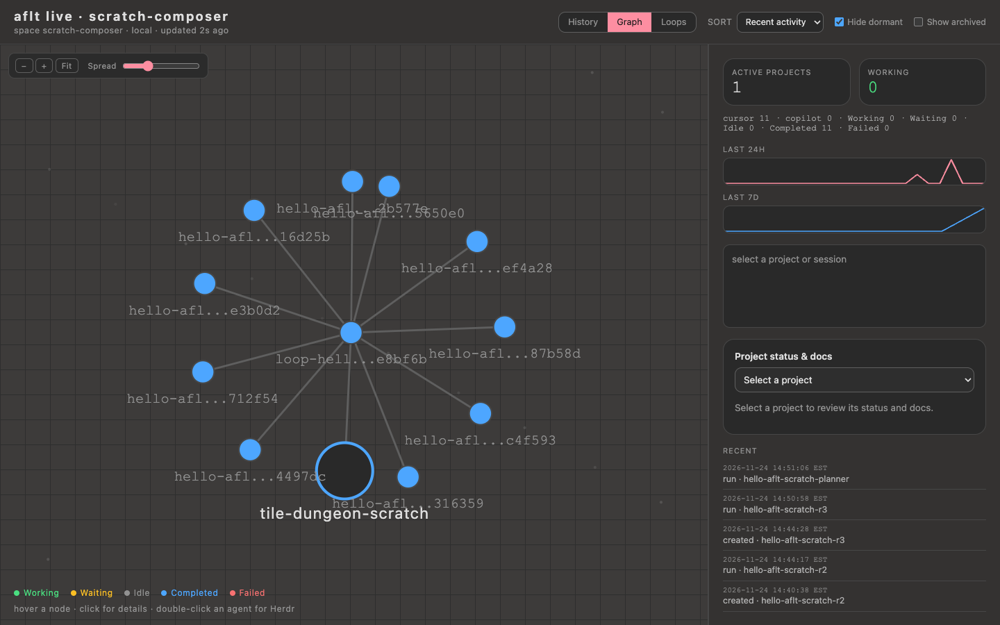
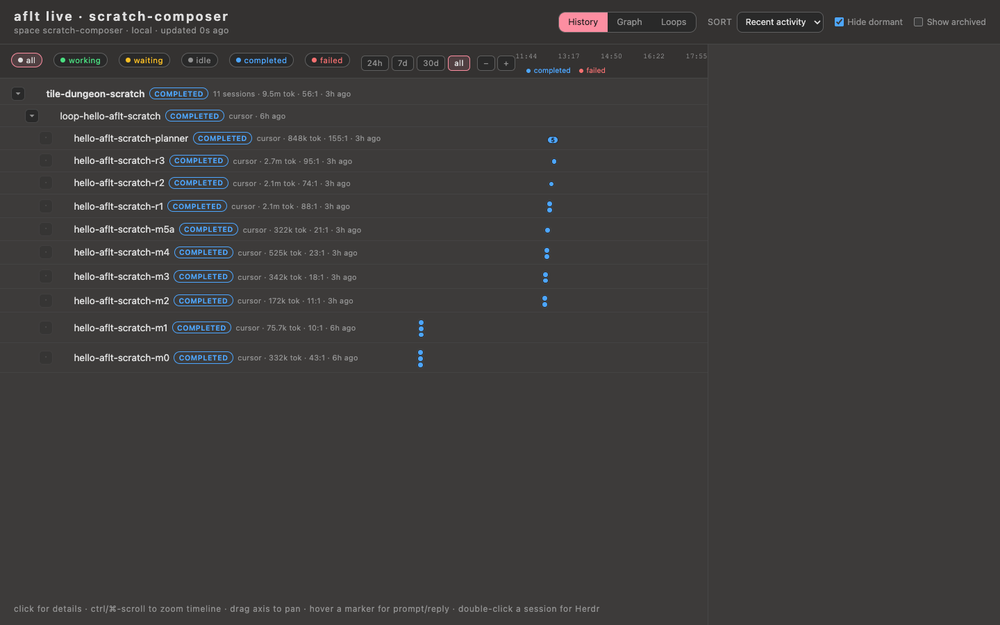
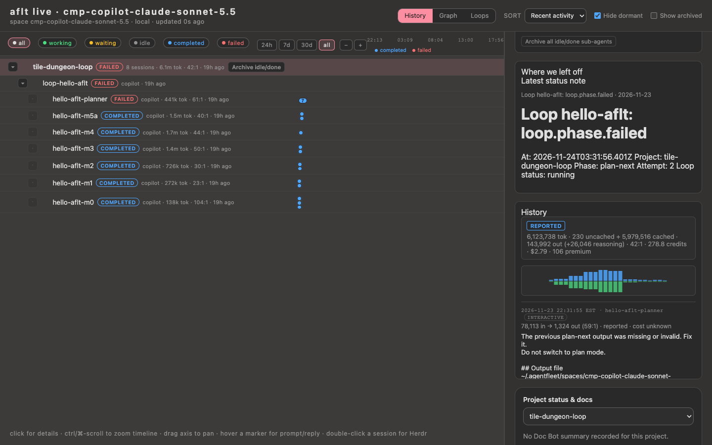
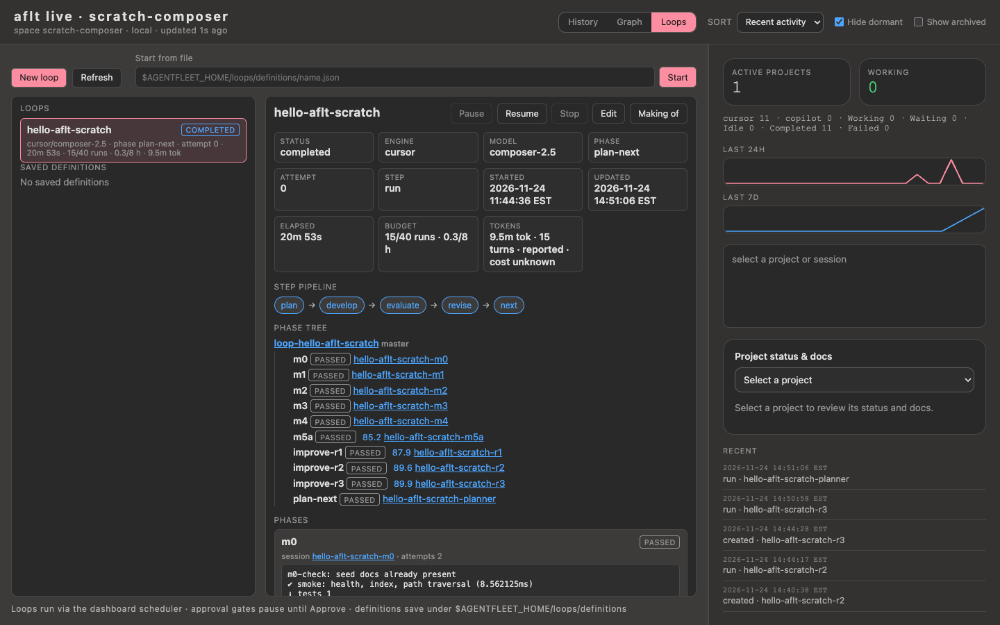
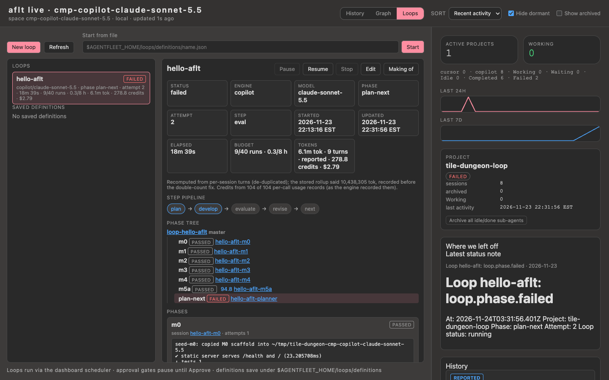
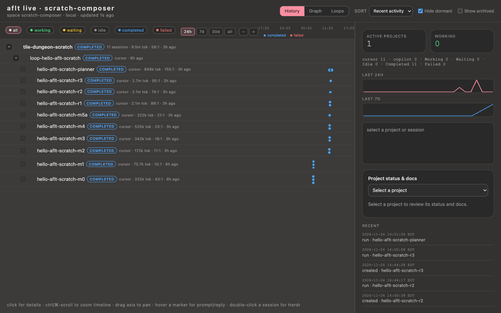
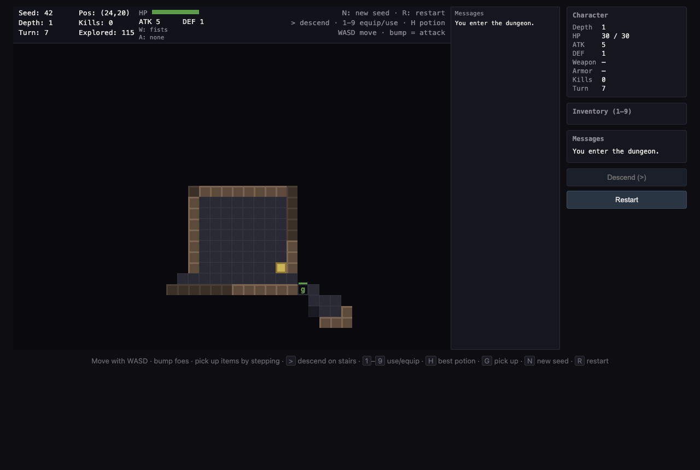
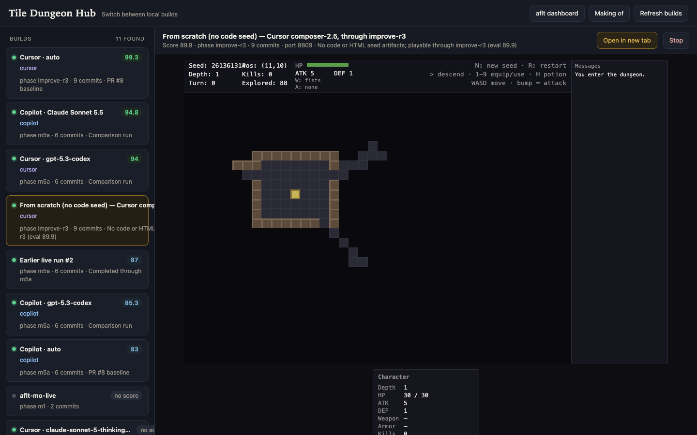
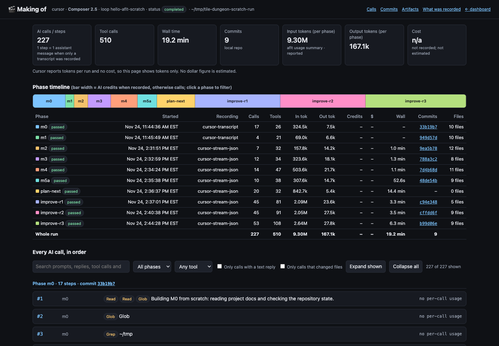
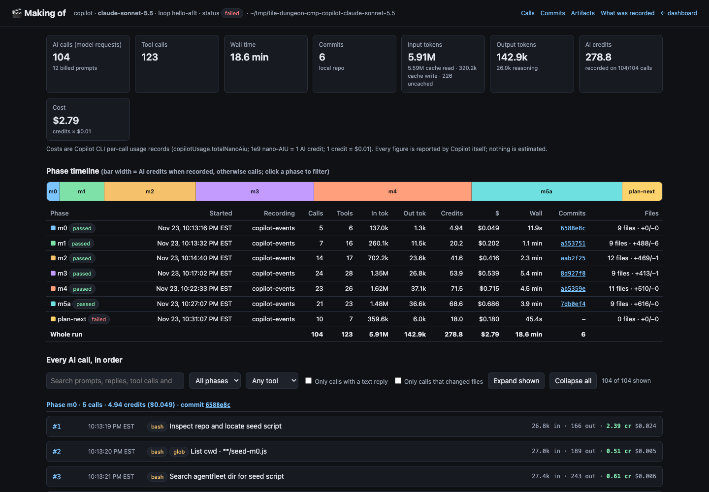

<p align="center">
  
</p>

<p align="center"><strong>aflt</strong> / AgentFleet — track, resume, and orchestrate Cursor, Copilot &amp; OpenCode CLI agents</p>

<p align="center">
  
  
  
  
  
</p>

`aflt` is the main command; `af` and `agentfleet` are aliases that run the same CLI.

**For AI agents:** [AGENTS.md](AGENTS.md) — install, commands, engines, and how to delegate or orchestrate work from Cursor, Copilot, or OpenCode CLI.

**New to aflt?** Start with the [tutorial](docs/tutorial/README.md) (throwaway `--space tutorial`, beginner → advanced). CLI loop quick start (hello-aflt tile dungeon, watch it in the dashboard, review it with `aflt making-of`): [docs/cli-quickstart-loops.md](docs/cli-quickstart-loops.md). Copilot-only work Mac live test of `hello-aflt`: [docs/copilot-live-test.md](docs/copilot-live-test.md). Self-improve worktree runbook: [docs/self-improve-runbook.md](docs/self-improve-runbook.md).

Zero npm runtime dependencies beyond **Node ≥20.10**. The npm name `aflt` is not published yet (`npm install -g aflt` 404s). Install from GitHub or a checkout (`npm install -g github:wwlib/aflt`, or `npm link` / `npm install -g .`), then optionally run `aflt setup` for machine config. Engine × mode behavior (liveness, completion, handoffs, `aflt wait`): [docs/CAPABILITIES.md](docs/CAPABILITIES.md). Setup deep-dive: [docs/SETUP.md](docs/SETUP.md). Full history: [CHANGELOG.md](CHANGELOG.md).

## Screenshots

Live dashboard (`aflt dashboard --serve`):


*Graph view (space `scratch-composer`): projects and sessions colored by Working / Waiting / Idle / Completed / Failed; the **Recent** list shows times in your local zone.*


*History view: activity Gantt with completed/failed turn markers (all preset, side panel hidden).*


*Sessions overview (space `cmp-copilot-claude-sonnet-5.5`): collapsible project/session tree, project detail with local-time last activity, and the project's usage summary with Copilot AI credits and dollars (278.8 credits · $2.79).*

### Herdr panel


*Herdr desktop with the bundled **af sessions** panel (lower left). Every registered aflt session is listed with its project, branch, live state and last activity; click one to focus its tab, adopt it, or resume it. `aflt resume` and `aflt run` open sessions as Herdr spaces/tabs (right), and Herdr's live status (working / waiting / idle) feeds the aflt dashboard.*

Install the panel and layout with `aflt setup --apply --herdr` (or `aflt herdr-app install`), then `herdr-app do layout.switch --name af`. The panel header also has an **aflt space picker** (“default ▾”); this screenshot predates it. See [Herdr integration](#herdr-integration) below for details.

### Loops: the tile-dungeon runs

`aflt loop` building the [hello-aflt](examples/loops/hello-aflt/) tile-dungeon roguelike from scratch (docs-only seed; no game code or HTML). Example run on Cursor `composer-2.5`: every phase passed, eval 85.2 after M5a → 89.9 after three improve rounds.


*Loops view (`aflt dashboard --serve`, space `scratch-composer`): status, engine/model, Started / Updated in local time, active elapsed time (20m 53s, not the 3 h wall clock since the first run), budget, token rollup, step pipeline, phase tree with eval scores, and the **Making of** button. Stop is grey and disabled because the loop has completed.*


*Loops view for the Copilot Claude Sonnet 5.5 run: the row and the Tokens line show recorded AI credits and dollars (6.1m tok · 278.8 credits · $2.79), with a note that the totals were recomputed from per-session records (the stored rollup was double-counted).*


*History view (24h preset): the loop master with one session per phase, each with its token count and turn markers.*


*The game the scratch loop built (`?seed=42`): rooms and corridors, fog of war, stats, inventory and message log.*


*Comparing builds: a small local hub (not part of aflt) that lists each run's game repo with its engine, model, last phase and eval score, and launches it on its own port.*

### Making of

`aflt making-of <loop>` (or **Making of** on the Loops tab, `/making-of/<loop>`) shows every AI call, commit, diff and artifact of a loop run, with tokens and, for Copilot, the AI credits and dollars Copilot recorded.


*Cursor run: 227 AI steps, 510 tool calls, 9.30M input tokens, 9 commits; Cursor reports no cost, so none is shown.*


*Copilot run: per-phase AI credits and dollars from Copilot's own usage records (278.8 credits = $2.79 for 104 model calls).*

Regenerate the dashboard shots with `npm run screenshots` (needs Google Chrome, Node ≥20.10, and a dashboard running at `DASHBOARD_URL`, default `http://127.0.0.1:8787/`; output in `OUT_DIR`, default `docs/images`). The loop, making-of and game screenshots above were captured the same way (headless Chrome) from live runs; home-directory paths are shown as `~`.

## What's new (unreleased)

- **`aflt init` + `aflt loop init`** — start a looped project from `SPEC.md` / `AGENTS.md`: the engine drafts `.agentfleet/loop.json` and prompts, checked against [templates/loop-guide.md](templates/loop-guide.md) (tests + eval in M0, a real check on every phase, a gate after M0, budget caps). Tutorial: [docs/tutorial/14-new-project.md](docs/tutorial/14-new-project.md).
- **Gate cost so far**, **`improveModel`**, **`workdir.mode: "project"`**, prompt/check-script snapshots in the loop state, and isolation checks (`--isolated`). Details in [CHANGELOG.md](CHANGELOG.md).

## What's new (2026-11-24)

- **`aflt making-of <loop>`** — one self-contained page per loop: every AI call in order (prompt, reply, reasoning, tool calls + results, tokens, Copilot AI credits / $ as recorded), every commit with phase, files and diff, seed files, files per phase, eval outputs and a `--build-url` link to the build. `--serve`, `--with-files` (static export), `--json`. Also `/making-of/<loop>` and a **Making of** button on the dashboard Loops tab. Guide: [docs/cli-quickstart-loops.md §7](docs/cli-quickstart-loops.md#7-see-exactly-how-it-was-built-making-of).
- **Recorded calls** — each loop phase archives the engine's own record under `runs/<session>/engine/` and writes `runs/<session>/calls.jsonl` (one line per model call) and `session-context.json`. Loop phases run Cursor with `--output-format stream-json`.
- **Usage fixes** — `usage-summary.json` counts a headless run once (`dedupedTurns`); Copilot usage carries `credits` / `usd` / `costBasis` from `copilotUsage.totalNanoAiu` (1e9 nano-AIU = 1 credit = $0.01). Nothing is estimated.
- **`type: "script"` loop phases** — the eval command is the step: no AI call, session, fix attempts or `maxRuns` budget. hello-aflt's `m0` seeds this way.
- **`hello-aflt`** — [`examples/loops/hello-aflt/`](examples/loops/hello-aflt/): default tile-dungeon loop from a docs-only seed (`install.sh` or `seed/`); M0 is a real agent build checked by `.agentfleet/checks/m0-check.cjs`. Non-default [`hello-aflt-seeded`](examples/loops/hello-aflt-seeded/) copies M0 in with a script phase.
- **Herdr space picker + `aflt space ls`** — the af sessions panel lists every aflt space (`aflt space ls --json`) and passes `--space` to `ls` / `resume` / `adopt`; `space ls` is an alias of `space list`.
- **Self-improving loop** — `examples/loops/self-improve.json` runs in a worktree with engine failover, protected paths, cheap-first verify tiers, commit-gate trailers and `needs_human` escalation; `aflt doctor --strict` preflight. Runbook: [docs/self-improve-runbook.md](docs/self-improve-runbook.md).

## What's new (2026-11-23)

- **Copilot live-test fixes** — a phase fails or retries when the agent exits non-zero or times out (even if the eval is already green). Fresh Copilot homes get `results/` / `plans/` before `--add-dir`. Loop `model` / `COPILOT_MODEL` / `config.json` `defaultModel`; Copilot `usage_record` counts (`estimated` stays char/4 of prompt + final reply). `force` defaults off (`--force` or `"force": true`). `loop run` refuses a non-empty/dirty cwd or one that contains the aflt checkout or the definition unless `--allow-existing`. `--dry-run` prints cwd, permission mode, and model. `aflt doctor` ignores a non-Cursor `agent`. Node `>=20.10`. Guide: [docs/copilot-live-test.md](docs/copilot-live-test.md); report: [docs/reports/2026-11-23-copilot-live-test-report.md](docs/reports/2026-11-23-copilot-live-test-report.md).

## What's new (2026-11-22)

- **hello-aflt audit follow-ups** — fresh loop runs mint new planner/root sessions; Cursor transcript sync aggregates multi-step tool turns and can enrich sparse estimated usage; prompt teasers strip same-line plan-mode preambles; completed loops freeze the step pipeline.
- **`aflt loop` fixes + portable hello-aflt** — freeze elapsed time on finished loops; per-loop token rollup on status/Loops UI; phase sessions nest under a loop master in History; phase tree shows eval scores; prompt previews skip plan-mode boilerplate; `promptFile` resolves next to the definition. Example: [`examples/loops/hello-aflt/`](examples/loops/hello-aflt/) (Copilot-friendly improve gate).

## What's new (2026-11-21)

- **Token usage** — per-turn `usage` on `runs/<id>/turns.jsonl` + `usage-summary.json`; headless Cursor/OpenCode capture tokens when `--output-format` is omitted (stdout stays text); dashboard History shows compact counts + chart; memory timeline includes a rollup. Never invents USD from tokens.
- **Named spaces** — opt-in `--space NAME` / `AFLT_SPACE` isolate a fleet under `~/.agentfleet/spaces/<name>` when `AGENTFLEET_HOME` is unset. `aflt space list|create|current|remove`; new spaces get a unique dashboard port, notify off, isolated memory, and LaunchAgent `dev.aflt.dashboard.<space>` (default unchanged).
- **`aflt eval` self-improve (milestone E3)** — `examples/loops/self-improve.json`: measure → score + baseline → plan-next one fix → build → `aflt eval gate --improve`; stop on plateau / max rounds (`aflt eval plateau`). Autonomous profile keeps approval gates and allow.commit/merge/push off.
- **`aflt eval measure` (milestone E1)** — hermetic self-measurement: suite summary + flake rerun, best-effort coverage, sandboxed CLI smoke, dashboard `/api` contracts; writes `eval/results/<timestamp>.json`.
- **`aflt eval score` / `report` / `gate` (milestone E2)** — deterministic 0–100 score from measure JSON + `eval/RUBRIC.md`; history in `eval/history.jsonl`; human report + trend; RUBRIC GUARD blocks improvement-loop edits to the rubric/scoring impl.
- **`aflt loop` (milestone 4)** — multi-phase projects: `type: "plan-next"` planner appends phases (or `done: true`); `budget.maxPhases`; loop `goal` / `acceptance` / `plannedPhaseGate`; acceptance summary note. Example: `examples/loops/plan-next.json`.
- **`aflt loop` (milestone 3)** — Loops view in `aflt dashboard --serve` (list, pipeline, eval tails, History links, start/pause/resume/stop/approve, define/edit form; definitions only under allowed loops dirs). Phase `gate: "approve"` + `aflt loop approve`.
- **`aflt loop` (milestone 2)** — unattended scheduler via `aflt loop start` + `dashboard --serve`; `aflt service` macOS LaunchAgent; opt-in `loop.heartbeat`.
- **`aflt loop` (milestone 1)** — multi-phase plan→develop→eval→fix runner (`validate` / `run` / `status` / `stop` / `resume`). JSON definitions, persisted state + runner lock under `$AGENTFLEET_HOME/loops/`, opt-in `loop.*` notify events, memory timeline/status notes when configured. Example: `examples/loops/hello-eval.json`.

## What's new (2026-11-20)

- **OpenCode engine** — `--engine opencode` for `aflt new` / `run` / `resume` / `spawn` / `memory doc` (and related); headless `opencode run`; resume via `--session`; turn capture from `~/.local/share/opencode/opencode.db` (read-only; `node:sqlite` when available); soft check in `aflt doctor`.
- **Direct messaging** — opt-in `aflt msg` / `aflt inbox` / `aflt thread` + MCP `read_inbox` / `post_message` (`aflt msg enable`, `--messaging`, or `.agentfleet.json` `{"messaging": true}`).
- **Project↔repo metadata** — portable mappings in `<memoryRepo>/<project>/.agentfleet.json`; inspect with `aflt projects [--json]`.
- **Interactive turn capture** — redacted turns in `runs/<id>/turns.jsonl`; backfill with `aflt turns backfill [--apply]` (Copilot, Cursor, OpenCode).
- **`aflt purge` / `aflt orphans`** — full delete (dry-run unless `--apply`) and orphan/stale scan (`orphans --purge --ids … [--apply]`).
- **Agent docs lifecycle (issue #3)** — checkpoint cadence at safe boundaries, note acknowledgement, bounded retry/backoff, batched Doc Bot notify after notes are written (`aflt docs notify …`); archive convention labeled/ignored in reporting.
- **Turns → Doc Bot** — `emitTurnCaptured` enqueues turns for batched Doc Bot notify (one message per batch after a dated note; messaging optional).
- **Notify webhook** — opt-in `config.json` `notify` or `AFLT_NOTIFY_URL`/`KEY`/`HEADER`; events `run.completed` / `run.failed` / `turn.captured` / `loop.*`; `aflt notify test`; flushed before `aflt run` / `aflt loop` exits.
- **Dashboard UX** — Graph zoom/pan/Fit/Spread; History Gantt presets (24h/7d/30d/all), zoom/scroll, marker stacking and count badges (`aflt dashboard --serve`).
- **`aflt memory config`** — refresh template-managed memory root files (`DOC-AGENT.md`, `DOCUMENTATION-PROCESS.md`) after upgrades (dry-run default; `--apply`; optional `--commit`/`--push`); `aflt doctor` hints when `DOC-AGENT.md` is outdated.

## Why AgentFleet

CLI coding agents are powerful but ephemeral: chat IDs live in engine-local stores, terminals die on reboot, and a controller (script, bot, master agent) cannot babysit a TUI. **AgentFleet** (`aflt`) keeps a small local registry under `~/.agentfleet`, resumes the right engine argv into Herdr/tmux/iTerm/WezTerm (or plain), runs headless one-shots that capture output, and can orchestrate a **master → workers** fleet with wait/result/send/stop, optional task messaging, and an optional documentarian pass.

## Features at a glance

| Area | What you get |
|------|----------------|
| **Registry** | Atomic `sessions.json`; runs/, results/, plans/, messages/, docs/ under `$AGENTFLEET_HOME` |
| **Engines** | Cursor CLI (`cursor-agent` / `agent`), GitHub Copilot CLI, and OpenCode (`opencode`); precedence `--engine` → `AGENTFLEET_ENGINE` → `config.json` → `cursor` |
| **Modes** | Interactive TUI (Herdr by default when `hc` is on PATH) vs headless `aflt run` / spawn |
| **Herdr** | `hc` terminals + desktop app spaces/tabs + bundled `af-sessions` panel; shell-only reboot recovery via in-tab relaunch |
| **Orchestration** | `aflt master`, `aflt spawn [--detach]`, `children`, `wait`, `result [--require-fresh]`, `tail`, `send`, `stop`, `rm --children` |
| **Loop** | `aflt loop` multi-phase eval/fix runner (`validate` / `run [--dry-run\|--fresh]` / `start` / `status` / `pause` / `resume` / `stop` / `approve`; JSON definition with `run`, `script` and `plan-next` phases; state under `loops/`; opt-in notify + memory; examples [`hello-aflt`](examples/loops/hello-aflt/) and [`hello-aflt-seeded`](examples/loops/hello-aflt-seeded/)) |
| **Making of** | `aflt making-of <loop>` — every AI call, commit, diff and artifact of a loop run, with tokens and recorded Copilot credits / $; `/making-of/<loop>` on the dashboard |
| **Eval** | `aflt eval measure` / `score` / `report` / `gate` / `plateau` — hermetic measure → rubric score → improve gate + self-improve loop example |
| **Projects** | Optional `session.project` + `aflt ls --project` / `aflt timeline` / `aflt projects` (repo mappings + validation) |
| **Live dashboard** | `aflt dashboard --serve` / `--snapshot` — local history-first activity UI (tree + Gantt; optional star graph; not `aflt memory dashboard`) |
| **Memory** | Opt-in `aflt memory` repo: sync per-project timelines + root `DASHBOARD.md` into a local git working tree; `memory config` refreshes template-managed root docs; optional `--commit`/`--push` for generated `_aflt/` + root `DASHBOARD.md` |
| **Messaging** | Opt-in `aflt msg` / `inbox` / `thread` + stdio MCP (`aflt mcp`) for Copilot & Cursor |
| **Documentarian** | Opt-in `aflt docs`; auto once after headless master / `aflt wait --docs` |
| **Agent docs** | Opt-in `agentDocs`: shared process + `AGENT-DOCS.md`, launch paths, safe-boundary checkpoints, note ack, retry/backoff, batched Doc Bot notify, archive labeling |
| **Spaces** | `--space NAME` / `AFLT_SPACE` isolated fleet homes; `aflt space list\|ls\|create\|current\|remove`; Herdr panel space picker |
| **Ops** | `aflt setup`, `aflt import`, `aflt doctor`, `aflt notify test`, `aflt loop`, `aflt eval measure\|score\|report\|gate\|plateau`, `aflt service`, `aflt purge` / `aflt orphans`, `aflt turns backfill`, `--json` / `--dry-run` on mutating paths |

## Architecture

<p align="center">
  
</p>

### Master → workers flow

<p align="center">
  
</p>

## Install

Step-by-step walkthrough (spaces, doctor, first run, dashboard, …): [docs/tutorial/README.md](docs/tutorial/README.md).

**Install** the CLI, then optionally run **machine setup**. Project onboarding (`.agentfleet.json`, `aflt memory`, …) and day-to-day workflows stay separate.

```bash
# Node >= 20.10
# The registry name is not published yet (npm install -g aflt → 404).
# Supported installs until the first npm publish:
npm install -g github:wwlib/aflt

# Contributors / local checkout:
#   cd /path/to/aflt && npm link
#   # or: npm install -g .
#   # or: ln -sfn "$(pwd)/bin/af.js" ~/.local/bin/{aflt,af,agentfleet}

# Ensure your PATH includes the npm global bin dir (and ~/.local/bin if you
# use clone-backed symlinks). Edit your shell rc yourself — aflt never does.
```

Until the first `npm publish`, the GitHub install (or `npm link` from a checkout) is the supported path. Bin entries are `aflt`, `af`, and `agentfleet` (same CLI).

**Migration** from clone-backed `~/.local/bin` aliases: after `npm install -g aflt` (or the GitHub form), remove or replace old symlinks that pointed at a checkout so `which aflt` resolves to the npm-installed binary. `aflt setup` will refuse to overwrite an unrelated `~/.local/bin/aflt` unless you pass `--force`.

```bash
# Machine setup (preview by default; apply only with --apply)
aflt setup                # non-mutating plan
aflt setup --apply        # create ~/.agentfleet if missing; link aliases if needed
aflt setup --apply --herdr                  # optional Herdr templates + panel
aflt setup --apply --memory ~/aflt-memory   # optional memory repo init/register
aflt setup --json

# Engines (install yourself — setup never installs them)
curl https://cursor.com/install -fsS | bash   # agent / cursor-agent on PATH
# npm install -g @github/copilot              # optional

# Optional bash completion (source manually)
# source /path/to/aflt/completions/af.bash

aflt doctor          # read-only: node, home, hc, engines, MCP hints, notify status
aflt doctor --json
aflt doctor --strict [--notify] [--port N] [--loop FILE]   # preflight; exit 1 on any failed check
aflt notify test     # sample webhook POST (requires notify.url / AFLT_NOTIFY_URL)
```

## Quick start

Prefer a throwaway space while learning: see the [tutorial](docs/tutorial/README.md) (`aflt space create tutorial`).

```bash
# Interactive tracked session (create-chat / mint UUID → register → launch)
aflt new "auth-refactor" --cwd ~/src/app-wt-auth --prompt "Refactor auth to JWT"

# Default engine for NEW sessions
aflt engine                 # print + source (flag/env/config/builtin)
aflt cursor                 # or: aflt copilot / aflt engine copilot

# Headless one-shot (create or resume; capture to ~/.agentfleet/runs/)
aflt run "auth-refactor" --prompt "Summarize the current branch" --mode ask --cwd ~/src/app-wt-auth
aflt log auth-refactor

# List / resume
aflt ls
aflt resume auth-refactor          # Herdr when hc on PATH; Attach: hc attach <name>
aflt resume                        # or aflt pick — TTY multi-select
aflt resume --all --via herdr      # fleet reopen after reboot

# New looped project: folder + git + space + SPEC/AGENTS, then a drafted loop
aflt init tile-dungeon --engine cursor && cd tile-dungeon
aflt loop init && git add -A && git commit -m "Add aflt loop" && aflt loop start .agentfleet/loop.json

# Master + detached workers
aflt master --goal "Split auth into helpers + tests" --cwd ~/src/app --headless --force
aflt spawn --parent <master> --prompt "…" --detach
aflt wait --parent <master>
aflt result <worker-id>
aflt result <worker-id> --json
aflt result <worker-id> --require-fresh   # exit 1 if handoff is stale
```

---

## Sessions & registry

Home directory: **`$AGENTFLEET_HOME`** (default `~/.agentfleet`, or `~/.agentfleet/spaces/<name>` when `--space` / `AFLT_SPACE` is set and `AGENTFLEET_HOME` is unset). An explicit `AGENTFLEET_HOME` always wins. Override registry file with **`AGENTFLEET_REGISTRY`**.

| Path | Role |
|------|------|
| `sessions.json` | Atomic registry (temp + rename; cross-process `.lock` for RMW) |
| `config.json` | Fleet defaults (`defaultEngine`, optional `memoryRepo`, `project`, `notify`, `repositories`) |
| `runs/<id>/` | Captured headless stdout + interactive `turns.jsonl` / `turns-index.json` / `usage-summary.json`; loop phases add `calls.jsonl`, `session-context.json` and `engine/` (archived engine record) |
| `loops/<name>/` | Loop `state.json`, `runner.lock`, `plan-next.json`, default `making-of.html`; `loops/definitions/` for UI-saved definitions |
| `spaces/<name>/` | Named spaces (default home only): each is a full home with the same layout |
| `results/` | Worker/master handoffs (`$AGENTFLEET_RESULT`) |
| `plans/` | Master plans (`$AGENTFLEET_PLAN`) |
| `messages/<masterId>.jsonl` | Team message log |
| `messages/dm__<idA>__<idB>.jsonl` | Cross-session direct-message log (sorted ids) |
| `docs/<hash>.json` | Documentarian since-tracking |
| `doc-checkpoints/<project>.json` | Opt-in agentDocs checkpoint state |
| `doc-bot-pending.json` | Batched Doc Bot pending items + batch ack records |

Each session stores identity (`id`, `title`, `chatId`, `cwd`, `branch`, `model`, `engine`), optional `project`, lifecycle `status` (`active`\|`paused`\|`done`), `tags` / `notes` / `prompt`, optional `herdr` evidence from `aflt sync`, and orchestration fields (`parent`, `role`, `task`, `result`, `workerStatus`, run pid metadata, `messaging`, …).

**Project name:** projects need **no git**. New sessions store: `--project` → parent → `AFLT_PROJECT` → `.agentfleet.json` `"project"` / `"projectId"` → `config.json` `"project"` → **unambiguous** project↔repo mapping inference (memory `<project>/.agentfleet.json` + local `config.repositories` checkouts) → git basename → cwd basename (`adhoc` for `$HOME`/`tmpdir`/`/tmp`). Existing rows without `project`: derive at read with cwd rules only (never env/global; **never rewrite** the registry). Workers inherit the master's project. Legacy alias: stored project `af` groups/displays/syncs as `aflt` (registry value unchanged). Schema: [docs/PROJECT-REPO-METADATA.md](docs/PROJECT-REPO-METADATA.md). Inspect with `aflt projects [--json]`.

**STATUS vs HERDR on `aflt ls`:** STATUS is saved lifecycle (a process exit does **not** mark the task done — use `aflt done`). HERDR is live runtime from `hc ls --all --json`: `running` \| `shell` \| `exited` \| `missing` \| `unknown` \| `-`. `aflt ls --json` includes effective `project` + `parent`. Archived sessions are hidden by default; `--archived` or `--all` includes them (`archived` / `archivedAt` in JSON). `aflt ls` never writes the registry; `aflt sync` persists `herdr` evidence without changing `status` / `lastUsed`. `aflt timeline` is read-only (no registry/Herdr writes).

## Session lifecycle commands

| Command | Purpose |
|---------|---------|
| `aflt new` | Create engine session → register → interactive launch |
| `aflt add` | Register an existing chat / Copilot UUID |
| `aflt ls` / `aflt sync` | List (optional `--project`); persist Herdr evidence |
| `aflt timeline` | Read-only project session tree (+ best-effort commits) |
| `aflt projects` | Read-only project↔repo mappings + checkout validation |
| `aflt dashboard` | Live local activity UI (`--serve`) or SVG/HTML snapshot (`--snapshot`); read-only; not `aflt memory dashboard` |
| `aflt making-of` | Self-contained page for a loop run: every AI call, commit + diff, artifact, recorded cost (`--out`, `--serve`, `--build-url`, `--with-files`, `--json`); also `/making-of/<loop>` on the dashboard |
| `aflt turns backfill` | Import interactive turns into `runs/<id>/turns.jsonl` (dry-run unless `--apply`) |
| `aflt memory` | Opt-in project-memory git repo (`init` / `sync --commit --push` / `dashboard` / `config` / `doc` / `status` / `where`) |
| `aflt run` / `aflt log` | Headless create-or-resume; print last capture |
| `aflt resume` / `aflt pick` | Resume one, interactive pick, or `--all` |
| `aflt rename` / `aflt note` / `aflt done` | Metadata |
| `aflt cwd` / `aflt set-cwd` | Show or change folder (refreshes branch; live tab not moved) |
| `aflt archive` / `aflt unarchive` | Soft-hide sessions (`archived` + `archivedAt`); reversible; logs untouched |
| `aflt rm` | Drop registry row(s) + results/plans (keeps `runs/<id>/`; exact id/title; TTY fuzzy pick; multi-arg) |
| `aflt purge` / `aflt rm --purge` | Full delete (registry + `runs/<id>/` + engine chat when certain); dry-run unless `--apply` |
| `aflt orphans` | Scan orphan/stale sessions & chats; selective `--purge --ids … [--apply]` |
| `aflt export` / `aflt import-file` | Backup / merge registry JSON |

<details>
<summary><code>aflt new</code> / <code>aflt add</code> / <code>aflt resume</code> / <code>aflt run</code> options</summary>

- **`aflt new "<title>"`** — `--cwd` `--prompt` `--model` `--engine cursor|copilot|opencode` `--project` `--force` `--messaging|--no-messaging` `--tag` `--dry-run` (plus Cursor `--no-trust` where applicable)
- **`aflt add "<title>" --chat <id>`** — `--cwd` `--model` `--engine` `--project` `--tag` `--prompt`
- **`aflt run`** — `--prompt` (required) `--cwd` `--model` `--engine` `--project` `--mode ask|plan` (Cursor) `--force` `--output-format text|json` `--timeout` `--messaging|--no-messaging` `--no-docs` `--dry-run` `--json`
- **`aflt timeline [<project>]`** — `--all` `--json` `--since <date>` (ISO or YYYY-MM-DD); read-only. Default project: `<project>` arg → `AFLT_PROJECT` → cwd's derived project. Text shows local times (JSON keeps ISO UTC). Commits come from each session's own cwd (`commitsReason`: `not-git` / `missing-cwd`); an open-ended row that is not a live run is bounded at `lastUsed` (`open-ended` when it never ran).
- **`aflt dashboard`** — local live activity dashboard (read-only by default; completion capture is opt-in). `aflt dashboard --serve [--port 8787] [--host 127.0.0.1] [--json]` binds only the requested host (default `127.0.0.1:8787`) and serves a **history-first** UI with SSE updates; Ctrl-C to stop. Default view: collapsible project → session → sub-session tree with an **activity-only** Gantt timeline (completed/failed turn markers at completion time — no working/idle bars; hover a marker for redacted prompt/reply; markers appear only on the session that produced them — project rows never roll up child markers). Timeline scale is zoomable (buttons + ctrl/⌘-wheel or pinch), pannable (drag the axis/track), and has presets (24h / 7d / 30d / all); crowded markers stack or collapse into a count badge that expands on click so each turn stays selectable. Sort: recent activity, created, name, project; dormant projects collapsed. History and Graph share one state vocabulary and colors: **Working** (green), **Waiting** (orange), **Idle** (gray), **Completed** (blue), **Failed** (red) — filter chips, badges, Graph legend/rings/dots, detail panel, and stats all use the same labels. Rows show waiting `?` / working spinner; click opens the history panel; **no History row hover popups** (Graph node tooltips stay). Double-click a session focuses its live Herdr terminal (same loopback-only `/api/herdr/focus` as Graph — when the page is opened from another device, an inline note says Herdr open only works on the Mini). The star graph remains available via the Graph toggle: zoom (buttons + wheel/pinch), drag-to-pan, Fit-to-view, and a Spread slider for force-layout elasticity (defaults to a tighter fit-to-view layout; prefs in `localStorage`). History panel: “where we left off” + prompt/reply pairs from `~/.agentfleet/runs/<id>/`, status notes, Copilot completions. Sensitive values are redacted; write/action endpoints stay loopback-only even when serving on LAN (`--host 0.0.0.0`). Stats **Working** / **open** = agent actually working (Herdr OSC 7501 `status=working`, or live headless `runPid`) — not merely `herdr.runtime=running` (pane alive; Herdr Agents panel shows idle). Registry-`active` alone does not count. Project badges/rings/filters roll up from session live states only (`waiting > working > failed > idle > completed`; empty → idle). Memory-only folders with no sessions sit in a collapsed **No sessions (N)** group at the bottom of History (still clickable for notes); they are omitted from the Graph and from Active project counts. **Hide dormant** (default on, `localStorage`) hides idle/completed projects whose last activity is older than the 24h Active window from Graph and History; working/waiting/failed stay visible, with a “N dormant hidden” count. **Show archived** (off by default, `localStorage`) reveals sessions flagged via `aflt archive`; timeline preset/view and Graph Spread also persist in `localStorage`. Row and detail actions support Archive / Archive with sub-agents / Unarchive / Remove (registry only; logs kept) / Delete everything (typed session id confirm; full purge via `/api/session/purge`) and project bulk “Archive all idle/completed sub-agents” — loopback + action-token only (same Mini-only gate as Herdr focus). Legacy project name `af` groups under `aflt`. `aflt dashboard --snapshot <file.svg|html>` writes a standalone SVG or self-contained HTML snapshot (no server). Separate from **`aflt memory dashboard`**, which regenerates the memory repo's root `DASHBOARD.md`.
- **`aflt memory`** — opt-in project memory (local git repo). `init <path>` registers `memoryRepo` in config (or override with `AFLT_MEMORY_REPO`). `sync [<project>…]` writes `<repo>/<project>/_aflt/timeline.md` + `sessions.jsonl`, then regenerates root `DASHBOARD.md` (complete Active/Dormant table for all memory-repo + registry projects; default 14-day ET window via `--active-days` / config `memoryActiveDays`). `Sessions (open/idle/total)` uses the same open/idle rules as the live dashboard (Herdr-exited → idle). Legacy project `af` aliases to `aflt` for folder selection and rows (registry `project` left as `af`; existing `af/` human folders are not deleted). `aflt memory dashboard` regenerates `DASHBOARD.md` only. `aflt memory config` refreshes template-managed root files (`DOC-AGENT.md`, `DOCUMENTATION-PROCESS.md`) after an aflt upgrade (dry-run by default; `--apply` writes, keeping `*.bak` only when the existing file had local edits; then regenerates root `DASHBOARD.md` like dashboard, preserving the doc-bot summary block; optional `--commit`/`--push` mirror sync). Default sync target: cwd/`AFLT_PROJECT`; `--all` skips `adhoc` unless `--include-adhoc`. Redaction ON by default for generated files (home → `~`; private IPs, `*.local` hosts, emails, token-like strings, long hex/base64 → `[redacted]`; `--no-redact` to disable; doc-bot summary block in `DASHBOARD.md` is preserved verbatim and not redacted). Output is deterministic and only rewritten on change, so a repeat sync changes nothing. Human files (`<project>/README.md`, `dashboard.md`, `status-notes/`) are created only if missing and never overwritten or committed by aflt (never write `DASHBOARD.md` inside a project folder); to map a repo to a differently named memory folder, set `"project"` in its `.agentfleet.json`. Optional sync `--commit` stages root `DASHBOARD.md` + `*/_aflt/**` (refuses dirty index; no `--dry-run`); `--push` requires `--commit` and pushes to `@{u}` when a commit was made or the branch is ahead. Nightly: `aflt memory sync --all --commit --push`, then (optionally) `aflt memory doc` to fill the Doc Bot summary (separate commit, only when instructed). `aflt memory doc [--engine cursor|copilot]` launches an `aflt run` session titled `doc-bot` in the memory repo with `DOC-AGENT.md` as the prompt, so the same role works on a Cursor CLI machine or a Copilot CLI laptop. `status` / `where` are read-only. `aflt doctor` reports when `DOC-AGENT.md` is outdated.
- **`aflt resume <title|id>`** — `--via herdr|plain` `--here` `--open|--no-open` `--prompt` `--force` `--dry-run` `--no-herdr-app`
- **`aflt resume --all`** — `--tag` `--via tmux|iterm2|wezterm|herdr|plain` `--open|--no-open` `--force` `--dry-run` `--no-herdr-app`
- **`aflt archive` / `aflt unarchive`** — set/clear `archived` + `archivedAt` (status unchanged). `--with-children` includes descendants. Refuses running/waiting (live `runPid` or Herdr working/blocked) unless `--force`. Run logs untouched.
- **`aflt rm`** — exact id/title preferred (multi-arg); TTY confirms/picks fuzzy matches (agents: exact only); `--keep-files` `--force` `--dry-run`; or `--children <master> [--with-master]`. Never deletes `runs/<id>/` logs; clears `parent` on remaining children. `aflt rm --purge` is a synonym for `aflt purge`.
- **`aflt purge <title|id>…`** — full delete: registry row, `runs/<id>/`, results/plans, master message log, and the engine Copilot/Cursor chat directory when the path mapping is unique/certain. **Dry-run by default**; pass `--apply` to mutate. Never touches Herdr panes. Refuses busy sessions unless `--force` (prefer `aflt stop` first). `--yes` skips typed confirm (required for non-TTY apply). `--aflt-only` / `--no-engine` skips engine files; `--engine-only` skips af files; `--no-transcripts` skips Cursor `agent-transcripts/`.
- **`aflt orphans`** — scan-only by default (`--days N`, `--engine cursor|copilot|all`, `--category`, `--json`, `--allow-uncertain-engine`, `--include-interactive`). Categories include `orphan-runs`, `missing-cwd`, `archived-old`, `stale-empty`, best-effort `orphan-engine-chat`, and report-only `herdr-orphan-pane`. Selective purge: `aflt orphans --purge --ids <id,…> [--apply] [--yes] [--force]` (never auto-kills Herdr panes; never purges all orphans without selection).

</details>

### Project status and docs in the live dashboard

When a memory repo is configured, **Project status & docs** lets you select a
project (or click a history-tree / graph row) to see Doc Bot's recorded progress
and blockers from the root `DASHBOARD.md` summary table. The history panel also
surfaces the latest status note under “where we left off.” Open the project's
`README.md`, `dashboard.md`, or ten latest dated `status-notes/*.md` in the
read-only rendered Markdown reader, with a **View source** toggle. Headings,
lists, tables, links, and fenced code blocks render locally using bundled
[Marked](https://marked.js.org/) (MIT); no CDN or npm runtime dependency is
required. Raw HTML is escaped and images are shown as text without loading
external content. Relative links open only documents already included in the
preview; web links open separately. Archived notes are excluded. Documents refresh with
live state updates; no sync or Doc Bot run is triggered. Previews redact
sensitive values, are limited to 32 KiB each, and never follow filesystem links outside
the memory repo. Missing summaries and read errors are shown explicitly.
HTML snapshots include the offline reader and embedded documents; SVG
snapshots include Doc Bot summaries in project tooltips.
The HTML dashboard supports light/dark system themes (`?scoutTheme=light` or
`?scoutTheme=dark` to override).
Solid graph links show the session hierarchy: projects connect to root sessions,
and parents connect directly to their workers, without duplicate project links.
Sessions whose parent is absent connect to their project instead.
Long session-node labels use the first nine and last six ID characters
(for example, `pla-funne...29c501`); popups retain the full ID. Their popups show only the activity
state, session ID, engine, saved lifecycle status, and Herdr runtime status;
project popups show only the Doc Bot summary. Popups remain visible briefly
after leaving a node so you can move into them to select and copy text. They stay
steady while hovered, then dismiss after rollout. Click empty graph space or
press Escape to dismiss any popup immediately.
Double-click any agent node (any color) in the live local dashboard to select its
existing terminal in Herdr and raise the app. Single-click still shows details.
Herdr must already be open, with one live terminal labeled for that session;
unavailable or ambiguous terminals produce a visible sidebar error. This never
resumes, launches, or sends input to an agent. Offline snapshots cannot focus Herdr.
Canonical live states (History + Graph): Working (green spinning ring), Waiting
(orange dashed ring + `?`), Idle (gray), Completed (blue), Failed (red). Graph
tooltips and detail badges use the same labels; History row hover popups are
disabled (timeline marker popups show prompt/reply instead). Herdr's explicit
turn-complete signal means Completed, not Waiting; completion remains visible
through idle until new work or a new prompt. Live headless workers also show
Working/Completed states. Detection uses confirmed runtime signals and aflt's
worker state, not ordinary inactivity; engines without those signals cannot
reliably expose input prompts. Spinners respect reduced-motion preferences.
Existing open/session counts and lifecycle status are unchanged.

The latest native Copilot **Task Complete** message is rendered as Markdown in
session/project details. Earlier completions
remain historical messages when new work starts; they do not mark the new work
complete. HTML snapshots include these messages without writing notes.

To automatically save completion messages for the Doc Bot while the live
dashboard runs:

```bash
aflt dashboard --serve --capture-completions
```

This opt-in mode requires a configured memory repo. It backfills successful
`session.task_complete` events from registered Copilot sessions, then captures
new events on the live refresh. Each message becomes a redacted
`<project>/status-notes/YYYY-MM-DDTHHMMSS-task-complete-<id>.md` note.
Generated receipts under `<project>/_aflt/task-completions/` prevent duplicates
across restarts and preserve decisions to archive older notes. Human files are
never overwritten; capture errors appear in the dashboard. The Doc Bot reads
these notes on its next pass; capture does not launch it, commit, push, or
change session lifecycle. Other engines, or turns without a native Task Complete
event, do not get an invented completion message. Without this flag the
dashboard does not write memory notes (it may still append local
`runs/<id>/turns.jsonl` for History Gantt — see below).

### Interactive turn capture (History Gantt)

Interactive Copilot turns (and Cursor transcripts when uniquely mapped) are
captured into `$AGENTFLEET_HOME/runs/<id>/turns.jsonl` so the dashboard History
Gantt shows completed markers with redacted prompt + reply text on hover. Live
dashboard refresh pairs each Copilot `user.message` with the final
`assistant.message` of the agent loop that follows (completed when the next
*new* turn's `user.message` arrives, or on a trailing `assistant.turn_end`
whose last assistant message has no pending `toolRequests`). Mid-turn steering
`user.message` events join onto the open loop's prompt. Successful
`session.task_complete` events merge into the same turn when present (assistant
text wins; the summary is kept as `taskCompleteSummary`) and always pair with
the most recent preceding `user.message` so History hover is not `(no prompt)`.
Re-running backfill patches existing `turns.jsonl` rows that lack a prompt
(idempotent; no duplicates) and refreshes `usage-summary.json` from engine
stores when token metrics are available (or chars/4 estimates otherwise).
Incremental sync persists offsets / in-progress loop state so partial loops
are not recorded early. This is separate from `--capture-completions` memory
notes.

```bash
# Preview what would be imported (default = dry-run)
aflt turns backfill --json
aflt turns backfill my-session --engine copilot

# Write turns.jsonl (idempotent; safe to re-run)
aflt turns backfill --apply
aflt turns backfill my-session --engine copilot --apply --json
```

Secrets are redacted before disk write. `emitTurnCaptured` sends each captured
turn (redacted prompt + reply) to the `doc-bot` session via
`messages.sendDirectMessage` when **both** the source session and doc-bot have
messaging enabled; otherwise it is a quiet no-op (never wakes agents). An
optional in-process handler may still be registered via `setTurnCapturedHandler`.

## Engines (Cursor + Copilot)

**New-session precedence:** `--engine` → `AGENTFLEET_ENGINE` → `$AGENTFLEET_HOME/config.json` `defaultEngine` → builtin **`cursor`**. Existing sessions always keep their recorded `engine`.

```bash
aflt engine                  # print current default + source
aflt engine copilot          # persist defaultEngine
aflt cursor / aflt copilot     # aliases
```

| | Cursor | Copilot |
|---|--------|---------|
| Binary | `cursor-agent` / `agent` (`AGENTFLEET_CURSOR_BIN`) | `copilot` (`AGENTFLEET_COPILOT_BIN`) |
| Session id | `create-chat` UUID; resume `--resume` | Local UUID; `--session-id=` (create-or-resume; do not use `--resume=` for a fresh id) |
| Workspace | `--workspace` / `--trust` (default on; `--no-trust` to keep dialog) | `-C <cwd>` |
| Headless | `-p`, `--output-format`, `--mode ask|plan`, `--force` | `-p`, `--output-format`; `--force` → `--allow-all-tools` |
| Interactive `--force` | Unchanged for Cursor on `new`/`resume` | `--allow-all-tools` |
| Import | Scan `~/.cursor/chats/` | `~/.copilot/session-state/` (`AGENTFLEET_COPILOT_HOME` / `COPILOT_HOME`) |

OpenCode is a **full engine** (`--engine opencode`): headless `opencode run`, interactive `--session`, Herdr template still via `aflt herdr-templates`.

## Headless vs interactive

- **Interactive** — `aflt new`, `aflt resume`, `aflt master` (default), `aflt spawn --interactive`: TUI in Herdr (default when `hc` on PATH) or this terminal (`--here` / `--via plain`).
- **Headless** — `aflt run`, `aflt spawn` (default), `aflt master --headless`, `aflt docs`: print-mode, capture to `runs/`, exit with engine code (124 on `--timeout`). Do **not** send `aflt run` through Herdr.

Stdout = agent output; stderr = progress + `output: <path>`. Exit **75** = critical registry write failed after a run (result still printed; `--json` includes `registryWriteError`).

## Herdr integration

Requires **herdr-core** (`hc` on PATH or `AGENTFLEET_HC_BIN`) and optionally the **Herdr desktop app**.

- **Labels:** launches add `af_id=<id>`, `title=…`, and (by default) `--keep` + `herdr.space` / `herdr.tab` so the app shows one **space per session group** (workers join the master) and one **tab per session**. Renames set Agents list titles (`space.rename` / `tab.rename`). Opt out: `--no-herdr-app` or `AGENTFLEET_HERDR_APP=0`; skip renames only: `AGENTFLEET_HERDR_NAMES=0`.
- **`aflt adopt`** — move already-live panes into the right space (park → label → keep when needed), then rename. App should be open to move panes.
- **`aflt cwd`** — updates registry folder/branch; does not move a live tab — resume (and optionally adopt) after.
- **Shell status / reboot:** `--keep` terminals restore as a login shell (`HERDR=shell`). `aflt resume` relaunches the engine **into the existing tab** via `hc send` (`cd '<cwd>' && env … <engine>`), without a new terminal. Prefer herdr-core ≥ 0.1.20 (`aflt doctor` warns when older).
- **Panel:** `aflt herdr-app install` symlinks (or `--copy`) `herdr/mods/af-sessions` + `herdr/layouts/af.json` into `~/.config/herdr-app` (`HERDR_APP_HOME`). Switch layout: `herdr-app do layout.switch --name af`. Panel clicks focus / adopt / resume. The header's **space picker** (“default ▾”) lists every aflt space (`aflt space ls --json`) and passes `--space <name>` to `ls` / `resume` / `adopt`; the pick persists across Herdr restarts. Details: [RECIPE.md](herdr/mods/af-sessions/RECIPE.md).
- **Templates:** `aflt herdr-templates` installs only the Cursor, Copilot, and OpenCode Herdr templates into `~/.config/herdr-core/templates`. Package files `DOC-AGENT.md`, `documentarian.md`, and `orchestrator.md` stay in `templates/` for aflt itself and are not installed.
- **Backends for `resume --all`:** `tmux` | `iterm2` (macOS) | `wezterm` | `herdr` | `plain`. Auto-detect: `AGENTFLEET_VIA` → inside Herdr → tmux → `TERM_PROGRAM` → … → plain. `aflt which-backend` prints the choice.

## Master / worker orchestration

```bash
aflt master --goal "…" [--engine …] [--worker-engine …] [--headless] [--messaging] [--no-docs] …
aflt spawn --parent <master> --prompt "…" [--detach] [--interactive] [--engine …] …
aflt children [<master>] [--json] [--all]
aflt wait [<workers>…] [--parent <master>] [--any] [--timeout] [--interval] [--send-grace] [--docs] [--json]
aflt result <worker> [--path] [--json] [--require-fresh]
aflt tail <worker> [-n N] [-f]
aflt send <id> "text" [--timeout] [--force] [--json]
aflt stop <id> | aflt stop --all-children <master>
aflt rm --children <master> [--with-master] …
```

- **`workerStatus`:** `queued` \| `running` \| `waiting` \| `done` \| `failed` \| `stopped`
- **`aflt wait` exits:** `0` all done · `1` failed/stopped · `2` timeout · `3` waiting (needs input). Precedence: timeout → failed/stopped → waiting → ok. See [CAPABILITIES.md](docs/CAPABILITIES.md) for Cursor (no OSC 7501) vs Copilot interactive waiting.
- **`--detach`:** headless only; returns immediately; supervisor records exit/handoff. Prefer over shell `&`.
- **Handoffs:** workers write `$AGENTFLEET_RESULT` (default `$AGENTFLEET_HOME/results/<id>.md`). Headless success with missing/stale file → **af-fallback** from stdout. Freshness uses `runStartedAt` / `resultMtimeAtStart`; `aflt result --require-fresh` exits 1 if stale. HANDOFF column: `yes` / `af` / `stale` / `no`.
- **Env on launch:** `AGENTFLEET_ID` always; workers `AGENTFLEET_PARENT` / `AGENTFLEET_RESULT`; masters `AGENTFLEET_ROLE=master` / `AGENTFLEET_PLAN` / `AGENTFLEET_RESULT`. Messaging also sets `AGENTFLEET_SESSION` (= id) and `AGENTFLEET_MASTER` when known. Opt-in `agentDocs` also sets `AFLT_PROJECT` / `AFLT_MEMORY_REPO` / `AFLT_DOCS_PROCESS` / `AFLT_AGENT_DOCS` / `AFLT_AGENTS_MD` / `AFLT_MEMORY_PROJECT` (and `AFLT_MEMORY_MISSING=1` when memory is required but unset).

## Self-eval measure + score + improve (milestones E1–E3)

Opt-in hermetic measurement, deterministic scoring, and a self-improve loop. Never touches the real `~/.agentfleet`, live engines, or Herdr from measure/score/gate/plateau.

```bash
aflt eval measure                  # writes eval/results/<timestamp>.json
aflt eval measure --json --out /tmp/aflt-eval
aflt eval score                    # score latest results vs eval/RUBRIC.md; append eval/history.jsonl
aflt eval score --write-baseline   # also record eval/improve-baseline.json (maxRounds default 3)
aflt eval score path/to/results.json --json --history /tmp/aflt-history.jsonl
aflt eval report [--json]          # latest score + trend from history
aflt eval gate [--json]            # RUBRIC GUARD: fail if rubric/scoring paths changed
aflt eval gate --improve --json    # suite green + score >= baseline + RUBRIC GUARD
aflt eval plateau [--json]         # stop=true on plateau or max rounds
aflt loop validate examples/loops/self-improve.json
aflt loop run examples/loops/self-improve.json --dry-run --allow-existing
```

**Measure (E1):** suite pass/fail/skip + per-file duration, flake vs hard-fail (failures rerun once), best-effort coverage (`node --test --experimental-test-coverage` + path-based NDJSON reporter; unavailable → recorded, not a measure failure), sandboxed CLI smoke (read-only / `--dry-run` only), and dashboard `/api` contract checks (`/api/state`, `/api/loops`, …) with reliable server shutdown.

**Score (E2):** reads measure JSON + repo files against human-owned [`eval/RUBRIC.md`](eval/RUBRIC.md) (weights sum to 100 → overall 0–100). Qualitative grading is opt-in (`--qualitative`) and always skipped under `AGENTFLEET_TEST` / `AFLT_EVAL_SKIP_QUALITATIVE` — default path never calls engines. `aflt eval gate` exits non-zero if protected paths (`eval/RUBRIC.md`, `scripts/eval/score.js`, `scripts/eval/rubric.js`) change; improvement loops must fail this gate.

**Improve (E3):** [`examples/loops/self-improve.json`](examples/loops/self-improve.json) runs measure → score + baseline → `plan-next` (one highest-value small fix with tests; must not touch the rubric/scorer) → build → remasure/score → `aflt eval gate --improve`. Stops after max rounds (default 3) or when `aflt eval plateau` reports a non-improving score. Autonomous profile: `plannedPhaseGate: "none"` and `allow.commit/merge/push: false` (set allow flags + phase `onPass` to opt into commit/merge). Reuses existing loop notify + memory timeline/status notes. Helpers: `scripts/eval/improve.js`. Generated `eval/results/`, `eval/history.jsonl`, and `eval/improve-baseline.json` are gitignored.

## Loop runner (milestones 1–4)

`aflt` can drive long-running agent work itself (plan → develop → eval → revise → next phase) without a bot waking it. Each phase hands off to a Cursor / Copilot / OpenCode session via the existing engines, with an explicit eval and exit criteria. A phase does not pass when the agent exits non-zero or times out, even if the eval is already green. Progress is recorded to aflt-memory when configured and reported through opt-in notify webhooks (`loop.*` events) so bots can wake — but the loop never needs a bot to continue.

`force` defaults to **false** (no Cursor `--force` / Copilot `--allow-all-tools`) unless the definition sets `force: true` or you pass `aflt loop run --force`. `loop run` refuses a working folder that is not a clean empty git repo, or that contains the aflt checkout or the definition, unless `--allow-existing`. A definition can opt into `"workdir": { "mode": "worktree", "base": "origin/main", "path": "~/tmp/aflt-self" }` to accept a clean non-empty git worktree that is not the running aflt checkout (`aflt loop run … --create-worktree` runs `git worktree add` for a missing `path`). A definition can also set `"protected": { "paths": ["scripts/eval/**"] }` so a phase whose diff against its base commit touches those globs fails immediately (no fix attempts), which stops a worker from editing its own eval harness. `--dry-run` prints the resolved cwd, permission mode (`force` / `restricted` / `mixed`), and model. Model resolution: phase `model`, else definition `model`, else `COPILOT_MODEL` for Copilot, else `config.json` `defaultModel` (alias `model`).

New project: `aflt init <name>` then `aflt loop init` drafts `.agentfleet/loop.json` from `SPEC.md` / `AGENTS.md` and checks it (see [tutorial 14](docs/tutorial/14-new-project.md)). An `"approve"` gate reports the cost so far (credits and dollars for Copilot; “cost unknown” for Cursor). `improveModel` sets the model of plan-next improve rounds (they do not inherit the planner's model). Starting a loop snapshots its prompt files and outside check scripts into `loops/<name>/`, so resume never depends on files outside the project or space.

```bash
aflt loop init --dry-run                     # print the drafting prompt
aflt loop validate examples/loops/hello-eval.json
# In-repo examples use "cwd": "." — pass --allow-existing from this checkout.
aflt loop run examples/loops/hello-eval.json --dry-run --allow-existing
aflt loop run my-loop.json --json
aflt loop run my-loop.json --fresh --json   # restart a completed loop (0 of N) in the same fleethome
aflt loop start my-loop.json --json          # register for dashboard scheduler
aflt loop pause <name>
aflt loop status [name] [--json]            # --json includes elapsedMs, budget, usage, pipeline.evalScore
aflt making-of <name>                       # every AI call, commit, diff and artifact (HTML page)
aflt loop stop <name>
aflt loop resume <name>                     # run in this process
aflt loop approve <name>                    # release gate: "approve"

# Portable Copilot-friendly example (empty git repo cwd; set AGENTFLEET_ENGINE=copilot once)
# export AGENTFLEET_ENGINE=copilot
# # optional: export COPILOT_MODEL=auto
# examples/loops/hello-aflt/install.sh  # into an empty project folder
# git init && commit, then:
# aflt loop validate .agentfleet/loop.json --json
# aflt loop run .agentfleet/loop.json --dry-run
# aflt loop run .agentfleet/loop.json --fresh
# Seeded M0 (non-default): aflt loop run examples/loops/hello-aflt-seeded/hello-aflt.json
# See docs/cli-quickstart-loops.md, examples/loops/hello-aflt/README.md and docs/copilot-live-test.md

# Unattended host (scheduler + activity UI + Loops view)
aflt dashboard --serve
aflt service install --port 8787            # macOS LaunchAgent (KeepAlive)
aflt service status
aflt service uninstall

# Named spaces (opt-in isolation)
aflt space create lab
aflt --space lab ls
aflt space list                             # alias: aflt space ls
aflt space current
AFLT_SPACE=lab aflt doctor
aflt space remove lab --force
```

- **Definition (JSON):** `name`, `project`, `cwd`, `engine` (optional; omit to follow `AGENTFLEET_ENGINE` / config), optional ordered failover `engines` (primary precedence: phase `engine` > `engine` > `AGENTFLEET_ENGINE` > `engines[0]` > config > cursor; on `cli_missing`/`auth_required`/`usage_limit`/`rate_limit`/`model_unavailable` a phase reruns the same attempt on the next installed engine with session `<session>-<engine>`, never on an eval failure; notify/history `loop.engine.failover`), `allow` (`commit`/`merge`/`push`, default false), `budget` (`maxRuns`/`maxHours`/`maxPhases`), optional `goal`, `acceptance` (or `acceptanceCriteria`), `acceptanceEval`, `plannedPhaseGate` (`approve`|`none`, default `approve` for phases inserted by plan-next), `phases[]` with `id`, optional `type` (`run`|`plan-next`|`script`), `engine`, `session`, `prompt` or `promptFile`, `eval` (`command` string or argv array, `passRegex` and/or `exitCode`), `maxFixAttempts` (default 3), `onPass` (`none`|`commit`|`merge`|`push`), optional `gate: "approve"`. Relative `promptFile` / companion scripts resolve against the definition directory. UI-saved files: `$AGENTFLEET_HOME/loops/definitions/<name>.json` (or `config.json` `loop.definitionsDir` / `loopsDir`). Examples: `examples/loops/hello-eval.json`, `examples/loops/plan-next.json`, `examples/loops/self-improve.json`, `examples/loops/hello-aflt/`, `examples/loops/hello-aflt-scratch/`.
- **Script phases:** `type: "script"` makes the phase's `eval.command` the whole step — no AI call, no prompt or session, no fix attempts, not counted in `budget.maxRuns`; `onPass` still applies. hello-aflt `seed-docs` and hello-aflt-seeded `m0` use this.
- **hello-aflt:** [`examples/loops/hello-aflt/`](examples/loops/hello-aflt/) is the default from-scratch tile-dungeon loop (`seed-docs` → agent M0 → M1–M5a → ≤3 improve rounds; `plannedPhaseGate: "none"`). Loop, prompts, and checks live in the project (`.agentfleet/`); `install.sh` copies the seed. Improve rounds use `node .agentfleet/checks/improve-gate.cjs` (HEAD vs working tree). Continue-only: `hello-aflt-improve.json`. Non-default [`hello-aflt-seeded`](examples/loops/hello-aflt-seeded/) copies M0 with `seed-m0.js`. Work-Mac walkthrough: [docs/copilot-live-test.md](docs/copilot-live-test.md).
- **`--fresh`:** without it, a completed loop returns `loop already completed` and does no work. With `--fresh`, start a new state (0 of N) in the **same** fleethome (prefer over a new space so the default Loops view still shows the run). Fresh runs mint new planner / loop-root sessions.
- **Semantics:** run phase prompt → run eval → on fail send failing output back to the same session as a fix prompt (up to `maxFixAttempts`) → mark phase passed/failed. With `gate: "approve"`, the runner pauses (`status=waiting`) before the phase work until approve. Prompts are argv data (no shell interpolation).
- **Plan-next (M4):** `type: "plan-next"` gives the configured engine the goal, history, and status notes and requires JSON at `$AGENTFLEET_HOME/loops/<name>/plan-next.json`. `{ "done": true }` ends planning (then optional `acceptanceEval` + completion); `{ "phases": [ … ] }` validates and inserts phases before the plan-next sentinel (default gate from `plannedPhaseGate`). Cap with `budget.maxPhases`. When `goal`/`acceptance` are set, completion writes an acceptance-summary status note.
- **State:** `$AGENTFLEET_HOME/loops/<name>/state.json` (atomic writes) + `runner.lock`. Includes per-loop `usage` rollup from phase `usage-summary.json` (never estimates USD from tokens; Copilot `credits` / `usd` only as Copilot recorded them). `active` marks the loop for the dashboard scheduler. Crash/restart resumes via `aflt loop resume` or the scheduler on `dashboard --serve` start.
- **Unattended (M2):** `start` registers without running; `dashboard --serve` runs active loops in-process (one per name, lock respected). API: `GET /api/loops`, `GET /api/loops/:name`, `POST /api/loops/:name/{pause,resume,stop}`.
- **Making of:** `aflt making-of <name> [--out file.html] [--serve [--port 8797]] [--build-url URL] [--with-files] [--json]` renders every recorded AI call (prompt, reply, reasoning, tool calls + results, tokens, Copilot credits / $), every commit in the loop's repo with phase, files and diff, and the artifacts. After each phase aflt archives the engine record to `runs/<session>/engine/` and writes `runs/<session>/calls.jsonl` + `session-context.json`, so the page still works after the engine prunes its own logs. Default output: `$AGENTFLEET_HOME/loops/<name>/making-of.html`. Walkthrough: [docs/cli-quickstart-loops.md §7](docs/cli-quickstart-loops.md#7-see-exactly-how-it-was-built-making-of).
- **Dashboard UI (M3):** Loops view lists status / phase / attempt / elapsed / budget / token rollup, step pipeline, phase tree with eval scores, eval tails, History session links, a **Making of** button (`/making-of/<name>`); start / pause / resume / stop / approve; define/edit form (server-side `validateDefinition`; writes only under the allowed loops/definitions dirs). Also `POST /api/loops`, `GET /api/loops/definitions`, `POST /api/loops/start`, `POST /api/loops/:name/approve`, `GET|POST /api/loops/:name/definition`.
- **Service:** `aflt service install|uninstall|status` — macOS LaunchAgent `dev.aflt.dashboard` for the dashboard server (named space: `dev.aflt.dashboard.<space>`); logs under `$AGENTFLEET_HOME/logs`; `--print` shows the plist without writing. Default `--port` comes from the space `config.json` when set.
- **Named spaces:** `aflt space list|ls|create|current|remove` — isolated homes under `~/.agentfleet/spaces/<name>` via `--space` / `AFLT_SPACE` (explicit `AGENTFLEET_HOME` still wins). New spaces: unique dashboard port, notify off, own `memoryRepo`, never overwrite the default LaunchAgent plist.
- **Notify (opt-in):** events `loop.started`, `loop.phase.started`, `loop.phase.passed`, `loop.phase.failed`, `loop.completed`, `loop.failed`, `loop.stopped`, `loop.gate.waiting`, `loop.gate.approved`, `loop.engine.failover`, and opt-in `loop.heartbeat` (`loop.heartbeatSeconds` / `AFLT_LOOP_HEARTBEAT_SECONDS`, default off). Payload fields: `event`, `sessionId`, `title`, `project`, `engine`, `cwd` (redacted), `exitStatus`, `timestamp`, `summary` (redacted), `loop`, `phaseId`, `attempt`. Point `notify.url` / `AFLT_NOTIFY_URL` at a Grok Bot routine webhook to wake the bot on progress; the loop itself never waits on the bot.
- **Memory (opt-in):** appends `<project>/_aflt/loop-timeline.jsonl` and a status note per phase result (plus acceptance summary on complete when goal/acceptance set); no-op when no `memoryRepo`.

## Agent documentation (opt-in)

**Off by default.** Enable with `.agentfleet.json` `{"agentDocs": true}` (optional `docCheckpointHours`, default 4 — overdue labeling only; elapsed time is **not** progress). Fleet knobs in `$AGENTFLEET_HOME/config.json`:

```json
{
  "agentDocs": {
    "boundaries": ["turn-complete", "run-exit"],
    "requireNote": true,
    "retryMax": 3,
    "retryBackoffMinutes": [30, 120, 360],
    "batchNotify": true
  }
}
```

```bash
# Copy templates/AGENT-DOCS.md into the project root; memory init writes DOCUMENTATION-PROCESS.md
aflt docs checkpoint request [--reason …] [--json]
aflt docs checkpoint complete --note status-notes/YYYY-MM-DDTHHMM-slug.md [--json]
aflt docs notify flush|ack|status|retry [--json]
aflt docs --status --json   # checkpoint missing/overdue/retry + docBotQueue + archive policy
aflt dashboard --snapshot out.html --json  # includes checkpoints{} + docBotQueue
aflt doctor --json          # agent_docs check (boundaries / pending / acks)
```

- Delivers project identity + memory/instruction paths on launch/resume for **Cursor and Copilot** without replacing `AGENTS.md`.
- Works with no memory repo configured; warns when memory is required but missing (`AFLT_MEMORY_MISSING=1`).
- **Cadence:** requests only at safe boundaries (`turn-complete` / `run-exit`; optional `session-launch` if listed). Never while busy; elapsed time alone never creates a request.
- **Acknowledgement:** `complete` requires a dated note under live `status-notes/` (not `archive/`).
- **Retry:** bounded backoff reminders for unacked open checkpoints (`aflt docs notify retry`).
- **Doc Bot batches:** notes are written before notify; pending turns/checkpoints flush as one message; `aflt docs notify ack` records acknowledgement. Messaging optional (context only, not permissions).
- **Archive:** live pickup ignores `status-notes/archive/`; reporting may label archived counts; aflt never auto-moves or deletes documents.
- **vs completion capture:** Copilot Task Complete capture (`aflt dashboard --capture-completions` / `lib/task-completions.js`) is a separate opt-in path into memory notes. This lifecycle covers instructions, checkpoints, archive, and batched Doc Bot context.

## Messaging

**Off by default.** Enable with `aflt msg enable <session>`, `--messaging` on `new`/`run`/`master`/`spawn`, or project `.agentfleet.json` `{"messaging": true}` (ancestor walk to git root). Session `messaging: false` overrides project. Messaging-enabled masters pass `messaging: true` to workers unless `--no-messaging`. **Both sides must opt in.** Direct targets are **exact id or unique exact title** only; `master` / `all-siblings` stay team-scoped. Cross-session DMs are durable inbox context — they never wake agents, inject prompts, or change lifecycle/role/parent/project, and are not permission grants. Status: `queued` → `read` → `completed`. Library: `require('…/lib/messages').sendDirectMessage(from, to, body, meta)` (used by turn-capture → Doc Bot and `notifyDocBot`).

```bash
aflt msg enable auth-master
aflt msg master "blocked on schema" --type blocked --from auth-w1
aflt msg all-siblings "FYI" --from auth-w1
aflt msg doc-bot "turn summary…" --from auth-w1   # cross-session DM (exact title)
aflt msg --reply <msgId> "ack" --from auth-master
aflt inbox [--unread] [--status queued|read|completed] [--mark-read|--mark-complete] [--json]
aflt thread <msgId|master> [--json]
```

- **Types:** `question` \| `answer` \| `note` (default) \| `blocked`
- **Limits:** `AGENTFLEET_MSG_MAX_THREAD` (default 6), `AGENTFLEET_MSG_RATE` (default 10 / 60s)
- **Doc Bot:** enable messaging on `doc-bot`; poll `aflt inbox` / MCP `read_inbox` when idle. Checkpoints may notify via `notifyDocBot` when both sides are opted in. Captured interactive turns notify via `emitTurnCaptured` the same way.
- **Dashboard:** History shows message markers (queued→waiting, read→idle, completed→completed) and lists messages in the session history panel.
- **MCP:** `aflt mcp` exposes `post_message`, `read_inbox`, `list_team` when messaging is enabled for the inherited identity.
  - **Copilot:** per-run `--additional-mcp-config` + `--allow-tool=af` (no `~/.copilot` write on launch)
  - **Cursor:** install into project/user `mcp.json`; launches get `--approve-mcps` when an `af` server is present; install writes `${env:AGENTFLEET_SESSION}` etc. for identity forwarding

```bash
aflt mcp install --engine copilot [--write]
aflt mcp install --engine cursor --project   # <cwd>/.cursor/mcp.json
aflt mcp install --engine cursor --write     # ~/.cursor/mcp.json
```

## Documentarian

**Off by default.** Opt in: `.agentfleet.json` `{"docs": true}`.

| Key | Meaning |
|-----|---------|
| `docs` | `true` to enable |
| `docsPaths` | default `README.md` + `docs/` (+ `CHANGELOG.md` only if it already exists) |
| `docsInstructions` | optional file path(s) (string or array; `~` / repo-relative / absolute) whose contents are injected into the documentarian prompt; still only edit `docsPaths` |
| `docsEngine` | `cursor` \| `copilot` |
| `docsForce` | `false` to opt out of default write grant |

```bash
aflt docs [<project dir>] [--since <commit>] [--engine …] [--model …]
        [--force|--no-force] [--anyway] [--dry-run] [--json]
aflt docs --status [--json] [--all] [<dir>...]
aflt docs checkpoint request|complete [<dir>] [--project NAME] [--reason T] [--note PATH] [--json]
```

- One headless worker (`role=docs`, title `docs-<folder>`, reused). Template: `templates/documentarian.md`.
- Force/write **ON by default** (Cursor `--force` / Copilot `--allow-all-tools`); opt out `--no-force` or `docsForce: false`.
- Snapshots the tree; **warns** on non-doc edits (including disallowed new `CHANGELOG.md`); does not revert.
- State: `$AGENTFLEET_HOME/docs/<hash>.json` (`lastCommit`).
- **`docsInstructions`:** readable files are injected as a “Project-specific documentation instructions” section (per-file / total size caps; missing files warn + skip). Dry-run / `--json` list used and skipped paths.
- **Session timeline:** prompt may include a compact “Session timeline since last docs run” (same as `aflt timeline`, ~8KB cap). Dry-run / `--json` report `timelineBytes` (0 when skipped).
- **`--status`:** read-only (no engine, no writes). Per project: `docsEnabled`, `docsPaths`, `docsInstructions`, `lastRun`, `commitsSince`, `dirtyDocs`, `needsDocs`, `skip` / `skipReason` / `skipFiles`, `ready`, plus opt-in `agentDocs` checkpoint missing/overdue. **Doc Bot rule:** skip any repo with uncommitted docs edits — if a `docsPaths` file is dirty (`.DS_Store` ignored), status sets `skip: true`, `skipReason: "dirty-docs"`, and lists the files. `needsDocs` is unchanged; act only on `ready` (`needsDocs && !skip`). `aflt docs` itself does not enforce this. Exit 0 even when `needsDocs` is true. `--all` adds distinct registry project dirs.
- **Auto-trigger:** after successful headless master (`aflt master --headless` or `aflt run` on `role=master`) when docs enabled; skip `--no-docs`. Docs failure → WARNING + JSON `docs:{ok:false}` but master exit 0. `aflt wait --docs` same after wait exit 0; **errors** if no master. Guard: `docsTriggeredRunId` (once per master run). `--anyway` runs once without enabling in config.

## Import

```bash
aflt import                          # default engine path (cursor → ~/.cursor/chats)
aflt import cursor                   # always Cursor store
aflt import copilot                  # list ~/.copilot/session-state
aflt import copilot <uuid|prefix>…   # register; --title (single id), --tag, --cwd, --limit,
                                   # --json, --all, --dry-run, --allow-missing, -i|--pick
```

## Doctor, setup, JSON, dry-run

- **`aflt setup [--apply] [--json] [--herdr] [--memory <path>] [--force]`** — machine setup preview (default) or apply. Idempotent; never edits shell rc, never mutates sessions, never installs engines.
- **`aflt doctor [--json]`** — read-only checks: node, home, registry, default engine, `hc`, engines, MCP wiring hints, notify status (never prints the notify key). `--strict` adds engine CLI / sign-in / notify / free-port preflight (`--notify` live round trip, `--port N`, `--loop <file>`); only a failed check exits non-zero, warnings do not.
- **`aflt notify test [--json]`** — send a sample opt-in webhook event (`run.completed`). Requires `config.json` `notify.url` or `AFLT_NOTIFY_URL`.
- **`--json`** — machine-readable stdout on supporting commands (single JSON object where applicable).
- **`--dry-run`** — plan only; no registry/state mutation (new, run, spawn, master, docs, msg enable, adopt, cwd, rm, turns backfill, sync, herdr-*, mcp install, …). `aflt purge` / `aflt orphans` / `aflt turns backfill` are dry-run by default unless `--apply`.

## Configuration

### Project: `.agentfleet.json` (source checkout)

```json
{
  "project": "my-app",
  "messaging": true,
  "docs": true,
  "docsPaths": ["README.md", "docs/"],
  "docsInstructions": ["docs/DOCS_STYLE.md", "~/notes/af-docs.md"],
  "docsEngine": "cursor",
  "docsForce": false,
  "agentDocs": true,
  "docCheckpointHours": 4
}
```

Resolved by walking cwd → ancestors until the git root (or filesystem root). Optional `"project"` / `"projectId"` is a create-time launch default referencing the **project id** (not a checkout path). Optional `"agentDocs": true` delivers docs-process paths on launch and tracks checkpoints (`docCheckpointHours` is overdue labeling only). Fleet `config.json` `"agentDocs"` sets boundaries / requireNote / retry / batchNotify.

### Memory project metadata: `<memoryRepo>/<project>/.agentfleet.json`

Portable many-to-many project↔repo mappings (stable `id`, repository remotes, repo-relative `locations`, optional `relationships`). Machine checkout paths stay in local config. Full schema + examples: [docs/PROJECT-REPO-METADATA.md](docs/PROJECT-REPO-METADATA.md) and `templates/project-agentfleet.example.json`.

```bash
aflt projects              # mappings + validation problems
aflt projects my-app --json
```

### Fleet: `~/.agentfleet/config.json`

```json
{
  "defaultEngine": "cursor",
  "project": "ops",
  "memoryRepo": "/path/to/aflt-memory",
  "memoryActiveDays": 14,
  "notify": {
    "url": "https://hooks.example.com/aflt",
    "key": "optional-secret",
    "header": "Authorization"
  },
  "repositories": {
    "github.com/example/my-app": { "path": "~/github/example/my-app" }
  }
}
```

Optional `"project"` is a create-time default for non-repo agent groups (after `AFLT_PROJECT`, before mapping inference / basename/`adhoc`). Optional `"memoryRepo"` is set by `aflt memory init` (override with `AFLT_MEMORY_REPO`). Optional `"memoryActiveDays"` sets the Active/Dormant threshold for root `DASHBOARD.md` (overridden by `--active-days`; default 14). Optional `"repositories"` maps normalized remote identities → local checkout paths (per machine; never commit these into the memory repo).

Optional `"notify"` enables fire-and-forget webhook POSTs when a headless `aflt run` finishes or fails (`run.completed` / `run.failed`), when an interactive turn is captured (`turn.captured`), and for `aflt loop` lifecycle (`loop.started` / `loop.phase.started` / `loop.phase.passed` / `loop.phase.failed` / `loop.completed` / `loop.failed` / `loop.stopped` / `loop.gate.waiting` / `loop.gate.approved` / opt-in `loop.heartbeat`). Off unless `notify.url` or `AFLT_NOTIFY_URL` is set. Optional `key` is sent as a header (`header` name defaults to `Authorization` with value `Bearer <key>`; custom header names get the raw key). Env overrides config (`AFLT_NOTIFY_URL` / `AFLT_NOTIFY_KEY` / `AFLT_NOTIFY_HEADER`). Bodies are small JSON: `event`, `sessionId`, `title`, `project`, `engine`, `cwd` (redacted), `exitStatus`, `timestamp`, `summary` (redacted); loop events also include `loop`, `phaseId`, `attempt`. To wake a Grok Bot routine on loop progress, set the notify URL to that bot’s webhook ingest endpoint (still opt-in; the loop never blocks on the bot). Failures are logged and never break the run. Headless `aflt run` awaits the webhook before exit; pending `turn.captured` posts are flushed on CLI shutdown. Probe with `aflt notify test`; `aflt doctor` shows status without printing the key.

### Environment

| Variable | Purpose |
|----------|---------|
| `AGENTFLEET_HOME` | Registry dir (default `~/.agentfleet`, or `~/.agentfleet/spaces/<name>` when a space is selected and this is unset) |
| `AFLT_SPACE` | Named space (overridden by `--space`); opt-in isolation from the default home |
| `AGENTFLEET_REGISTRY` | Override `sessions.json` path |
| `AGENTFLEET_ENGINE` | Default engine for **new** sessions |
| `AFLT_PROJECT` | Default project for **new** sessions (after `--project` / parent; before `.agentfleet.json` / config / basename). No git required. |
| `AFLT_MEMORY_REPO` | Override project-memory repo path (else `config.json` `memoryRepo`) |
| `AFLT_NOTIFY_URL` | Opt-in webhook URL (else `config.json` `notify.url`); off unless set |
| `AFLT_NOTIFY_KEY` | Optional notify webhook secret (else `notify.key`) |
| `AFLT_NOTIFY_HEADER` | Notify auth header name (default `Authorization` → `Bearer <key>`) |
| `AFLT_LOOP_HEARTBEAT_SECONDS` | Opt-in `loop.heartbeat` interval (else `config.json` `loop.heartbeatSeconds`; default off) |
| `AGENTFLEET_CURSOR_BIN` | Override `cursor-agent` |
| `AGENTFLEET_COPILOT_BIN` | Override `copilot` |
| `AGENTFLEET_OPENCODE_BIN` | Override `opencode` |
| `AGENTFLEET_OPENCODE_HOME` | OpenCode data dir (default `~/.local/share/opencode`) |
| `COPILOT_MODEL` | Model for Copilot loop phases when the phase / definition set none (before `config.json` `defaultModel`) |
| `AGENTFLEET_COPILOT_HOME` | Copilot home for import (else `COPILOT_HOME` / `~/.copilot`) |
| `AGENTFLEET_VIA` | Default `--via` / single-resume herdr vs plain |
| `AGENTFLEET_TMUX_SESSION` | tmux session name (default `agentfleet`) |
| `AGENTFLEET_HERDR_APP` | `0/false/off/no` → skip space/tab labels |
| `AGENTFLEET_HERDR_APP_BIN` | Override `herdr-app` |
| `AGENTFLEET_HC_BIN` | Override `hc` |
| `AGENTFLEET_HERDR_APP_WAIT_MS` | Max ms wait for space/rename (default 5000) |
| `AGENTFLEET_HERDR_NAMES` | `0/false/off/no` → skip rename (labels still applied) |
| `HERDR_APP_HOME` | Herdr app config dir (default `~/.config/herdr-app`) |
| `AGENTFLEET_ID` / `SESSION` / `MASTER` / `PARENT` | Set on launched sessions |
| `AGENTFLEET_RESULT` / `PLAN` / `ROLE` | Handoff / plan / role on workers & masters |
| `AGENTFLEET_SEND_GRACE` | `aflt wait` grace after send (default 15s) |
| `AGENTFLEET_MSG_MAX_THREAD` / `MSG_RATE` | Messaging limits (defaults 6 / 10 per 60s) |

---

## Command reference

<details>
<summary>All commands (purpose)</summary>

| Command | Purpose |
|---------|---------|
| `aflt new` | Create + register + interactive launch |
| `aflt add` | Register existing chat / Copilot UUID |
| `aflt import` / `aflt import-file` | Discover local sessions / merge backup |
| `aflt ls` / `aflt sync` | List sessions / persist Herdr evidence |
| `aflt timeline` | Read-only project session tree |
| `aflt projects` | Read-only project↔repo mappings + validation |
| `aflt dashboard` | Live local activity UI (`--serve`) or SVG/HTML snapshot (read-only; ≠ memory dashboard) |
| `aflt making-of` | Every AI call, commit, diff and artifact of a loop run (HTML; `--serve`, `--with-files`, `--json`) |
| `aflt turns backfill` | Import interactive turns into `runs/<id>/turns.jsonl` |
| `aflt memory` | Opt-in project-memory repo (init / sync / dashboard / config / doc / status; sync/config `--commit`/`--push`) |
| `aflt run` / `aflt log` | Headless prompt / last capture |
| `aflt spawn` / `aflt master` | Worker under master / bootstrap orchestrator |
| `aflt children` | List workers or summarize masters |
| `aflt wait` | Block until workers terminal |
| `aflt result` / `aflt tail` | Handoff file (`--json` / `--require-fresh`) / run log follow |
| `aflt send` / `aflt stop` | Continue chat or stop workers |
| `aflt docs` | Documentarian worker |
| `aflt msg` / `inbox` / `thread` | Task-scoped messaging |
| `aflt mcp` / `aflt mcp install` | Stdio MCP server / merge engine MCP config |
| `aflt resume` / `aflt pick` | Resume one, pick, or `--all` |
| `aflt adopt` | Label/move live Herdr panes into session spaces |
| `aflt cwd` / `aflt set-cwd` | Show or change session folder |
| `aflt cursor` / `aflt copilot` / `aflt opencode` / `aflt engine` | Default engine get/set (`cursor` \| `copilot` \| `opencode`) |
| `aflt rename` / `aflt done` / `aflt note` | Metadata |
| `aflt archive` / `aflt unarchive` | Soft-hide / restore sessions (logs untouched) |
| `aflt rm` | Remove session(s) by exact id/title or TTY fuzzy pick (+ results/plans; keeps runs/) |
| `aflt purge` / `rm --purge` | Full delete (registry + runs/ + engine chat); dry-run unless `--apply` |
| `aflt orphans` | Scan orphans; selective `--purge --ids … [--apply]` |
| `aflt export` | Write registry JSON |
| `aflt which-backend` | Show auto-detected `resume --all` backend |
| `aflt setup` | Machine setup preview / `--apply` (opt-in `--herdr`, `--memory`) |
| `aflt herdr-templates` | Install Cursor/Copilot/OpenCode hc templates only |
| `aflt herdr-app install` / `status` | Install/report af-sessions panel + layout |
| `aflt doctor` | Read-only environment checks (includes notify status; never prints the key) |
| `aflt notify test` | Send a sample notify webhook event |
| `aflt loop` | Multi-phase eval/fix runner (`validate` / `run [--dry-run\|--fresh\|--force\|--allow-existing]` / `start` / `pause` / `status` / `stop` / `resume` / `approve`) |
| `aflt service` | macOS LaunchAgent for the dashboard (`install` / `uninstall` / `status`) |
| `aflt space` | Named spaces (`list` / `ls` / `create` / `current` / `remove`) |
| `aflt eval measure` | Hermetic self-measurement → `eval/results/<timestamp>.json` |
| `aflt eval score` | Deterministic 0–100 score vs `eval/RUBRIC.md`; appends `eval/history.jsonl`; optional `--write-baseline` |
| `aflt eval report` | Latest score + trend from history (`--json`) |
| `aflt eval gate` | RUBRIC GUARD; `--improve` adds suite green + score ≥ baseline |
| `aflt eval plateau` | Improve-loop stop check (plateau / max rounds) |
| `aflt help` | This usage text |

Exit codes (global): `0` ok · `1` error · `2` wait timeout · `3` waiting · `75` critical registry write after run.

</details>

<details>
<summary>Full <code>af --help</code> usage sketch</summary>

See `af --help` / `aflt help` for the authoritative flag list. Long-form help covers every command above including messaging MCP install paths, wait grace, docs force defaults, and the full `AGENTFLEET_*` environment block.

</details>

## More docs

- [docs/tutorial/README.md](docs/tutorial/README.md) — **tutorial** (beginner → advanced; use a throwaway space)
- [docs/copilot-live-test.md](docs/copilot-live-test.md) — Copilot-only work Mac: validate / dry-run / live `hello-aflt` with `--fresh`
- [AGENTS.md](AGENTS.md) — guide for AI coding agents (Copilot CLI, Cursor, orchestrators)
- [CHANGELOG.md](CHANGELOG.md) — release notes
- [docs/CAPABILITIES.md](docs/CAPABILITIES.md) — engine × mode capability matrix and `aflt wait` outcomes
- [docs/SETUP.md](docs/SETUP.md) — environment setup, Herdr, troubleshooting
- [docs/PROJECT-REPO-METADATA.md](docs/PROJECT-REPO-METADATA.md) — project↔repo schema
- [docs/cli-quickstart-loops.md](docs/cli-quickstart-loops.md) — run the hello-aflt loop from the CLI, watch it, review it with `aflt making-of`
- [docs/copilot-live-test.md](docs/copilot-live-test.md) — Copilot-only live test of hello-aflt (results template)
- [docs/self-improve-runbook.md](docs/self-improve-runbook.md) / [docs/self-improving-loop-design.md](docs/self-improving-loop-design.md) — self-improving loop runbook and design
- [examples/loops/](examples/loops/) — loop definitions (`hello-eval`, `plan-next`, `self-improve`, [`hello-aflt`](examples/loops/hello-aflt/README.md), [`hello-aflt-seeded`](examples/loops/hello-aflt-seeded/README.md))
- [completions/af.bash](completions/af.bash) — bash completion
- [herdr/mods/af-sessions](herdr/mods/af-sessions) — Herdr desktop panel mod (`RECIPE.md`)
- [herdr/layouts/af.json](herdr/layouts/af.json) — layout that includes the panel

## Tests

```bash
npm test
```

944 tests (Node test runner): 943 passing and 1 skipped in the hermetic suite (the skipped live `create-chat` smoke test only runs with a real `cursor-agent`). Coverage includes registry, engines, Herdr backends and the af sessions panel space picker, orchestration, messaging, MCP, docs and tutorial commands, project/timeline, project memory, live dashboard (local-time stamps, Stop state, loop credits), loops (active-time budget, script phases, verify tiers, commit gate, escalation, failover, hello-aflt and hello-aflt-seeded), making-of, usage, named spaces, eval, dry-run purity, interactive rm/stop pickers, and hermetic `AGENTFLEET_HOME` fixtures.

## Versioning and releases

aflt uses [Semantic Versioning](https://semver.org/): patch for fixes, minor for backward-compatible features, major for breaking changes. Changes collect under **Unreleased** in [CHANGELOG.md](CHANGELOG.md) and are cut into tagged releases (`vX.Y.Z`) on demand; see [RELEASING.md](RELEASING.md). Check what a machine runs with `aflt --version` or `aflt doctor`.

## License

[MIT](LICENSE) © 2026 Andrew Rapo.

## Caveats

- `cursor-agent ls` is interactive-only; Cursor import scans `~/.cursor/chats/`.
- Empty chats from `create-chat` may not appear on disk until a prompt is sent.
- Resume with the **same cwd/workspace** the chat was created in.
- Primary development target is **macOS**. Linux is untested here; `tmux` / `plain` resume backends are portable, while iTerm2 / WezTerm / Herdr desktop are macOS-oriented.
- No first-class Zellij backend beyond `--via plain`.
- Cursor does not emit OSC 7501 — interactive `aflt wait` cannot detect turn-complete for Cursor (timeout or terminal exit).
