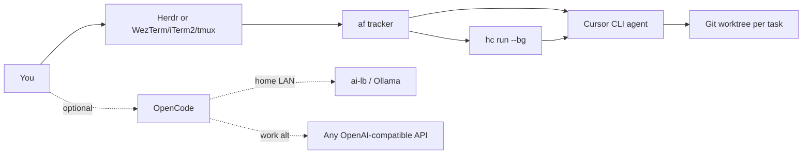

# CLI agent-fleet setup (work computer)

Self-contained guide to reproduce the home Mac mini agent-fleet stack on another macOS machine (for example a work laptop). Assumes macOS. Calls out **home-only** pieces (LAN ai-lb / ComfyUI) and gives work-friendly alternatives.

Source of truth for `aflt`: the code and README in this repo (`bin/af.js`, `lib/backends.js`, `lib/cursor.js`, tests). AI coding agents should start with [AGENTS.md](../AGENTS.md). Install commands below for Herdr, Cursor CLI, OpenCode, tmux, and WezTerm were checked against their official docs (2026-11).

### Install vs setup vs project vs workflows

| Layer | What | Command |
|-------|------|---------|
| **Install** the CLI | Put `aflt` / `af` / `agentfleet` on PATH | `npm install -g github:wwlib/aflt` until publish (`npm install -g aflt` 404s). Contributors: clone + `npm link` / `npm install -g .` / symlink |
| **Machine setup** | Home dir, optional Herdr templates/panel, optional memory registration | `aflt setup` (preview) / `aflt setup --apply` |
| **Project onboarding** | Per-repo messaging/docs/project name | `.agentfleet.json`, `aflt memory init`, `aflt mcp install` |
| **Ongoing workflows** | Run agents, orchestrate, sync memory | `aflt run`, `aflt master` / `spawn`, `aflt memory sync`, … |

Until the first npm registry publish, use the GitHub install. `aflt setup` never edits shell startup files, never installs engines, never publishes packages, and never rewrites `sessions.json`.

**Migration** from clone-backed `~/.local/bin` aliases: after a global npm install, replace those symlinks so `which aflt` resolves to the npm binary. `aflt setup` refuses to overwrite an unrelated `~/.local/bin` name unless you pass `--force`.

---

## 1. What each piece is (and how they fit)

| Piece | Role |
|-------|------|
| **Cursor CLI** (`agent` / `cursor-agent`) | Primary coding agent. Interactive TUI or headless `-p`. Sessions resume with `--resume <chatId>`. |
| **`aflt` (AgentFleet)** | Tracks those chat sessions (title, chatId, cwd/worktree, tags, engine) in `~/.agentfleet/sessions.json`. Reopens a fleet after reboot via tmux / iTerm2 / WezTerm / Herdr / plain. Also has **`aflt run`** for headless one-shot prompts a controller can launch and collect, plus stage-1 **`aflt spawn` / `aflt children` / `aflt result`** for master/worker orchestration. |
| **Herdr** (`hc` = herdr-core; optional desktop app) | Long-lived *interactive* agent terminals. Preferred front end when available: `aflt resume … --via herdr` launches `hc run --bg …`. Not used for `aflt run` print-mode. |
| **OpenCode** (optional) | Cheap / local-friendly coding agent. At home it pointed at the LAN **ai-lb** OpenAI-compatible proxy. On a work machine, point it at any OpenAI-compatible endpoint you are allowed to use — or skip it. `aflt` does not wrap OpenCode headless; a Herdr template is provided for interactive use. |
| **GitHub Copilot CLI** (optional) | Separate coding agent (`copilot`, also reachable as `gh copilot`). Interactive via `aflt new --engine copilot` / resume (`--session-id=`), and headless via `aflt run --engine copilot` (`-p`). This is **not** `gh` repo tooling and **not** `gh agent-task`. See §3.8 for a Copilot-only work Mac. |
| **tmux / WezTerm / iTerm2** | Terminal backends for `aflt resume --all` when Herdr is not the front end. tmux is best for headless/SSH; WezTerm or iTerm2 for a GUI Mac. |
| **Git worktree per task** | One cwd (worktree) per agent session so agents do not stomp each other's files. `aflt` records that cwd and always resumes with `--workspace`. |

Recommended division of labor (same as the home workflow):

- **Herdr** — front end / process host for agent terminals (when installed).
- **Cursor CLI** — hard coding work (uses your Cursor allowance).
- **OpenCode** — optional cheap/local runs (home: ai-lb; work: other endpoint or skip).
- **tmux** — headless or remote recovery when you are not in Herdr.
- **One git worktree per task** — always.



---

## 2. Prerequisites

- **macOS** (Intel or Apple Silicon).
- **Node.js ≥ 20.10** (required by `af` / `package.json` `engines`; Cursor CLI is also a Node binary).
- Ability to write under your home directory (`~/.local`, `~/.config`, `~/.agentfleet`). Admin/`sudo` is **not** required for the user-local install path used below.
- A Cursor account (for `agent login`), unless you use `CURSOR_API_KEY` instead.
- Git (for worktrees).
- Network access to the install URLs (or a pre-downloaded archive of this repo).

**Home-only (do not expect these on a work machine):**

| Resource | Home example | Work alternative |
|----------|--------------|------------------|
| ai-lb OpenAI-compatible proxy | `http://192.168.10.101:11435/v1` (e.g. `gemma4:12b-16k`) | Point OpenCode at any allowed OpenAI-compatible `…/v1` endpoint, use `/connect` for a cloud provider, or **skip OpenCode** |
| ComfyUI | `192.168.10.102:8188` | Not part of this fleet stack; omit |
| Herdr desktop Cursor/OpenCode *app* integrations | Desktop app is installed on the home Mini (`~/Applications/Herdr.app`) but `~/.config/herdr-app` was absent as of 2026-11-10; no GUI recipes to finish from the CLI | Use `hc` templates (`aflt herdr-templates`) + `aflt resume --via herdr` + raw CLIs; see §3.6 and §8 |

---

## 3. Install steps (in order)

Prefer user-local installs. On a locked-down Mac without Homebrew in `/opt/homebrew` or `/usr/local`, install Homebrew into your home prefix if policy allows, or install Node via nvm/fnm and skip casks you cannot install.

### 3.1 PATH baseline

Add these early so later installers and CLIs resolve:

```bash
# zsh (default on modern macOS) — put in ~/.zshrc (and ~/.zprofile for login shells if needed)
export PATH="$HOME/.local/bin:/opt/homebrew/bin:/usr/local/bin:$PATH"
```

Reload: `source ~/.zshrc`

### 3.2 Homebrew + Node (if missing)

```bash
# Official Homebrew installer (asks for password when installing Apple CLT / system paths)
 /bin/bash -c "$(curl -fsSL https://raw.githubusercontent.com/Homebrew/install/HEAD/install.sh)"

# Then follow the "Next steps" it prints to add brew to PATH, e.g. Apple Silicon:
# eval "$(/opt/homebrew/bin/brew shellenv)"

brew install node    # Node ≥ 20.10
node -v
```

Without admin/Homebrew: use [nvm](https://github.com/nvm-sh/nvm) or [fnm](https://github.com/Schniz/fnm) to install Node into `~`.

### 3.3 tmux

```bash
brew install tmux
tmux -V
```

### 3.4 WezTerm or iTerm2 (pick one GUI terminal)

```bash
# WezTerm (af has a first-class --via wezterm backend)
brew install --cask wezterm

# or iTerm2 (af --via iterm2 uses osascript)
brew install --cask iterm2
```

You can use the stock Terminal.app and rely on `af … --via tmux` or `--via plain` instead.

### 3.5 Cursor CLI + login

Official install ([cursor.com/docs/cli/installation](https://cursor.com/docs/cli/installation)):

```bash
curl https://cursor.com/install -fsS | bash

# Ensure ~/.local/bin is on PATH (installer places agent + cursor-agent there)
agent --version
# cursor-agent is the same binary (legacy name); af prefers cursor-agent then agent
which cursor-agent || which agent
```

Authenticate:

```bash
agent login
agent status
```

Headless / scripted usage (from [CLI parameters](https://cursor.com/docs/cli/reference/parameters)):

```bash
# Print mode: non-interactive answer to stdout
agent -p "Summarize this repo's README" --output-format text

# --force / --yolo: only for runs that must edit / run shell without prompts
agent -p "Apply the fix in src/foo.ts" --force --output-format text
```

**Convention used at home:** use `--force` only on editing runs; omit it for read-only / ask-style prompts.

Create / resume chats (what `af` wraps):

```bash
agent create-chat          # prints a UUID
agent --resume <chatId> --workspace /path/to/worktree
```

### 3.6 Herdr (core CLI + optional app)

**Core only** (`hc`) — enough for `af --via herdr` ([herdr-core README](https://github.com/herdrdev/herdr-core)):

```bash
curl -fsSL https://releases.herdr.dev/core/install.sh | sh
hc --help
hc update   # later updates; running terminals keep running
```

**Desktop app** (installs/updates core if missing) — [herdr.dev/download](https://herdr.dev/download/):

```bash
curl -fsSL https://releases.herdr.dev/app/install.sh | sh
# macOS app typically lands in ~/Applications/Herdr.app
# Apple Silicon also: brew install --cask herdr-app
```

Config file (created/used by core): `~/.config/herdr-core/config.toml`  
(Windows would use `%APPDATA%\herdr-core\config.toml`; this guide is macOS-focused.)

Minimal example from upstream docs (optional shell override):

```toml
# ~/.config/herdr-core/config.toml
# shell = ["zsh", "-l"]
```

Smoke test (this exact form was verified on the home Mini, herdr-core **0.1.16**, 2026-11-10):

```bash
hc run --bg --no-parent --outlive-parent --name af-smoke --cwd /tmp --label af_id=smoke -- echo hello
hc ls --json
hc read af-smoke
hc kill af-smoke; hc rm af-smoke   # if it has already exited, just hc rm
```

**`--` separator: do not use it.** On hc 0.1.16, `hc run … -- echo hello` fails with `spawn_failed` / `cannot start "--": No such file or directory`. `af` therefore does **not** emit `--` (see `lib/backends.js` `buildHerdrCommands`). The program name must come immediately after the flags.

**Cursor / OpenCode integrations, as of 2026-11-10 on the home Mini:**

- `hc` 0.1.16 at `~/.local/bin/hc`; Herdr.app at `~/Applications/Herdr.app` (also `~/.local/bin/herdr-app`).
- `hc templates` was empty; `~/.config/herdr-core` did not exist; `~/.config/herdr-app` did not exist. The desktop app's agent-menu integrations were not configured, and finishing those in the GUI needs the Herdr desktop (not available to a CLI-only agent).
- CLI path that *is* finished: `aflt herdr-templates` installs only the bundled Herdr templates `copilot.md`, `cursor.md`, and `opencode.md` into `~/.config/herdr-core/templates/` (official format from [templates.md](https://github.com/herdrdev/herdr-core/blob/master/docs/templates.md): `command`, `description`, `ready: quiet`). aflt prompt files (`DOC-AGENT.md`, `documentarian.md`, `orchestrator.md`) stay in the package and are not installed. Then:

```bash
hc templates
hc run --bg --name review --cwd /path/to/worktree cursor "Review src/foo.ts only. Read-only."
hc read review --lines 100
```

`ready: quiet` is used because Cursor CLI and OpenCode do not implement Herdr's OSC 7501 status protocol, so the default "wait for a status report" readiness would often fail to send the first message. If the first message is still delayed, `hc read` then `hc send`.

`aflt resume --via herdr` still does **not** need templates — it shells out to `hc run` with `cursor-agent --resume …` directly.

Home Mini ran **hc 0.1.16**; current upstream may be newer — `hc update` is fine, but re-check `hc run` if you upgrade (especially the `--` behavior).

### 3.7 OpenCode (optional)

Current official install ([opencode.ai](https://opencode.ai/docs/), [terminal page](https://opencode.ai/terminal)):

```bash
# Pick one
curl -fsSL https://opencode.ai/v2/install | bash
# or: brew install anomalyco/tap/opencode-v2
# or: npm install -g @opencode/cli

opencode --version
```

**Home setup note:** the home Mini used OpenCode **1.19.5** pointed at ai-lb. Current docs describe OpenCode **v2** and `opencode.json` / `opencode.jsonc`. Prefer the current installer on a new machine; do not assume 1.x config files still apply.

**Work alternatives (no home LAN):**

1. Skip OpenCode entirely and use Cursor CLI only.
2. `/connect` inside OpenCode to a cloud provider you are allowed to use.
3. Custom OpenAI-compatible provider in `~/.config/opencode/opencode.json` (or project `opencode.json`), per [Providers](https://opencode.ai/docs/providers/):

```jsonc
{
  "$schema": "https://opencode.ai/config.json",
  "model": "workgate/coder",
  "providers": {
    "workgate": {
      "name": "Work gateway",
      "env": ["WORK_GATEWAY_API_KEY"],
      "package": "@opencode/ai/providers/openai-compatible",
      "settings": {
        "baseURL": "https://llm.example.com/v1"
      },
      "models": {
        "coder": { "name": "Coder" }
      }
    }
  }
}
```

Put the API key in the environment (`export WORK_GATEWAY_API_KEY=…`), not in a git repo.

**Home-only ai-lb sketch** (only if VPN/LAN reaches the box — not expected at work):

```jsonc
{
  "$schema": "https://opencode.ai/config.json",
  "providers": {
    "ailb": {
      "name": "ai-lb",
      "package": "@opencode/ai/providers/openai-compatible",
      "settings": { "baseURL": "http://192.168.10.101:11435/v1" },
      "models": { "gemma4:12b-16k": { "name": "gemma4 12b" } }
    }
  }
}
```

(Exact 1.x vs 2.x field names may differ; verify against `opencode` docs for your installed version.)

### 3.8 Work Mac with Copilot CLI (no Cursor)

When the machine has Herdr + Copilot CLI but not Cursor CLI, drive the fleet with Copilot as the default engine:

```bash
# Herdr app + hc (see §3.6); keep hc updated
hc update   # or follow herdr-core install docs

# Copilot CLI
npm install -g @github/copilot
copilot     # first run: sign in

# af
git clone <this-repo> ~/src/af   # or copy the tree
cd ~/src/af && npm install
mkdir -p "$HOME/.local/bin"
ln -sfn "$PWD/bin/af.js" "$HOME/.local/bin/aflt"   # primary command
ln -sfn "$PWD/bin/af.js" "$HOME/.local/bin/af"     # optional alias
ln -sfn "$PWD/bin/af.js" "$HOME/.local/bin/agentfleet"  # optional alias
export PATH="$HOME/.local/bin:$PATH"

aflt copilot                 # persist defaultEngine=copilot in ~/.agentfleet/config.json
aflt herdr-app install       # af-sessions panel + af layout
aflt new "first-task"        # mints UUID, launches interactive copilot (or --dry-run first)

# Import existing Copilot CLI sessions from ~/.copilot/session-state/
aflt import                  # lists Copilot sessions when defaultEngine=copilot
aflt import copilot          # same, explicit (works even if default is cursor)
aflt import copilot <uuid>   # register by full id or unique ≥8-char prefix
aflt import copilot --all --cwd ~/src/app
```

Override without changing config: `aflt new "…" --engine cursor` / `AGENTFLEET_ENGINE=cursor`. Resume always uses the session's recorded engine. Import follows the same default-engine rules; `aflt import cursor` always scans `~/.cursor/chats/`.

**Project grouping (optional):** projects **need no git**. New sessions store `project` from `--project` → parent → `AFLT_PROJECT` → `.agentfleet.json` `"project"` → `$AGENTFLEET_HOME/config.json` `"project"` → git-root / cwd basename (`adhoc` for `$HOME`/`tmpdir`/`/tmp`). Existing rows derive at read with cwd rules only (never env/global; never backfill). `aflt ls --project NAME` filters; `aflt ls --json` includes effective `project` + `parent`. `aflt timeline [<project>] [--all] [--json] [--since <date>]` is **read-only**: chronological tree; commits per session cwd (skipped when missing/not-git).

**Live dashboard (optional):** `aflt dashboard --serve [--port 8787] [--host 127.0.0.1]` opens a local activity UI (default bind `127.0.0.1` only). Graph positions persist across SSE updates and settle; **Running** / **open** = agent actually working (Herdr OSC `status=working` or live `runPid`), not merely pane-alive `herdr.runtime` (Herdr Agents panel idle). Legacy project `af` groups under `aflt`. Double-click an agent node to focus its existing live terminal in the open Herdr app; single-click shows details. Focus is local-only, never launches/resumes agents, and reports unavailable terminals in the sidebar. `aflt dashboard --snapshot <file.svg|html>` writes a standalone SVG or self-contained HTML snapshot without Herdr actions. Background refreshes do not mutate the registry or Herdr; memory writes require `--capture-completions`. Separate from `aflt memory dashboard` (memory-repo `DASHBOARD.md`; same open/idle rules and `af`→`aflt` alias).

**Project memory (optional):** `aflt memory init <path>` creates a local git working tree (never adds a remote) and registers its realpath as `memoryRepo` in `$AGENTFLEET_HOME/config.json` (override with `AFLT_MEMORY_REPO`). `aflt memory sync` writes per-project `<folder>/_aflt/timeline.md` + `sessions.jsonl` from the registry (read-only) and regenerates root `DASHBOARD.md` (complete Active/Dormant table; default 14-day ET window via `--active-days` or config `memoryActiveDays`; preserves `<!-- doc-bot:summary -->` block verbatim). `aflt memory dashboard` regenerates `DASHBOARD.md` only. `--all` skips `adhoc` unless `--include-adhoc` (home/tmp one-offs are often personal). Human `README.md` / per-project `dashboard.md` / `status-notes/` are create-if-missing only (never write `DASHBOARD.md` inside a project folder). Redaction is ON by default for generated files (`--no-redact` to disable). Optional `--commit` stages root `DASHBOARD.md` + `*/_aflt/**` and commits (`memory: sync YYYY-MM-DD`); refuses if the index already has staged changes; incompatible with `--dry-run`. `--push` requires `--commit` and pushes to the current branch upstream when a commit was made or the branch is ahead (never adds remotes / never force). Nightly: `aflt memory sync --all --commit --push`. `aflt memory doc [--engine cursor|copilot]` launches the portable Doc Bot (`DOC-AGENT.md` in the memory repo; written by `init` when missing) as an `aflt run` session titled `doc-bot`. `aflt memory status` / `where` are read-only. No auto-sync hooks.

**Documentarian (optional):** docs updates are **off by default**. Add `{"docs": true}` to `.agentfleet.json` (optional `"project"`, `"docsPaths"`, `"docsInstructions"`, `"docsEngine"`, `"docsForce": false`). Default paths are `README.md` + `docs/` (+ `CHANGELOG.md` only if it already exists). `docsInstructions` is an optional file path or array (`~` / repo-relative / absolute) whose contents are injected into the documentarian prompt (still only edit `docsPaths`). The prompt may also include a compact session timeline since the last docs run (`timelineBytes` in dry-run/`--json`). `aflt docs` grants write tools by default (`--no-force` to opt out). `aflt docs --status [--json] [--all]` is read-only (reports `needsDocs`, `commitsSince`, `dirtyDocs`, `skip`, `ready`). **Doc Bot rule:** skip repos with uncommitted docs edits — a dirty `docsPaths` file (`.DS_Store` ignored) sets `skip: true` / `skipReason: "dirty-docs"`; run docs only where `ready` (`needsDocs && !skip`) is true. Auto-trigger after headless master / `aflt wait --docs`; docs failure warns but does not fail the master; `aflt wait --docs` errors if no master. State: `$AGENTFLEET_HOME/docs/<hash>.json`. See README “Documentarian”.

**Task-scoped messaging MCP (optional):** messaging is **off by default**. After `aflt msg enable <session>` (or project `.agentfleet.json` with `{"messaging": true}`), Copilot can use af’s MCP tools when the session was launched by aflt (identity via inherited `AGENTFLEET_SESSION` / `AGENTFLEET_ID` — no per-session env in the MCP config):

```bash
# Preview the snippet for ~/.copilot/mcp-config.json (type:local + tools:["*"])
aflt mcp install --engine copilot

# Merge into the real config (backs up to mcp-config.json.bak-<timestamp> first)
aflt mcp install --engine copilot --write

# Cursor: project mcp.json (preferred; then aflt passes --approve-mcps when messaging is on).
# Install writes env "${env:AGENTFLEET_SESSION}" (etc.) so cursor-agent forwards identity
# into the MCP child (cursor does not inherit process env into MCP servers).
aflt mcp install --engine cursor --project --cwd ~/src/app
# Cursor user config (optional)
aflt mcp install --engine cursor --write
```

Until messaging is enabled for the running session, `aflt mcp` advertises no tools. Copilot launches get a per-run `--additional-mcp-config` automatically when messaging is enabled (no `~/.copilot` write). If an older Cursor `af` entry lacks the `${env:…}` mapping, re-run install (`aflt` warns on launch; `aflt doctor` flags `mcp_cursor`).

### 3.9 Install `aflt` (preferred: npm)

```bash
# npm install -g aflt 404s until the package is published.
npm install -g github:wwlib/aflt

# From a checkout: npm link
# or: npm install -g .

# Then machine setup (preview first):
aflt setup
aflt setup --apply
# optional:
# aflt setup --apply --herdr
# aflt setup --apply --memory ~/aflt-memory
```

Add the npm global bin directory to `PATH` yourself (for example in `~/.zshrc`). `aflt` never edits shell rc files.

### 3.9b Install from a checkout / archive (contributors)

Copy or clone the repo onto the work machine, then:

Preferred user-local layout (used on the home Mini; avoids writing under `/usr/local`):

```bash
# after cloning or copying this tree
mkdir -p "$HOME/.local/share" "$HOME/.local/bin"
# install tree: ~/.local/share/aflt
cp -R /path/to/aflt "$HOME/.local/share/aflt"
ln -sfn "$HOME/.local/share/aflt/bin/af.js" "$HOME/.local/bin/aflt"
ln -sfn "$HOME/.local/share/aflt/bin/af.js" "$HOME/.local/bin/af"          # optional alias
ln -sfn "$HOME/.local/share/aflt/bin/af.js" "$HOME/.local/bin/agentfleet" # optional alias

# Add ~/.local/bin to PATH in your shell rc yourself, then:
aflt help
aflt setup --apply          # idempotent machine setup
# or piecemeal:
# aflt herdr-templates      # optional; skips files that already exist
cd "$HOME/.local/share/aflt" && npm test
```

Alternatives: `npm install -g --prefix "$HOME/.local" .` (creates `~/.local/lib`), `npm link`, or `alias aflt='node /path/to/aflt/bin/af.js'`. Avoid `npm install -g .` into `/usr/local` unless you intend to write there.

Optional bash completion:

```bash
source /path/to/aflt/completions/af.bash
```

Override binary if needed:

```bash
export AGENTFLEET_CURSOR_BIN="$HOME/.local/bin/cursor-agent"
```

---

## 4. Configuration cheat sheet

| Variable / path | Purpose |
|-----------------|---------|
| `~/.agentfleet/sessions.json` | Session registry (atomic write). Mode `0600`. |
| `~/.agentfleet/config.json` | Default engine (`defaultEngine`: `cursor`\|`copilot`), optional `project`, optional `memoryRepo` from `aflt memory init`. Separate from sessions. |
| `AGENTFLEET_HOME` | Override registry directory. |
| `AGENTFLEET_REGISTRY` | Override full path to `sessions.json`. |
| `AGENTFLEET_ENGINE` | Default engine for **new** sessions (`cursor`\|`copilot`); after `--engine`, before config. |
| `AGENTFLEET_CURSOR_BIN` | Force path to `cursor-agent` / `agent`. |
| `AGENTFLEET_TMUX_SESSION` | tmux session name (default `agentfleet`). |
| `AGENTFLEET_HERDR_APP` | Set `0` / `false` / `off` / `no` to skip Herdr-app space/tab labels. |
| `AGENTFLEET_HERDR_APP_BIN` | Override `herdr-app` binary path. |
| `AGENTFLEET_HERDR_NAMES` | Set `0` / `false` / `off` / `no` to skip `space.rename` + `tab.rename` (Agents list titles); labels still applied. |
| `HERDR_APP_HOME` | Herdr app config dir for `aflt herdr-app install` (default `~/.config/herdr-app`). |
| `~/.config/herdr-core/config.toml` | herdr-core settings. |
| `~/.config/opencode/opencode.json` | OpenCode global config (v2). |
| `CURSOR_API_KEY` | Headless Cursor auth alternative to `agent login`. |
| `AGENTFLEET_COPILOT_BIN` | Force path to `copilot`. |
| `AGENTFLEET_COPILOT_HOME` | Override Copilot config/home dir (default `COPILOT_HOME` or `~/.copilot`); `aflt import` reads `session-state/` under it. |
| `COPILOT_HOME` | Upstream Copilot home; used when `AGENTFLEET_COPILOT_HOME` is unset. |
| `PATH` | Must include `~/.local/bin` (and Homebrew). |
| `~/.config/herdr-core/templates/*.md` | `hc` agent templates (`aflt herdr-templates`). |
| `~/.agentfleet/runs/<id>/` | Captured `aflt run` output (mode `0600`). |
| `~/.agentfleet/results/<id>.md` | Worker handoff files from `aflt spawn` (see README “Master and worker agents”). |
| `AGENTFLEET_ID` / `SESSION` / `MASTER` / `PARENT` / `RESULT` | Set on launched sessions / spawned workers for orchestration and messaging. |
| `aflt msg` / `inbox` / `thread` / `aflt mcp` | Task-scoped messaging (off by default; see README “Messaging”). |
| `AGENTFLEET_MSG_MAX_THREAD` / `AGENTFLEET_MSG_RATE` | Thread cap (default 6) and per-sender rate (default 10/60s). |
| `aflt wait` / `aflt tail` / `aflt send` / `aflt stop` | Stage 2 master/worker controls (see README “Master and worker agents (stage 2)”). |
| `aflt master` / `--send-grace` / `AGENTFLEET_SEND_GRACE` | Stage 3: bootstrap a master with `templates/orchestrator.md`; wait grace after interactive send (see README “Master and worker agents (stage 3)”). |
| `AGENTFLEET_ROLE` / `AGENTFLEET_PLAN` | Set on `aflt master` launches (`master`; plan under `~/.agentfleet/plans/<id>.md`). |
| `aflt wait --parent` | Wait on all children of a master (ids on the CLI still win). |
| Copilot `--allow-tool=write(<result>)` | Pre-approves the handoff/plan path without `--force`; af falls back from stdout if the file is still missing. |
| `~/.agentfleet/plans/<id>.md` | Master plan file (not in the project cwd). |
| Headless SIGINT/SIGTERM/SIGHUP | `af` forwards SIGTERM to the engine process group; exits 130/143 (does not orphan the CLI). |
| `aflt rm` / `--keep-files` / `--children` | Removes registry row(s) + af-owned files under `$AGENTFLEET_HOME` only (never project/`~/.cursor`/`~/.copilot`). Exact id/title preferred; on a TTY, fuzzy candidates get a confirm/pick prompt (agents/scripts never prompted — use exact ids). Multiple ids as separate args. `aflt stop` uses the same resolution rules. |

Backend auto-detect order in `af` (`lib/backends.js`):  
`$AGENTFLEET_VIA` → inside Herdr (`HERDR` / `HC_TERMINAL` / … and `hc` on PATH) → inside tmux → `TERM_PROGRAM` WezTerm / iTerm → `tmux` on PATH → `wezterm` → `plain`.

Check what your shell would pick:

```bash
aflt which-backend
```

---

## 5. Daily workflow

### 5.1 New task → worktree → tracked agent

```bash
# From the main clone
REPO=~/src/myapp
TASK=auth-refactor
git -C "$REPO" fetch
git -C "$REPO" worktree add -b "feat/${TASK}" "$REPO-wt-${TASK}" origin/main
# (branch base name is up to you; keep one worktree directory per agent)

cd "$REPO-wt-${TASK}"

# Create chat, register, and drop into interactive resume
aflt new "$TASK" --cwd "$PWD" --prompt "Refactor auth to JWT" --model gpt-5
```

Register an existing chat instead:

```bash
aflt add "$TASK" --chat aaaaaaaa-bbbb-cccc-dddd-eeeeeeeeeeee --cwd "$REPO-wt-${TASK}"
```

List / annotate:

```bash
aflt ls                         # STATUS = lifecycle; HERDR = running|exited|missing|unknown|-
aflt ls --json                  # includes effective project + parent
aflt ls --project my-app
aflt timeline                   # read-only session tree for cwd project
aflt timeline --all --json
aflt dashboard --serve          # live local activity UI (http://127.0.0.1:8787/)
aflt dashboard --snapshot /tmp/aflt.svg  # SVG/HTML snapshot (≠ aflt memory dashboard)
aflt memory init ~/aflt-memory  # opt-in project memory repo (never auto-commits)
aflt memory sync                # write cwd project + root DASHBOARD.md
aflt memory dashboard           # regenerate root DASHBOARD.md only
aflt memory doc --engine copilot  # portable Doc Bot (or --engine cursor)
aflt memory sync --all --commit --push  # nightly: sync + commit generated + push
aflt sync --dry-run             # preview Herdr runtime that would be persisted
aflt sync                       # persist herdr evidence only (not status / lastUsed)
aflt note "$TASK" "dev server: npm run dev on :5173"
```

**STATUS vs HERDR:** `STATUS` is the saved task lifecycle (`active`/`paused`/`done`). A Herdr process exiting does **not** mean the task is done — mark that with `aflt done`. `HERDR` is live runtime from `hc ls --all --json` (matched only by label `af_id=<session.id>`). Sessions never launched via Herdr show `-`, not `missing`. Default `hc ls` hides finished terminals; `hc ls --all` is required so finished shows as `exited`. Attach with `~/.local/bin/hc attach <name>`.

### 5.2 Headless run (controller / Grok Bot)

Use this when another agent or a script should offload a task to Cursor (or Copilot), wait, and read the result — no TUI, no Herdr attach.

```bash
# Cheap read-only (Cursor --mode ask). --force is omitted on purpose.
aflt run "smoke-ask" --prompt "Reply with the single word pong and nothing else." --mode ask --cwd /tmp

# Plan only (still read-only)
aflt run "smoke-ask" --prompt "Outline how you would add a --json flag." --mode plan --cwd "$PWD"

# Editing run — only when you intend the agent to change files / run tools
aflt run "fix-tests" --prompt "Fix the failing unit tests." --force --cwd "$REPO-wt-${TASK}"

# Bound the wait
aflt run "smoke-ask" --prompt "…" --mode ask --cwd "$PWD" --timeout 180

# Collected output
aflt log smoke-ask
aflt log smoke-ask --path     # ~/.agentfleet/runs/<id>/<timestamp>.cursor.txt
```

Stdout is the print-mode response. Stderr has progress plus `output: <path>`.

**Cursor `--trust` default (caller-controlled):** `aflt run` and `aflt resume` (including `--via herdr`) pass `--trust` unless you pass `--no-trust`. That only skips Cursor's "Workspace Trust Required" dialog in a registered cwd. It is visible in `--dry-run` and is **not** `--force` (it does not auto-approve tools or shell). A Mini smoke on 2026-11-10 hit that dialog before this default was added. Use `--no-trust` if you want the prompt.

**Copilot:** `--help` claims `--allow-all-tools` is required for `-p`, but a no-tool "reply pong" prompt succeeded without it (CLI 1.0.83, Mini, 2026-11-10). `aflt run --engine copilot` therefore does **not** add `--allow-all-tools` unless you pass `--force`. `--force` is an explicit grant (not `--allow-all` / `--yolo`). For a text-only prompt, omit `--force`.

```bash
aflt run "copilot-probe" --engine copilot --prompt "Reply pong." --cwd "$PWD" --dry-run
aflt run "copilot-probe" --engine copilot --prompt "Reply pong." --cwd "$PWD" --timeout 90
# only if you intend auto-approved tools in that cwd:
aflt run "copilot-probe" --engine copilot --prompt "…" --cwd "$PWD" --force
```

`gh` itself (`gh pr`, `gh issue`, `gh api`, …) stays a separate CLI. `af` will not run it, will not commit or push, and will not create `gh agent-task` cloud jobs. Use `gh` directly when you want repo operations, with the usual approval rules.

Do not combine `aflt run` with `--via herdr`. Long-lived interactive sessions use §5.3.

### 5.3 Launch / resume via Herdr

```bash
# One session into Herdr (default when hc is on PATH; skips if already live)
aflt resume "$TASK"
aflt resume "$TASK" --via herdr             # same
aflt resume "$TASK" --dry-run               # print hc command + Attach line
aflt resume "$TASK" --here                  # Cursor TUI in this terminal
aflt resume "$TASK" --open                  # also open an iTerm2 tab: hc attach <name>
aflt resume                                 # TTY picker (or: aflt resume -i / aflt pick)

# Entire active fleet
aflt resume --all --via herdr
aflt resume --all --via herdr --dry-run
```

What `af` builds (from `buildHerdrCommands`):

```text
hc run --bg --no-parent --outlive-parent \
  --name <sanitized-title> \
  --cwd <workdir> \
  --label af_id=<session-id> \
  --label title=<title> \
  --keep \
  --label herdr.space=sp<md5hex> \
  --label herdr.tab=tb<md5hex> \
  env -u NO_COLOR -u FORCE_COLOR [TERM=xterm-256color COLORTERM=truecolor] \
  cursor-agent --resume <chatId> [--model …] --workspace <cwd> --trust
```

(`TERM`/`COLORTERM` assignments are added only when the caller's `TERM` is unset, empty, or `dumb`, so non-TTY af launches still get a color-capable Cursor TUI.)

Names are lowercased, sanitized to `[a-z0-9_-]`, truncated to 32 chars, and de-duplicated. `--cwd` is the realpath-normalized session folder (must exist); engine `--workspace` / `-C` and `herdr.space` use the same path. Sessions already present in `hc ls --json` with matching `af_id` and a **non-shell** agent are skipped. A live tab whose agent is only a shell (`zsh`/`bash`/…, typical after reboot/`--keep`) is **not** skipped: `aflt resume` runs `hc send <addr> "cd '<cwd>' && env -u … <engine>"` into that tab (no new `hc run`). Resume restores chat context via `--resume <chatId>` and does **not** resend the saved original task prompt (a prompt is sent only on `aflt new --prompt` or an explicit `--prompt` on that resume). Prefer herdr-core ≥ 0.1.20 (`aflt doctor` warns when older; update with `hc update`) so restored shells keep the launch cwd instead of landing in `~`.

#### Herdr app (desktop)

### Smoke

```bash
hc server status && hc ls --json | head -c 200 && aflt ls
aflt doctor
aflt doctor --strict --port 8789   # preflight: engine CLIs, sign-in, notify, free port; exit 1 on a failed check
```

Capability matrix: [CAPABILITIES.md](CAPABILITIES.md).


The Herdr desktop app shows any core terminal labeled `herdr.space=<id>` and `herdr.tab=<id>` (unknown ids become a new space/tab). `af` derives:

- `herdr.space` = `sp` + md5(`agentfleet:space:` + normalized cwd) — sessions in the same repo/cwd share a space
- `herdr.tab` = `tb` + md5(`agentfleet:tab:` + session.id) — one tab per af session; stable across resumes

On Herdr launch, `aflt` also passes `--keep` (lost program → shell; Cursor is **not** re-run — use `aflt resume` again), waits briefly for the app to create the labeled space, then best-effort **names the space** (group session title) and **tab** (session title) via `herdr-app do space.rename` / `tab.rename` (never fails the resume). Space ids are **session-group** based (workers join the master), not folder/repo based — so the Agents list shows `dxs-icm-management · dxs-icm-management` instead of `copilot-master-directory · dxs-icm-management`. Opt out of labels with `--no-herdr-app` or `AGENTFLEET_HERDR_APP=0|false|off|no`; skip renames only with `AGENTFLEET_HERDR_NAMES=0`. Override the binary with `AGENTFLEET_HERDR_APP_BIN` (default: `herdr-app` on PATH, typically `~/.local/bin/herdr-app`).

`aflt adopt` moves existing panes when the app is open: if `herdr-app ls` shows the terminal in the wrong space, it parks → labels → keeps → waits → renames (labels alone do not move panes). After pulling session-group naming, run `aflt adopt --all` with the Herdr app open; empty old spaces may remain and can be closed in the app.

Adopt / migrate terminals (including legacy cwd-based `herdr.space` labels):

```bash
aflt adopt --all                 # or: aflt adopt <title|id …>
aflt adopt --all --dry-run
aflt adopt --all --json
```

That runs `hc label <addr> herdr.space=… herdr.tab=…` and `hc keep <addr>`, then space+tab rename. Cursor does not emit OSC 7501 (Agents panel empty for Cursor); Copilot may report agent state when supported. See [CAPABILITIES.md](CAPABILITIES.md).

Optional sidebar panel (lists af sessions; click to focus/resume):

```bash
aflt herdr-app install              # symlink panel + af layout into ~/.config/herdr-app
herdr-app do layout.switch --name af
# back: herdr-app do layout.switch --name main   (or ctrl-shift-l / escape hatch)
```

List / attach:

```bash
hc ls              # live only (finished are hidden)
hc ls --all --json # includes finished (what aflt ls / aflt sync query)
~/.local/bin/hc attach <name>
herdr-app ls       # desktop spaces/tabs (when the app window is running)
```

`aflt resume` / `aflt resume --via herdr` (and `--dry-run`) prints a copy-pasteable `Attach: hc attach <name>` for each launched or already-live skipped session. In an iTerm2 TTY, a new tab running the attach command (absolute `~/.local/bin/hc` path) opens by default; `--no-open` prints the line only. `--all` still auto-detects its backend and does not default to Herdr just because `hc` is on PATH.

`aflt ls` shows a HERDR column from that `--all` query without writing the registry. `aflt sync` persists last-known `herdr` evidence (runtime/address/exit) and does **not** overwrite `status` or `lastUsed`. Process exit ≠ task done.

### 5.4 Launch / resume via tmux / WezTerm / iTerm2 / plain

```bash
aflt resume --all --via tmux
tmux attach -t agentfleet

aflt resume --all --via wezterm
aflt resume --all --via iterm2
aflt resume --all --via plain          # print commands only
aflt resume --all --dry-run
aflt resume "$TASK" --here             # this terminal; sets OSC tab title
```

### 5.5 Track → finish → cleanup

```bash
aflt ls
aflt rename "$TASK" "auth-jwt-done"
aflt done "$TASK"          # status=done (hidden from default ls)
aflt ls --all              # include done
aflt export ~/backup-af-sessions.json
aflt rm --dry-run "$TASK"  # preview; default deletes af-owned results/runs/plans under $AGENTFLEET_HOME
aflt rm --keep-files "$TASK"  # registry row only (keeps handoffs/logs; never deletes Cursor/Copilot chats)

# When finished with the worktree itself (your git hygiene — af does not delete trees)
git -C "$REPO" worktree remove "$REPO-wt-${TASK}"
```

**Wrong folder (work Mac example):** a Copilot session imported or added under `…/hello-af` that should be `~/github/wwlib/aflt`:

```bash
aflt cwd hello-af                          # print current folder
aflt cwd hello-af ~/github/wwlib/aflt        # update registry cwd + branch (~ ok)
aflt cwd hello-af ~/github/wwlib/aflt --dry-run
# If a Herdr tab is live: aflt stop hello-af (agent running) then aflt resume hello-af;
# shell-only: just aflt resume hello-af (cd's into the new folder in-tab).
# Space is session-based — adopt not required for the folder change.
```

### 5.6 Headless Cursor (without af)

```bash
export PATH="$HOME/.local/bin:/opt/homebrew/bin:$PATH"
cursor-agent -p "Run unit tests and summarize failures" --output-format text
# editing run:
cursor-agent -p "Fix the failing test" --force --output-format text --workspace "$PWD"
```

---

## 6. Reboot / recovery

1. Boot, open Herdr **or** your terminal multiplexer.
2. Ensure PATH includes `~/.local/bin`.
3. `aflt ls` — confirm active sessions and that worktree paths still exist.
4. Reopen the fleet:

```bash
aflt resume --all --via herdr     # preferred if hc works
# or
aflt resume --all                 # auto-detect
# or
aflt resume --all --via tmux
```

**Important (from README):** resume restores **chat context** via `--resume <chatId>` and does **not** resend the saved original task prompt. It also does not restart in-flight shells, servers, or watchers — restart those yourself (or keep them in `aflt note`).

Backup / migrate registry between machines:

```bash
aflt export ~/af-sessions.json
# on the other Mac, after paths exist:
aflt import-file ~/af-sessions.json
```

---

## 7. Work-computer caveats

- **Corporate policy:** confirm that Cursor CLI, Herdr, OpenCode, and Homebrew/casks are allowed. Prefer user-local installs under `~`.
- **No secrets in repos:** never commit API keys, `CURSOR_API_KEY`, gateway tokens, or `~/.agentfleet` dumps that contain prompts you would not share. Use env vars or the OS keychain.
- **Separate Cursor accounts:** `agent login` / `agent status` — use the work account on the work machine; do not copy home auth blobs.
- **No home LAN:** skip ai-lb and ComfyUI; OpenCode is optional.
- **VPN:** if work VPN blocks `releases.herdr.dev` / `cursor.com` / `opencode.ai`, download installers on an allowed network and transfer the archive.
- **Git worktrees on corporate repos:** follow your team's branch naming and do not force-push shared branches.
- **Do not** commit, push, reset, or delete files in shared repos without explicit approval from the repo owner.

---

## 8. Troubleshooting

| Symptom | What to try |
|---------|-------------|
| `cursor-agent: command not found` | `ls ~/.local/bin/agent`; add `~/.local/bin` to PATH; re-run Cursor install. |
| `hc: command not found` | Re-run core or app installer; check `~/.local/bin/hc`. |
| `aflt resume --via herdr` / `cannot start "--"` | Confirmed on hc 0.1.16: do **not** put `--` before the program. Current `aflt` already omits it. If an older copy still emits `--`, update `lib/backends.js`. |
| Cursor TUI is plain white / uncolored in Herdr | Herdr/parent may set `NO_COLOR=1` and `FORCE_COLOR=0`; non-TTY callers may also pass `TERM=dumb`. `af` clears the color vars with `env -u NO_COLOR -u FORCE_COLOR` and, when `TERM` is unset/empty/`dumb`, sets `TERM=xterm-256color` `COLORTERM=truecolor` before `cursor-agent`. |
| Herdr skips a session | `hc ls --json` already has `af_id=<id>`. Attach that terminal or kill it before re-launching. |
| Resume lost context / wrong files | Always use the **same cwd/worktree** the chat was created with. `af` passes `--workspace`. |
| Resume re-triggers the original task | Older `aflt` fell back to `session.prompt` on resume. Current `aflt` does not; only `aflt new --prompt` or an explicit resume `--prompt` sends a prompt. |
| `aflt import` empty | Cursor: `cursor-agent ls` is interactive-only; import scans `~/.cursor/chats/`. Empty chats from `create-chat` may not appear until a prompt is sent — use `aflt new` or `aflt add --chat`. Copilot: scans `~/.copilot/session-state/` (override with `AGENTFLEET_COPILOT_HOME`); import by UUID with `aflt import copilot <id>`. |
| iTerm2 backend fails | Needs macOS + iTerm2 + `osascript`. Use `--via tmux` or `--via wezterm` instead. |
| OpenCode cannot reach ai-lb | Expected off-LAN. Reconfigure provider or skip OpenCode. |
| Tests fail without Cursor CLI | Unit tests still pass with a stub; the optional live `create-chat` test needs a real binary + auth. |
| Desktop Herdr has no Cursor/OpenCode recipe | App integrations need the Herdr GUI (not configured on the home Mini as of 2026-11-10). CLI alternative: `aflt herdr-templates` then `hc run cursor "…"` / `hc run opencode "…"`, or `aflt resume --via herdr`. |
| Copilot tool prompts / hangs in `-p` | A no-tool text prompt does not need `--force`. `--force` adds `--allow-all-tools`. Auth is `copilot login`; there is no `copilot status`. |
| `aflt run` / Herdr resume hangs on "Workspace Trust Required" | Default is `--trust` (documented; shown in `--dry-run`). Pass `--no-trust` to keep the dialog and accept it in the TUI or `hc keys`. `--trust` is not `--force`. |

Useful dry-runs:

```bash
aflt new "probe" --cwd "$PWD" --dry-run
aflt resume --all --via herdr --dry-run
aflt resume --all --via tmux --dry-run
aflt which-backend
```

---

## 9. Supported vs verified (home Mini, 2026-11-10, America/New_York)

| Path | Status |
|------|--------|
| Cursor `aflt run` headless (`-p`, `--mode ask`) + `aflt log` | **Verified** live (reply "pong", exit 0) |
| Cursor `aflt resume --via herdr` | **Verified** live. hc 0.1.16 **rejects** a `--` separator (`cannot start "--"`); current `aflt` omits it. Default `--trust` required to clear the workspace-trust dialog. |
| Copilot `copilot -p` / `aflt run --engine copilot` **without** `--force` | **Verified** live no-tool "pong" (CLI 1.0.83). Auth confirmed by that CLI result; credential files were not read. `--help` overstated the need for `--allow-all-tools`. |
| Copilot `--force` (`--allow-all-tools`) | Supported by `af`; **not** live-tested (broad tool grant). `af` never adds `--allow-all` / `--yolo`. |
| OpenCode | Full engine (`--engine opencode`): `aflt run` / `new` / `resume` / `spawn`; Herdr template still via `aflt herdr-templates`. Turn capture from `opencode.db` (read-only). |
| Herdr desktop Cursor/OpenCode integrations | **Unconfigured**. Herdr.app is present; `~/.config/herdr-app` is absent. Needs the GUI. |
| Reboot persistence | **Not tested** (Mini was not rebooted). |
| `cursor-agent persist` | Exists (`list` / `attach` / `stop`); not wrapped by `af`. |
| `gh` repo tooling / `gh agent-task` | Installed/authenticated separately; **not** wrapped by `af`. |

Other notes: bundled Herdr templates use official frontmatter and `ready: quiet`. OpenCode on this Mini is still 1.19.5 + ai-lb; a new-machine install should follow current OpenCode docs. Local Cursor chat store layout `~/.cursor/chats/<md5(cwd)>/<chatId>/` remains community-observed.

---

## 10. Quick checklist (work Mac)

- [ ] PATH has `~/.local/bin` (+ Homebrew)
- [ ] Node ≥ 20.10
- [ ] `tmux` installed
- [ ] WezTerm or iTerm2 (optional but nice)
- [ ] `agent` / `cursor-agent` installed and `agent login` OK
- [ ] `hc` installed; optional Herdr.app
- [ ] OpenCode installed **or** consciously skipped
- [ ] `af` installed on PATH (`~/.local/bin/af`); `npm test` green
- [ ] `aflt help` shows `run`, `log`, `sync`, `herdr-templates`
- [ ] `aflt ls` shows HERDR; `aflt sync --dry-run` does not write
- [ ] `aflt run "smoke" --prompt "Reply pong." --mode ask --cwd … --dry-run` looks right; then a cheap live ask if you want to spend Cursor quota
- [ ] `aflt resume smoke --via herdr --dry-run` has **no** `--` before `cursor-agent`; then without `--dry-run` if you want a live TUI
- [ ] `aflt herdr-templates` && `hc templates` lists `copilot`, `cursor`, and `opencode` (not DOC-AGENT/documentarian/orchestrator)
- [ ] `aflt export` backup stored outside the repo
- [ ] (Copilot work Mac) `aflt import copilot` lists sessions; import an existing UUID by id
- [ ] (Wrong folder) `aflt cwd <title> ~/correct/path` updates cwd; resume/adopt if a Herdr tab was live

When in doubt, lean on Cursor CLI + `af` + tmux; treat Herdr as the nicer front end and OpenCode as optional.
