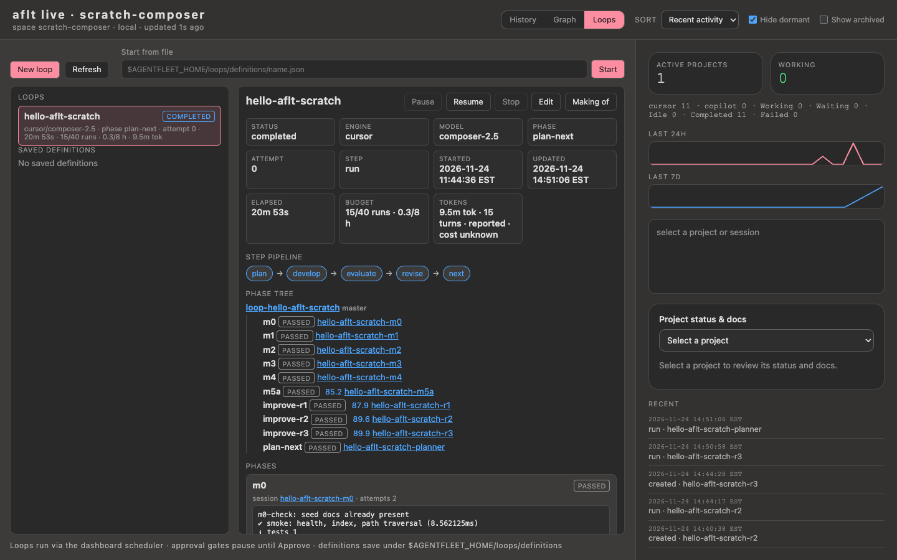
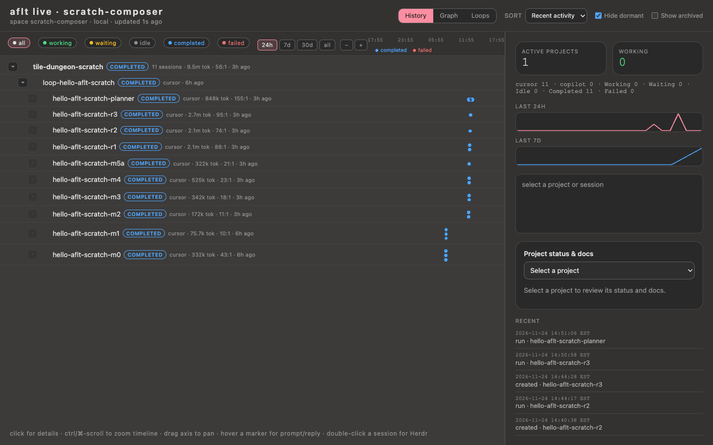
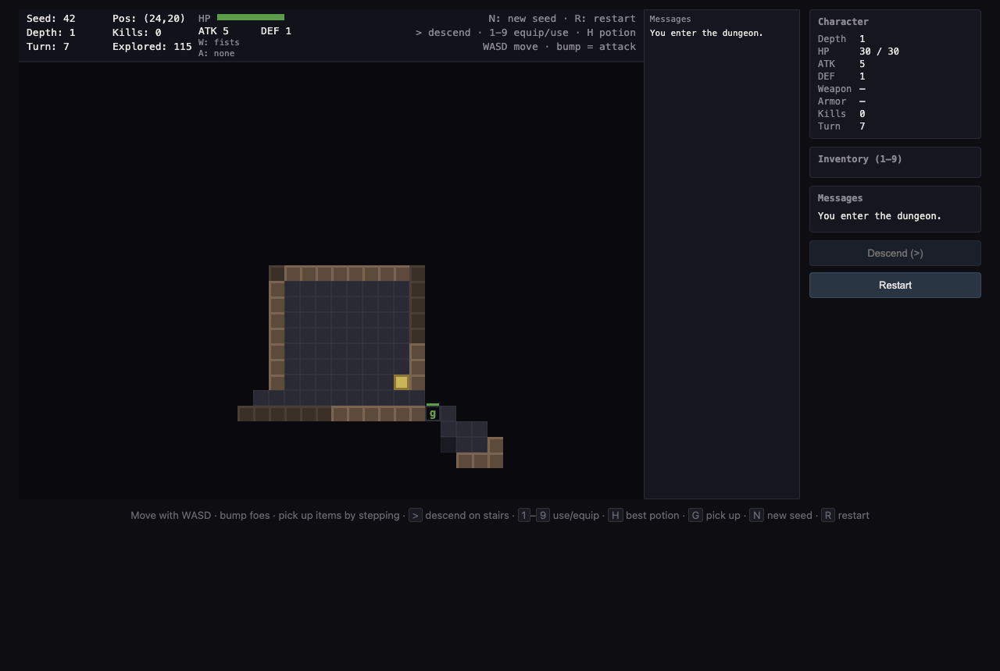
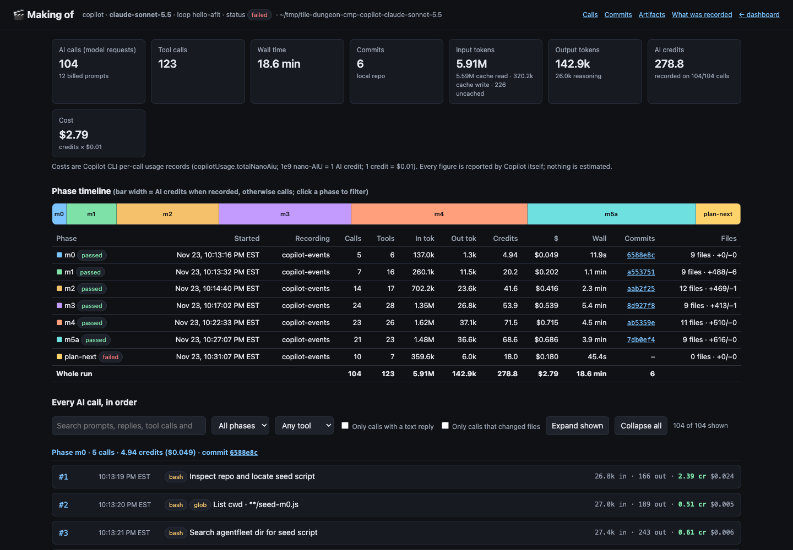
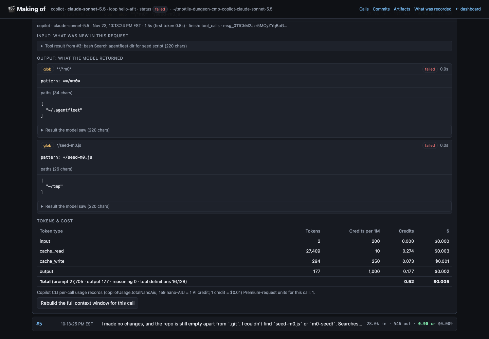
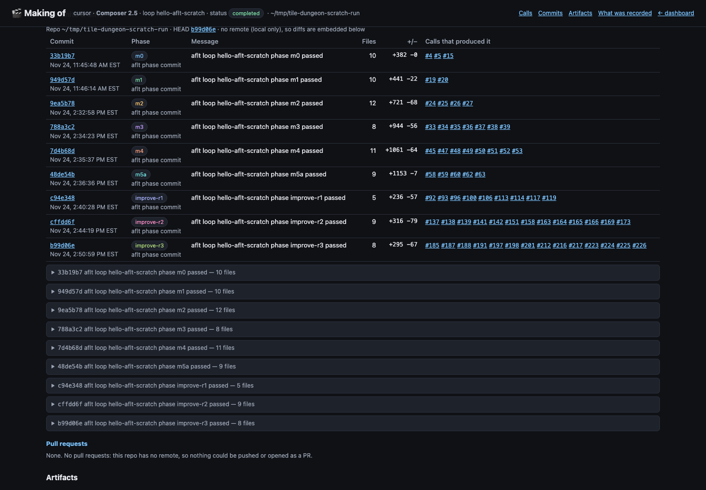

# Kick off loop development from the CLI (no assistant)

Copy-paste paths for a **fresh Mac**: install AgentFleet, sign in to an engine, run the **hello-aflt** tile-dungeon loop, and watch it in the dashboard. Aligned with [tutorial/01-install.md](tutorial/01-install.md), [SETUP.md](SETUP.md), and [tutorial/09-loops.md](tutorial/09-loops.md).

Self-improve loop (worktree + verify tiers): [self-improve-runbook.md](self-improve-runbook.md).

## 1. Install aflt

```bash
git clone https://github.com/wwlib/aflt.git ~/github/wwlib/aflt
cd ~/github/wwlib/aflt
npm link
# or: npm install -g .
# or: ln -sfn "$(pwd)/bin/af.js" ~/.local/bin/{aflt,af,agentfleet}
```

Ensure the npm global bin dir and `~/.local/bin` are on `PATH` (`which aflt`).

```bash
aflt --version
aflt setup --apply
```

## 2. Install and sign in to an engine

Add `~/.local/bin` to PATH if Cursor installed `cursor-agent` there:

```bash
export PATH="$HOME/.local/bin:$PATH"
```

### Copilot (recommended for hello-aflt)

```bash
npm install -g @github/copilot
copilot
# complete browser / device sign-in
```

### Cursor

```bash
curl https://cursor.com/install -fsS | bash
cursor-agent status
```

### Preflight

```bash
aflt doctor --strict
```

## 3. Model selection

Precedence for loop workers: phase `model` → definition `model` → `COPILOT_MODEL` (Copilot only) → `config.json` `defaultModel`. Example:

```bash
export COPILOT_MODEL=claude-sonnet-5.5   # any model your Copilot plan offers; `auto` when the account default is unavailable
# or set "model" on the loop JSON / phase
```

## 4. Empty repo + isolated space

```bash
mkdir -p ~/tmp/td && cd ~/tmp/td
git init -b main
export AFLT_SPACE=td-copilot
export AGENTFLEET_ENGINE=copilot
```

## 5. Validate and run hello-aflt (from scratch)

Default **hello-aflt** is docs-only: no game code or HTML in the seed. The loop,
prompts, and checks live under `.agentfleet/` inside your project folder.
`plannedPhaseGate: "none"` is intentional (improve phases need no approval gate).

Replace `AFLT_HOME` with your clone path.

```bash
AFLT_HOME=~/github/wwlib/aflt
mkdir -p ~/aflt-projects/td && cd ~/aflt-projects/td
"$AFLT_HOME/examples/loops/hello-aflt/install.sh"
# or: cp -R "$AFLT_HOME/examples/loops/hello-aflt/seed/." .
git init -b main && git add -A && git commit -m "Seed hello-aflt"
export AFLT_SPACE=td-copilot   # optional isolated space

aflt loop validate .agentfleet/loop.json --json
aflt loop run .agentfleet/loop.json --dry-run --json
aflt loop run .agentfleet/loop.json
```

The first phase, `seed-docs`, is a script phase (no AI call) that checks the repo
holds only the seed. M0 is a real agent build from `SPEC.md`, checked by
`.agentfleet/checks/m0-check.cjs`.

### Background / scheduler (optional)

```bash
aflt loop start .agentfleet/loop.json --json
aflt dashboard --serve --port 8787
```

Then `aflt loop status hello-aflt --json`, pause / resume / stop.

### Non-default: copy M0 in with a script (`hello-aflt-seeded`)

[`examples/loops/hello-aflt-seeded/`](../examples/loops/hello-aflt-seeded/README.md) —
`aflt loop run "$AFLT_HOME/examples/loops/hello-aflt-seeded/hello-aflt.json"` from an
empty `git init` repo (M0 = `seed-m0.js`, no AI call).

## 6. Watch the dashboard

```bash
AFLT_SPACE=td-copilot aflt dashboard --serve --port 8787
```

Open `http://127.0.0.1:8787/` → Loops tab. Each loop has a **Making of** button (`http://127.0.0.1:8787/making-of/hello-aflt`). If another dashboard already listens on 8787 (for example the default space's), pass a free `--port`; each named space also records its own port (`aflt space ls`).



History shows the loop master with one session per phase:



The game itself runs from the game repo (`npm start`, default `http://127.0.0.1:8792/`; `?seed=42` gives a repeatable map):



## 7. See exactly how it was built (making of)

After (or during) a run, one command writes a self-contained page with every AI call in order — the prompt, the reply, reasoning, every tool call with its result, tokens, and Copilot AI credits / dollars as Copilot recorded them — plus every commit in the game repo with its phase, files and diff, the M0 seed files, files changed per phase, eval outputs and the final build:

```bash
AFLT_SPACE=td-copilot aflt making-of hello-aflt
# → ~/.agentfleet/spaces/td-copilot/loops/hello-aflt/making-of.html (open it in a browser)

AFLT_SPACE=td-copilot aflt making-of hello-aflt --out ~/Desktop/hello-aflt-making-of.html \
  --build-url http://127.0.0.1:8792/          # link the playable build
AFLT_SPACE=td-copilot aflt making-of hello-aflt --serve --port 8797   # live page + raw diffs
AFLT_SPACE=td-copilot aflt making-of hello-aflt --out site/making-of.html --with-files
# → site/making-of.html + site/making-of-files/ (every commit diff and seed/eval/tracked file
#   as a small HTML page, all linked) for any static host
AFLT_SPACE=td-copilot aflt making-of hello-aflt --json    # summary: calls, tokens, credits/$, commits
```

The top of the page: totals, a phase timeline and one row per phase with calls, tokens, credits, dollars, wall time and its commit. Copilot run:



Below that, every call in order; expand one to see what was new in the request, what the model returned (text and tool calls with results) and its token and credit table:



Then every commit with its phase, size and the calls that produced it, followed by PRs and artifacts (final tree, seed inputs, files per phase):



What aflt records for this (per phase session, `$AGENTFLEET_HOME/runs/<session>/`):

| File | Contents |
|------|----------|
| `engine/copilot-<chatId>.events.jsonl` | Copy of Copilot's own session log (messages, tool calls + results, per-call usage and AI credits) |
| `engine/cursor-<chatId>-<time>.stream.jsonl` | Every Cursor `--output-format stream-json` event (loop phases now run Cursor in stream-json) |
| `engine/cursor-<chatId>.transcript.jsonl` | Copy of Cursor's agent transcript |
| `calls.jsonl` | One normalized line per model call: `phase, index, timestamp, engine, model, input, output, toolCalls, tokens, cost, costBasis` |
| `session-context.json` | System prompt(s), runtime instructions, tool-definition size — once per session |
| `usage-summary.json` | Token rollup; a headless run is counted once (Copilot `credits` / `usd` + `costBasis` when reported) |

Costs are never estimated: Copilot credits come from its usage records (1e9 nano-AIU = 1 credit = $0.01); Cursor reports tokens per run and no cost, so its page shows tokens only.

---

## Copilot one block

```bash
git clone https://github.com/wwlib/aflt.git ~/github/wwlib/aflt
cd ~/github/wwlib/aflt && npm link
npm install -g @github/copilot && copilot
export PATH="$HOME/.local/bin:$PATH"
aflt doctor --strict
mkdir -p ~/tmp/td && cd ~/tmp/td && ~/github/wwlib/aflt/examples/loops/hello-aflt/install.sh
git init -b main && git add -A && git commit -m "Seed hello-aflt"
export AFLT_SPACE=td-copilot AGENTFLEET_ENGINE=copilot
# optional: export COPILOT_MODEL=...
aflt loop run .agentfleet/loop.json
# another terminal:
AFLT_SPACE=td-copilot aflt dashboard --serve --port 8787
```

## Cursor one block

```bash
git clone https://github.com/wwlib/aflt.git ~/github/wwlib/aflt
cd ~/github/wwlib/aflt && npm link
curl https://cursor.com/install -fsS | bash
export PATH="$HOME/.local/bin:$PATH"
cursor-agent status
aflt doctor --strict
mkdir -p ~/tmp/td && cd ~/tmp/td && ~/github/wwlib/aflt/examples/loops/hello-aflt/install.sh
git init -b main && git add -A && git commit -m "Seed hello-aflt"
export AFLT_SPACE=td-cursor AGENTFLEET_ENGINE=cursor
aflt loop run .agentfleet/loop.json
# another terminal:
AFLT_SPACE=td-cursor aflt dashboard --serve --port 8787
```