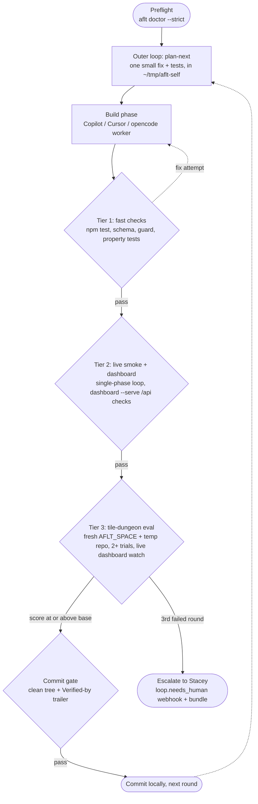

# aflt Self-Improving Loop Design

A design for using aflt to improve aflt: an outer loop works in a separate worktree, every change passes cheap checks first and then a real tile-dungeon run, and the loop calls a human after three failed rounds.

- **Date:** 2026-11-23
- **Status:** Design proposal; mostly implemented on branch `feat/self-improving-loop` (2026-11-24 note below)

> [!NOTE]
> **Implementation status (2026-11-24).** Built: `workdir.mode: "worktree"` (+ `--create-worktree`), `protected` paths with a base-commit diff guard, `aflt doctor --strict`, cheap-first `verify` tiers 1–3 (tile-dungeon runner with `trials`), tier checkpoints keyed by tree state, `commitGate` stamps (`observe` / `enforce`), `escalation` → `loop.needs_human`, and ordered `engines` failover; `examples/loops/self-improve.json` uses them (runbook: [self-improve-runbook.md](self-improve-runbook.md)). Not built yet: paired multi-trial acceptance with `minDelta` / `maxStdDev`, rule learning and the pruning routine, and running `commitGate` in `enforce` by default. The rest of this document is the original proposal.
- **Target:** [`wwlib/aflt` PR #8](https://github.com/wwlib/aflt/pull/8)

## Contents

- [Summary and architecture](#summary-and-architecture)
  - [Workspace and state isolation](#workspace-and-state-isolation)
- [Engine flexibility and preflight health](#engine-flexibility-and-preflight-health)
- [Verification and anti-gaming](#verification-and-anti-gaming)
  - [Immutable checks (no self-grading)](#immutable-checks-no-self-grading)
  - [Cheap-first tiers](#cheap-first-tiers)
  - [Handling eval noise](#handling-eval-noise)
  - [Verification stamps and commit gate](#verification-stamps-and-commit-gate)
- [Escalation, alerts and recovery](#escalation-alerts-and-recovery)
- [Rule learning and hygiene](#rule-learning-and-hygiene)
- [Autonomy gaps coverage](#autonomy-gaps-coverage)
- [Phased rollout](#phased-rollout)
- [Proposed self-improve.json](#proposed-self-improvejson)
- [Open questions](#open-questions)

## Summary and architecture

> [!IMPORTANT]
> **Use aflt to make aflt.** The loop already exists in `examples/loops/self-improve.json`: measure, score a baseline, then plan one tested fix per round under RUBRIC GUARD. This design adds what live testing showed it needs to run unattended: a separate worktree, the tile dungeon as a real-world eval, tamper-proof checks, engine failover, and a human call after three failed rounds.



Every arrow back to the build phase counts toward the three-strike limit. Tier 3 only runs when the cheap tiers are green, so most bad changes fail in minutes, not in a 25-minute dungeon run.

- **Builds on:** `examples/loops/self-improve.json`, `aflt eval measure|score|gate|plateau`, RUBRIC GUARD in `scripts/eval/gate.js`
- **Depends on:** [PR #8](https://github.com/wwlib/aflt/pull/8): cwd guard, missing-CLI errors, Copilot `--model auto` fallback
- **Eval workload:** `examples/loops/hello-aflt/hello-aflt.json` (M0 to M5a + up to 3 improve rounds)
- **Grounded in:** PR #8 branch at `5e4c6a1`, read on the Mac mini, 23 Nov 2026

### Workspace and state isolation

PR #8's guard (`inspectLoopWorkdir` in `lib/loop.js`) refuses a cwd that is not an empty, clean git repo, or that sits inside the running aflt checkout. That is right for the tile dungeon but blocks `self-improve.json` as written (`"cwd": "."`). The plan below keeps the guard strict and gives the self loop a sanctioned exception.

1. **Outer loop in a dedicated worktree.** `git worktree add ~/tmp/aflt-self origin/main`. The loop runs from a stable aflt install (for example `~/tmp/aflt-bin`), never from the worktree it edits, so the main checkout at `~/github/wwlib/aflt` stays clean.
2. **A named workdir mode instead of `--allow-existing`.** Proposed `workdir.mode: "worktree"` passes only when the cwd is a clean git worktree on a fresh branch and is not the running package root. Until it lands, `--allow-existing` is the stopgap.
3. **Fresh space and temp repo per inner run.** Each tile-dungeon trial gets `AFLT_SPACE=self-eval-<sha>-<n>` and a new `mkdtemp` git repo, so registries, sessions and loop state never mix with Stacey's own spaces.
4. **Non-colliding ports.** The runner picks a free port (listen on 0) and passes `PORT` to the game; the m0 seed already honors `PORT` (`server.js`: `process.env.PORT || 8792`). The dashboard keeps its own default 8787 or `--port`.
5. **Post-run cleanup.** Spawn the inner loop detached, kill its process group at the end, then sweep `cursor-agent` worker-server processes started after the run began. Remove the eval space; keep the temp repo only when the trial failed.

## Engine flexibility and preflight health

Today `self-improve.json` pins `"engine": "cursor"` at the top and on every phase. In `lib/loop.js` the env default (`AGENTFLEET_ENGINE`) only applies when the definition omits `engine`, so a pinned loop cannot move to Copilot without editing JSON.

- Remove the pins; the loop then follows `AGENTFLEET_ENGINE`, then config, then `cursor`, the same order as new sessions.
- Add an optional ordered `engines` list for failover. Sessions are engine-bound (a phase refuses a session of another engine), so failover uses per-engine titles such as `loop-self-improve-copilot`.
- Fail over only on infrastructure errors (CLI missing, auth, rate limit, model unavailable), never on a failing eval, so a weak engine cannot be swapped in to dodge a red test.
- Keep PR #8's Copilot fallback: retry with `--model auto` when the account default is unavailable, overridable with `AGENTFLEET_COPILOT_FALLBACK_MODEL` (`"none"` disables).
- Record the engine and model on every phase result and in the commit trailer, so scores can be compared fairly.

| Preflight check | Today in aflt doctor | Proposed |
|---|---|---|
| Engine CLIs on PATH | Yes | Also flag `~/.local/bin` missing from PATH when `cursor-agent` lives there |
| Engine sign-in | No | Per-engine auth probe (for example `cursor-agent status`); fail before the loop starts |
| Notify config | Status only | Optional live `aflt notify test` round-trip with `--strict` |
| Free ports | No | Confirm the dashboard port and a free game port |
| Workdir | At loop run | Same `inspectLoopWorkdir` result, shown up front |

A new `aflt doctor --strict` exits non-zero on any failed check, and the outer loop runs it as its first step.

## Verification and anti-gaming

> Verification has to be something the agent cannot quietly change, cheap enough to run every time, and honest about noise.
>
> — Principles from Addy Osmani's post on how the Claude Code team approaches verification, mapped to aflt

### Immutable checks (no self-grading)

In the PR #8 Copilot run, the worker left uncommitted edits to `scripts/eval/bot.js` and `test/eval.test.js` in the game repo. The bot that plays the game is part of the yardstick, so editing it can raise the score without improving the game.

- Load eval scripts, rubric and harness from the base commit (a read-only `git worktree` at the base SHA), never from the mutable worktree.
- Widen RUBRIC GUARD beyond today's three paths (`eval/RUBRIC.md`, `scripts/eval/score.js`, `scripts/eval/rubric.js`) to all of `scripts/eval/`, the hello-aflt `improve-gate.js`, its prompts, and `self-improve.json` itself.
- Any phase whose diff touches a protected path fails outright, and that failure does not get a fix attempt.
- Inside the tile dungeon, lock `scripts/eval/bot.js` alongside `eval.js` and `scorer.js` once M5a passes.

### Cheap-first tiers

| Tier | What runs | Time |
|---|---|---|
| 1 | `npm test` (681 tests: 680 pass, 1 skipped), definition schema checks, dry-run and cwd guard tests, property tests, the dashboard API contract in `scripts/eval/dashboard-api.js` | About 2 min |
| 2 | Live smoke: a single-phase loop such as `examples/loops/hello-eval.json` on the chosen engine, watched by `aflt dashboard --serve` on a free port | 1–2 min |
| 3 | Full tile-dungeon eval through `hello-aflt.json`, only after tiers 1 and 2 pass, with the dashboard polled during and after the run | About 25 min per trial |

Tier 1 can start with focused `node --test` files for the touched modules, then the full suite. Property tests use `fast-check` as a devDependency only, so the shipped CLI stays zero-dependency. Good targets: registry and loop-state round-trips, and `aflt loop resume` being idempotent.

> [!NOTE]
> **Dashboard UI check (every eval, Stacey's requirement):** start `aflt dashboard --serve --port FREE_PORT --json` in the eval's `AFLT_SPACE`, then confirm `/api/state`, `/api/loops`, `/api/loops/definitions` and `/api/loops/:name` return 200 with valid JSON, the running loop shows its live phase and attempt, the finished loop shows completed status, every phase and its score, and the page HTML loads with no server errors or port clash. An `aflt dashboard --snapshot trial-N.html` (plus `.svg`) is saved with each trial as visual evidence. A dashboard failure fails the tier, the same as a red test.

### Handling eval noise

| Run | Score | Context |
|---|---:|---|
| Cursor run (PR #8) | **99.3** | after 3 improve rounds |
| Copilot run (PR #8) | **83.0** | after M5a |

```text
Cursor run (PR #8)    ████████████████████  99.3
Copilot run (PR #8)   ████████████████░░░░  83.0
                      0                  100
```

The same aflt build and loop definition scored 83 and 99.3 on two runs, so a single tile-dungeon score cannot judge a change.

- Run at least two trials, ideally paired: base and candidate on the same engine and model, back to back.
- Compare medians, and accept only when the gain exceeds `minDelta` and the spread stays under `maxStdDev`.
- Never retry a run until it passes. A third trial is allowed only when the first two disagree, and every trial is logged.

### Verification stamps and commit gate

```text
fix(loop): resume no longer re-runs a passed phase

Verified-by: npm test 681/681 (1 skipped); hello-eval smoke ok; tile-dungeon avg 94.2 (n=2, sd 1.8, base 92.9)
Aflt-Loop: self-improve round 2, engine copilot
```

Today `onPass: "commit"` runs `git add -A` and commits with "aflt loop NAME phase ID passed". The commit gate adds a `Verified-by` trailer (or `Verified-by: none`), and also catches the uncommitted edits the Copilot run left behind.

| Mode | Behavior |
|---|---|
| `off` | Today's behavior |
| `observe` | Writes the trailer and warns on a dirty tree or a missing check; never blocks |
| `enforce` | Refuses the commit unless the tree is clean apart from the phase's own changes and every required tier is recorded |

## Escalation, alerts and recovery

- Three strikes: after 3 failed fix rounds, the loop pauses instead of improvising and emits `loop.needs_human` (proposed new event), plus today's `loop.gate.waiting` so existing listeners still fire.
- The aflt-loop-alerts webhook routine picks it up and messages Stacey with a short diagnostic bundle.
- Every tier result is checkpointed by commit SHA, so `aflt loop resume self-improve` continues from the last green tier instead of starting over.
- Heartbeat stays opt-in (`loop.heartbeatSeconds`), but the self loop turns it on so a hung worker shows up within minutes.

The diagnostic bundle should include:

| Field | Contents |
|---|---|
| Failing phase | Phase id, tier, attempt count, engine and model |
| Diff summary | `git diff --stat` against the round's base SHA |
| Last error | Last 40 lines of eval output |
| Logs | Path to the loop log and to any kept temp repo |
| Next step | `aflt loop resume self-improve` or `aflt loop stop self-improve` |

## Rule learning and hygiene

- When the same failure shows up twice (same tier, same test or same guard), the planner writes one short rule to the project's agent instructions (`AGENTS.md`) or to aflt memory.
- Each rule names the failure it came from and the date, for example: never edit `scripts/eval/bot.js`; the score must come from the game.
- A monthly pruning routine merges duplicates, drops rules that have not fired in 60 days, and flags contradictions for a human.
- Rule edits go through the same commit gate, so a rule cannot quietly weaken a check.

## Autonomy gaps coverage

| Gap seen in live testing | Status |
|---|---|
| 1. Engine auth and doctor coverage | ⚠️ PR #8 partial (names a missing CLI); design adds auth probes |
| 2. Copilot account default model unavailable | ✅ Fixed in PR #8 (`--model auto` fallback) |
| 3. `~/.local/bin` not on PATH for `cursor-agent` | This design (doctor check); shell profile change needs Stacey's OK |
| 4. Commit policy and uncommitted worker edits | This design (commit gate, trailers) |
| 5. Eval gaming (`bot.js` edit) | This design (immutable checks, wider guard) |
| 6. Failed-run recovery and notify defaults | This design (three strikes, checkpoints, strict doctor) |
| 7. Pinned engines, no failover | This design (unpinned + `engines` list) |
| 8. Score and time variance between runs | This design (paired trials, medians) |
| 9. Port 8792 clash | This design (free port per trial); follow-up: seed prompt wording |
| 10. Lingering `cursor-agent` worker-server processes | This design (process-group cleanup); follow-up: report upstream to Cursor |

## Phased rollout

1. **Phase 0: prerequisites.** PR #8 merges. Tech Bot finishes its docs pass. Webhook is wired (`AFLT_NOTIFY_URL`, `AFLT_NOTIFY_KEY`, `aflt notify test`). Decide on the PATH change.
2. **Phase 1: safe worktree, immutable eval, cheap-first tiers.** `workdir.mode: worktree`, base-commit eval loading, wider RUBRIC GUARD, `aflt doctor --strict`, tiers 1–2 including the dashboard UI check, tile-dungeon runner with fresh space, free port and cleanup. Exit: one supervised round completes with no human fixes.
3. **Phase 2: stamps, commit gate, three-strike escalation.** Trailer in `observe` mode for a week, then `enforce`. `loop.needs_human` plus the diagnostic bundle wired to aflt-loop-alerts. Tier checkpoints for resume. Exit: an overnight run that either lands verified commits or pages cleanly.
4. **Phase 3: averaging, failover, rule learning.** Paired multi-trial scoring, `engines` failover (opencode when available), rule learning plus a pruning routine. Exit: three unattended nights in a row with no false passes.

> [!NOTE]
> Each phase is its own PR to wwlib/aflt, built by the loop where possible and reviewed by a person before merge. Nothing is pushed or merged without Stacey's go-ahead.

## Proposed self-improve.json

A sketch based on the current file. Keys marked `PROPOSED` do not exist yet; comments are for review only (the loader reads plain JSON).

```jsonc
{
  "name": "self-improve",
  "project": "aflt",
  "cwd": "~/tmp/aflt-self",
  // "engine" removed: AGENTFLEET_ENGINE / config now decide (lib/loop.js:805)
  "engines": ["copilot", "cursor", "opencode"],          // PROPOSED: failover order
  "workdir": { "mode": "worktree", "base": "origin/main" }, // PROPOSED: accept a clean aflt worktree
  "protected": {                                           // PROPOSED: loaded from base commit
    "source": "base",
    "paths": [
      "eval/RUBRIC.md", "scripts/eval/**",
      "examples/loops/hello-aflt/improve-gate.js",
      "examples/loops/hello-aflt/prompts/**",
      "examples/loops/self-improve.json"
    ]
  },
  "verify": {                                              // PROPOSED: cheap-first tiers
    "tier1": ["npm", "test"],
    "tier2": { "loop": "examples/loops/hello-eval.json", "timeoutSec": 180 },
    "dashboard": { "every": "tier", "port": "auto", "snapshot": true,   // PROPOSED: UI check on every eval
                   "routes": ["/api/state", "/api/loops", "/api/loops/definitions", "/api/loops/:name"] },
    "tier3": { "tileDungeon": true, "trials": 2, "paired": true,
               "minDelta": 1.0, "maxStdDev": 4.0, "timeoutSec": 3600 }
  },
  "commitGate": { "mode": "observe", "trailer": "Verified-by" }, // off | observe | enforce
  "escalation": { "afterFailedRounds": 3, "event": "loop.needs_human" },
  "rules": { "learnAfterRepeats": 2, "file": "AGENTS.md" },
  "goal": "Improve aflt's deterministic eval score with small, tested fixes. ...",
  "acceptance": "At most 3 improve rounds ... RUBRIC GUARD clean ...",
  "plannedPhaseGate": "none",
  "allow": { "commit": true, "merge": false, "push": false },
  "budget": { "maxRuns": 50, "maxHours": 12, "maxPhases": 16 },
  "phases": [
    { "id": "measure", "session": "loop-self-improve",
      "eval": { "command": ["node", "./bin/af.js", "eval", "measure", "--json"], "exitCode": 0 },
      "maxFixAttempts": 1, "onPass": "none", "force": false, "timeoutSec": 7200 },
    { "id": "score-baseline", "session": "loop-self-improve",
      "eval": { "command": ["node", "./bin/af.js", "eval", "score", "--json",
                "--write-baseline", "eval/improve-baseline.json", "--max-rounds", "3"], "exitCode": 0 },
      "maxFixAttempts": 1, "onPass": "none", "force": false, "timeoutSec": 600 },
    { "id": "tile-dungeon-baseline", "session": "loop-self-improve",   // PROPOSED phase
      "eval": { "command": ["node", "<base>/scripts/eval/tile-dungeon.js", "--json", "--trials", "2"],
                "exitCode": 0 },
      "maxFixAttempts": 0, "onPass": "none", "force": false, "timeoutSec": 3600 },
    { "id": "plan-next", "type": "plan-next", "session": "loop-self-improve-planner",
      "promptFile": "prompts/self-improve-plan-next.txt",
      "maxFixAttempts": 2, "onPass": "none", "force": true }
  ]
}
```

The tile-dungeon runner, also a sketch:

```js
// scripts/eval/tile-dungeon.js  (PROPOSED, zero-dependency CommonJS, loaded from the base commit)
// 1. mkdtemp ~/tmp/aflt-td-<sha>-<n>, git init (satisfies inspectLoopWorkdir: empty, clean, outside aflt)
// 2. AFLT_SPACE=self-eval-<sha>-<n>  -> fresh registry/state under ~/.agentfleet/spaces/
// 3. PORT = free port from net.createServer().listen(0)  (never the 8792 default)
// 4. spawn: node <candidate>/bin/af.js loop run <base>/examples/loops/hello-aflt/hello-aflt.json
//    detached: true, so the whole process group can be signalled afterwards
// 4b. alongside: aflt dashboard --serve --port <free2> in the same AFLT_SPACE; poll /api/loops/<name>
//    for live phase state, then check completed status + phases; aflt dashboard --snapshot trial-<n>.html
// 5. read eval/history.jsonl last line -> { overall, metrics }, plus wall time and engine
// 6. finally: kill process group, sweep leftover cursor-agent worker-server PIDs started after t0,
//    `aflt space rm self-eval-<sha>-<n>`, keep the temp repo only on failure (for the bundle)
// Output: { trials: [...], mean, median, stdDev, engine, sha, dashboard: { ok, routes, snapshot } }
```

## Open questions

- Should `allow.commit` be on for the self loop from Phase 1, or only once the commit gate is in `enforce`?
- Is two trials per tile-dungeon eval enough, given about 25 minutes each, or should Tier 3 run nightly on the round's best candidate only?
- Where should learned rules live: the repo's `AGENTS.md` (shared with the dev team) or aflt memory (local)?
- Should the outer loop's planner and builder be different engines, so one model never grades its own work?
