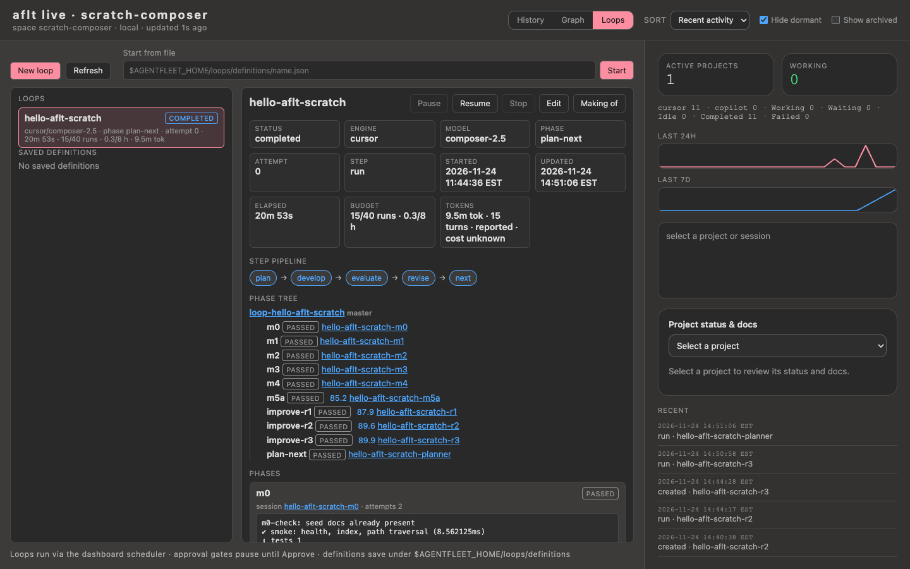

# 03 — Live dashboard

**Goals**

- Start `aflt dashboard --serve` on the right host/port for your space
- Know History vs Graph vs Loops, and the Gantt timeline
- Distinguish the live UI from `aflt memory dashboard`
- Optionally install the macOS LaunchAgent via `aflt service`

Screenshots: [dashboard-graph.png](../images/dashboard-graph.png), [dashboard-history.png](../images/dashboard-history.png), [dashboard-sessions.png](../images/dashboard-sessions.png), [dashboard-loops.png](../images/dashboard-loops.png) (Loops view), [dashboard-loops-copilot.png](../images/dashboard-loops-copilot.png) (Loops view with Copilot credits), [dashboard-history-loop.png](../images/dashboard-history-loop.png) (a loop's phase sessions in History).

## Serve

```bash
aflt --space tutorial dashboard --serve
# defaults: --host 127.0.0.1 --port 8787 (or the space's recorded port)
```

Named spaces get a unique dashboard port (8788+) in their `config.json` when created, skipping ports another space records and ports already in use (for example a dashboard started with `--port`; `dashboard --serve` notes its port in `dashboard-serve.json`). Default / no-space behavior stays **8787** and LaunchAgent label `dev.aflt.dashboard`.

```bash
aflt --space tutorial dashboard --serve --port 8790 --host 127.0.0.1
```

Binding beyond loopback (LAN) is possible with `--host`, but write/action endpoints stay loopback-only with an action token. Prefer `127.0.0.1` while learning.

`--capture-completions` opts into writing Copilot Task Complete events as memory status notes. Default serving is read-only for registry/Herdr (interactive turns may still append under `runs/<id>/turns.jsonl`).

Blocks until SIGINT/SIGTERM.

## History, Graph, Gantt

Default UI is **History**: collapsible project/session tree plus an **activity-only** Gantt (completed/failed turn markers). Toggle **Graph** for the star view (zoom/pan, Fit, Spread).

Shared state vocabulary and colors: **Working** (green), **Waiting** (orange), **Idle** (gray), **Completed** (blue), **Failed** (red). Timeline presets: 24h / 7d / 30d / all; zoom and pan supported.

The third tab, **Loops**, lists `aflt loop` runs in this space: status, engine/model, budget, token rollup, step pipeline, phase tree with eval scores, eval tails, and start / pause / resume / stop / approve. Each loop has a **Making of** button that opens `/making-of/<loop>` (every AI call, commit, diff and artifact). See [09 — Loops](09-loops.md).



Times are shown in your browser's local time zone with a short zone label (for example `2026-11-24 14:51:06 EST`): the **Recent** list, session and project details, timeline tooltips, the Loops detail (**Started** / **Updated**) and the making-of page. JSON APIs keep ISO UTC. The static `--snapshot` SVG stamp is rendered on the server and stays in ET.

This is **not** `aflt memory dashboard`, which only regenerates the memory-repo root `DASHBOARD.md`.

## Snapshot

```bash
aflt --space tutorial dashboard --snapshot /tmp/aflt-tutorial.html
# or .svg — parent dirs created as needed
```

Standalone SVG or self-contained HTML; no server. Snapshots cannot focus Herdr. Do not combine `--capture-completions` with `--snapshot`.

## macOS service (LaunchAgent)

```bash
aflt --space tutorial service status --json
aflt --space tutorial service install --print   # show plist without writing
# aflt --space tutorial service install         # writes LaunchAgent (mutates)
# aflt --space tutorial service uninstall
```

- Default label/plist: `dev.aflt.dashboard`
- Named space: `dev.aflt.dashboard.<space>` (never overwrites the default)
- Logs under `$AGENTFLEET_HOME/logs`
- KeepAlive runs `aflt dashboard --serve`
- Unsupported on non-macOS (clear error, exit 1)
- Default `--port` comes from the space config when set

Status text shape:

```text
label: dev.aflt.dashboard.tutorial
path: …/Library/LaunchAgents/dev.aflt.dashboard.tutorial.plist
exists: false
loaded: false
```

## Try it

Inspect the service plan for the tutorial space without installing, and confirm the space port:

```bash
aflt space create tutorial   # if needed
aflt --space tutorial service install --print --json | head -c 500
aflt --space tutorial space list --json
```

Do **not** start a long-lived dashboard against your real default home while following this tutorial. If you serve, use `--space tutorial` and stop with Ctrl-C.
