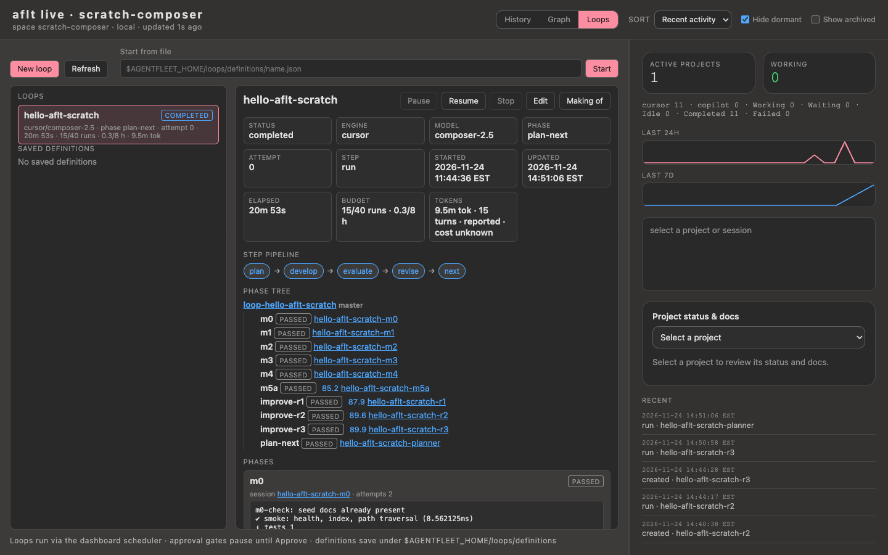
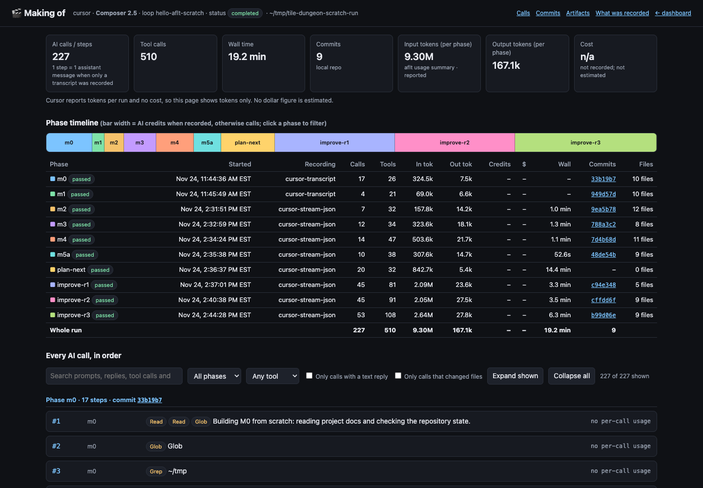

# 09 — Loops

**Goals**

- Validate and dry-run loop definitions without launching unattended work against a real fleet
- Know CLI vs dashboard scheduler / Loops UI at a high level
- Recognize approval gates and plan-next
- Inspect the shipped examples under `examples/loops/`
- Know `type: "script"` phases and how to review a run with `aflt making-of`

## Commands

```bash
aflt init <name> [--dir PATH] [--guidance FILE] [--engine E] [--yes] [--existing] [--isolated]   # new project: folder, git, space, SPEC/AGENTS
aflt --space tutorial loop init [--engine E] [--build-model M --plan-model M] [--dry-run] [--force] [--isolated]
aflt --space tutorial loop validate <file.json> [--json]
aflt --space tutorial loop run <file.json> [--dry-run] [--json] [--fresh] [--force] [--allow-existing] [--create-worktree]
aflt --space tutorial loop start <file.json> [--json]    # register active for dashboard scheduler
aflt --space tutorial loop pause <name> [--json]
aflt --space tutorial loop status [name] [--json]
aflt --space tutorial loop stop <name> [--json]
aflt --space tutorial loop resume <name> [--json]        # runs in this process from saved state
aflt --space tutorial loop approve <name> [--json]       # release gate: "approve"
aflt --space tutorial making-of <name> [--out file.html] [--serve] [--with-files] [--json]
```

New project? [14 — New looped project](14-new-project.md) walks through `aflt init` and `aflt loop init`, which drafts `.agentfleet/loop.json` from `SPEC.md` / `AGENTS.md` and checks it against the loop-writing guide.

State lives under `$AGENTFLEET_HOME/loops/<name>/` (`state.json` + runner lock). When a loop starts, each phase's `promptFile` is copied to `loops/<name>/prompts/` and check scripts outside the project (with their folder) to `loops/<name>/files/`; resume reads the copies (`promptSnapshot`; the original stays in `promptFileSource` / `eval.commandSource`). `loop validate` warns about prompt files or check paths outside the project. Definitions you save from the UI go only under `$AGENTFLEET_HOME/loops/definitions` (or configured loops dir).

## Examples in the repo

| File / dir | Role |
|------|------|
| `examples/loops/hello-eval.json` | Single phase: write HELLO.txt, grep eval |
| `examples/loops/plan-next.json` | Seed phases + `type: "plan-next"` planner |
| `examples/loops/self-improve.json` | Eval measure → score/baseline → plan-next → gate `--improve` |
| `examples/loops/hello-aflt/` | Default tile-dungeon from scratch: docs-only seed (`install.sh` or `seed/`), loop under `seed/.agentfleet/`; `seed-docs` script then agent M0 → M1–M5a → ≤3 improve rounds (`plannedPhaseGate: "none"`) |
| `examples/loops/hello-aflt-seeded/` | Non-default: M0 script (`seed-m0.js` copies scaffold, no AI call) then same milestones |
| `examples/loops/hello-aflt/hello-aflt-improve.json` | Continue improve-only on an existing M5a game (loop name `hello-aflt-improve`) |

Validate (safe; no engines):

```bash
aflt --space tutorial loop validate examples/loops/hello-eval.json --json
aflt --space tutorial loop validate examples/loops/plan-next.json --json
aflt --space tutorial loop validate examples/loops/self-improve.json --json
aflt --space tutorial loop validate examples/loops/hello-aflt/seed/.agentfleet/loop.json --json
aflt --space tutorial loop validate examples/loops/hello-aflt/hello-aflt-improve.json --json
aflt --space tutorial loop validate examples/loops/hello-aflt-seeded/hello-aflt.json --json
```

**hello-aflt quick start** (work Mac / Copilot; no Grok Bot): empty folder → `examples/loops/hello-aflt/install.sh`, `git init`, commit, then `aflt loop run .agentfleet/loop.json` — see [`examples/loops/hello-aflt/README.md`](../../examples/loops/hello-aflt/README.md) and [`docs/copilot-live-test.md`](../copilot-live-test.md). Optional: `export AGENTFLEET_ENGINE=copilot` and `COPILOT_MODEL=auto`. Continue-improve on an existing tree needs `--allow-existing`.

Success text shape:

```text
ok: loop "hello-eval" (1 phase(s))
```

JSON includes `ok`, `path`, `errors`, `warnings`, and `definition` when valid.

Dry-run (plan only; no lock / no phases executed):

`hello-eval.json` sets `"cwd": "."`. From this checkout that folder is the product repo, so the run is refused unless you pass `--allow-existing`. A clean empty `git init` directory is accepted without the flag.

```bash
aflt --space tutorial loop run examples/loops/hello-eval.json --dry-run --allow-existing --json
```

Text dry-run (cwd, permission mode, model):

```text
dry-run: loop "hello-eval" — 1 phase(s)
  cwd: …
  permissions: force
  model: (engine default)
  - write-greeting engine=cursor session=loop-hello-eval maxFix=3 onPass=none force=true permission=force model=-
```

`force` defaults to false. hello-eval sets `"force": true` on the phase. `--force` on `loop run` grants tools for every phase in that invocation. Model: phase `model`, definition `model`, `COPILOT_MODEL` (Copilot), then `config.json` `defaultModel`. A phase whose agent exits non-zero or times out fails or retries even when the eval is already green.

## Engine selection and failover

Primary engine precedence: phase `engine` > definition `engine` > `AGENTFLEET_ENGINE` > `engines[0]` > `config.json` `defaultEngine` > `cursor`. `examples/loops/self-improve.json` pins no engine, so `AGENTFLEET_ENGINE=copilot` moves the whole loop.

Optional `"engines": ["copilot", "cursor", "opencode"]` adds ordered failover. A phase moves to the next installed engine in the list (and reruns the same attempt, not a fix attempt) when a worker run hits a non-retryable infrastructure error: `cli_missing`, `auth_required`, `usage_limit`, `rate_limit`, or `model_unavailable`. A failing eval never fails over. Sessions are engine-bound, so the new engine uses `<session>-<engine>` (phase-level `model` is dropped; model names are engine-specific). A primary whose CLI is not installed is skipped up front. The engine actually used is stored on the phase (`engine`, `failovers[]`) and recorded as history/notify event `loop.engine.failover`. With no engines left, the phase fails as before.

Before an unattended run, `aflt doctor --strict --loop <def.json>` checks that the engine CLIs are installed and signed in, that notify is configured, that the dashboard port is free (`--port N`), and shows the loop's workdir inspection (`--notify` adds a live webhook round trip). It exits non-zero only on a failed check.

## Approval gates and plan-next

- Optional `escalation: { "afterFailedRounds": 3, "event": "loop.needs_human" }` — after a non-retryable phase failure (exhausted fix attempts, protected-path violation, commit-gate refusal, or non-retryable engine error), the runner sets `status=needs_human` instead of `failed`, writes `$AGENTFLEET_HOME/loops/<name>/needs-human.json`, and emits `loop.needs_human` plus `loop.gate.waiting` with a diagnostic bundle. Resume with `aflt loop resume <name>` (fresh attempt on the failed phase) or `aflt loop stop <name>`. Plan-next improve loops also count consecutive failed rounds toward `afterFailedRounds`. Without `escalation`, behavior is unchanged (`failed`).
- Phase `gate: "approve"` → runner `status=waiting`, notify `loop.gate.waiting`; release with `aflt loop approve` or dashboard `POST /api/loops/:name/approve`. The gate records the **cost so far** (`state.gate.costSoFar`): `aflt loop status` prints `cost so far: 12.4 credits · $0.12 · 9m active · 1.5M tok` (Cursor: `cost unknown (cursor recorded no cost) · …`), the history line and dashboard banner repeat it, and the notify payload carries `costSoFar`, `costKnown`, `credits`, `usd`, `activeHours`, `totalTokens`, `runsUsed`.
- `improveModel` (definition, or on the plan-next phase) sets the model of planner-inserted improve rounds that set none. Without it they use the loop's model chain (phase → definition `model` → `COPILOT_MODEL` → config default); they do **not** inherit the plan-next phase's `model`.
- Planned improve rounds whose `eval.command` climbs out of the project (`../x.js`, or a missing absolute path elsewhere) are rejected and sent back to the planner.
- `"workdir": { "mode": "project" }` — run in the project's own clean git repo even though it is not empty and holds the definition (what `aflt loop init` sets). Refuses a dirty tree and the aflt checkout.
- `type: "plan-next"`: planner must write `$AGENTFLEET_HOME/loops/<name>/plan-next.json` as `{ "done": true }` or `{ "phases": [ … ] }`
- `type: "script"`: no AI call — the phase's `eval.command` is the step (seed a scaffold, run a setup script). No prompt, no session, no fix attempts, not counted in `budget.maxRuns`; `onPass` still applies. hello-aflt's `seed-docs` and hello-aflt-seeded's `m0` use this; dry-run shows them as `engine=null session=null maxFix=0 … permission=no-agent`.
- Newly planned phases get `gate: "approve"` unless the phase sets `gate` or the loop sets `plannedPhaseGate: "none"`
- Cap growth with `budget.maxPhases`
- `onPass` (`none`|`commit`|`merge`|`push`) only runs when loop-level `allow` flags permit (default all false)
- Known gap: Copilot plan-next cannot yet write that plan file non-interactively (outside the game `-C` cwd); see [docs/copilot-live-test.md](../copilot-live-test.md) Known gaps.

## Eval contract (phase checks)

Project evaluators may print JSON like `{ "overall": 87, "mode": "live", "tiers": { ... } }`. Phase checks can use `eval.minOverall`, `eval.minTiers`, and `eval.noRegress` (compare to the previous live line in `eval/history.jsonl`) instead of brittle regexes; `passRegex` still works for older loops. The eval milestone can set `eval.coverage` so every scoring tier has enough probes in `eval/fixtures/transcript.json` (default 3 per tier, optional `command`) **before** protected paths apply — thin fixtures fail with fix attempts. Freeze harness paths with loop-level `protected: { "paths": ["eval/**", "scripts/eval/**"], "fromPhase": "eval" }` so only phases after the eval milestone (and planned improve rounds) are guarded. Put the approval gate on the phase after the eval milestone. Script `live-eval` phases can set `eval.infraRetries` so one backend timeout retries instead of failing the loop. See [`templates/loop-guide.md`](../../templates/loop-guide.md) §8–9.

## Stalled engines (idle timeout)

An engine run that prints nothing and changes no file in the work folder for `idleTimeoutSec` seconds (default 1200 = 20 min) is stopped, with every child process (also ones in their own process group, like a shell tool blocked on input). The phase then counts as a timed-out attempt: it gets a fix attempt if `maxFixAttempts` allows, else it fails. Set `"idleTimeoutSec"` on the loop or a phase, or `AFLT_LOOP_IDLE_TIMEOUT_SEC`; `0` turns it off. `aflt loop status --json` and `/api/loops` report `lastActivityAt` (from `loops/<name>/activity.json` or the state), and the dashboard shows it as "Last activity".

During improve rounds the dashboard shows the round (`improve-r2 (round 2/3)`, `round` in `/api/loops`) instead of plan-next, and the plan-next row reads "waiting · improve-r2 running".

## Dashboard scheduler / Loops UI

`aflt loop start` registers a loop as `active` without running phases in that process. `aflt dashboard --serve` hosts an in-process scheduler (one runner per name; lock respected). Loops view: list, phase pipeline, eval tails, History links, start/pause/resume/stop/approve, define/edit form, and a **Making of** button.



`budget.hoursUsed`, `elapsedMs` and the Loops “Elapsed” / “budget” hours are **active run time**: the sum of run segments from each start or resume until the loop completes, fails, stops, pauses or waits at a gate. A loop that finishes and is resumed hours later does not count the idle gap, and `budget.maxHours` is enforced on the same number. `wallElapsedMs` (in `aflt loop status --json`) keeps the wall time since `startedAt`. Loop state written before this change has no `activeMs`; its active time is rebuilt from the loop's history at read time (the state file is not rewritten until the loop runs again).

## Review a run: making of

After (or during) a real loop run, `aflt making-of <name>` writes one self-contained HTML page (default `$AGENTFLEET_HOME/loops/<name>/making-of.html`) with:

- every AI call in order: prompt, reply, reasoning, tool calls with results, tokens, and for Copilot the AI credits and dollars Copilot recorded (Cursor reports tokens only, so no cost is shown);
- every commit in the loop's repo with its phase, files and diff;
- artifacts: seed files, files changed per phase, eval outputs, the final tree, and an optional `--build-url` link to the playable build.

`--serve [--port 8797]` serves it live; `aflt dashboard --serve` also serves it at `/making-of/<name>`. `--with-files` writes every diff and artifact as small linked pages next to the HTML for static hosting. `--json` prints a summary (calls, tool calls, tokens, credits / $, commits).

```bash
aflt --space tutorial making-of hello-eval --json   # after a real hello-eval run in this space
```

The data comes from what each phase recorded under `runs/<session>/`: `engine/` (archived Copilot `events.jsonl` / Cursor stream-json + transcript), `calls.jsonl` (one line per model call) and `session-context.json`. See [12 — Token usage](12-token-usage.md#recorded-calls-for-loop-phases).



This tutorial stops at **validate / dry-run / status**. Do not start an unattended loop against a production fleet from these pages.

## Try it

```bash
aflt space create tutorial   # if needed
aflt --space tutorial loop validate examples/loops/hello-eval.json
# From this checkout, "cwd": "." is the product repo — need --allow-existing:
aflt --space tutorial loop run examples/loops/hello-eval.json --dry-run --allow-existing
aflt --space tutorial loop status --json
```

From this checkout, `--allow-existing` is required (the repo is not an empty dedicated git repo); without it the dry-run lists the reasons and exits 1.

Confirm validate exits 0 and dry-run does not create a runner lock under a real default home (you are on `--space tutorial`).
