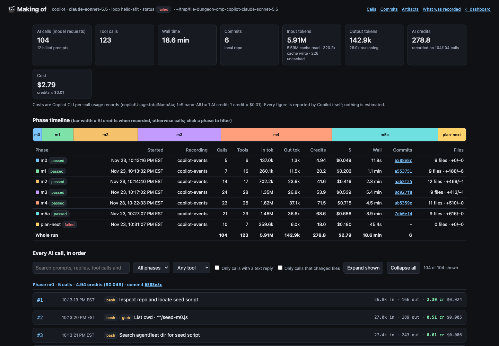
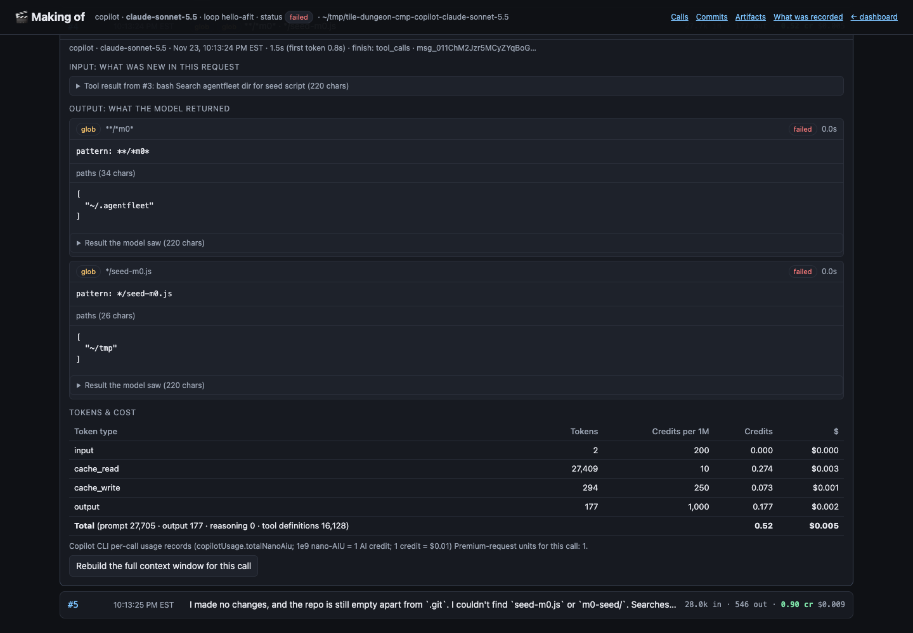
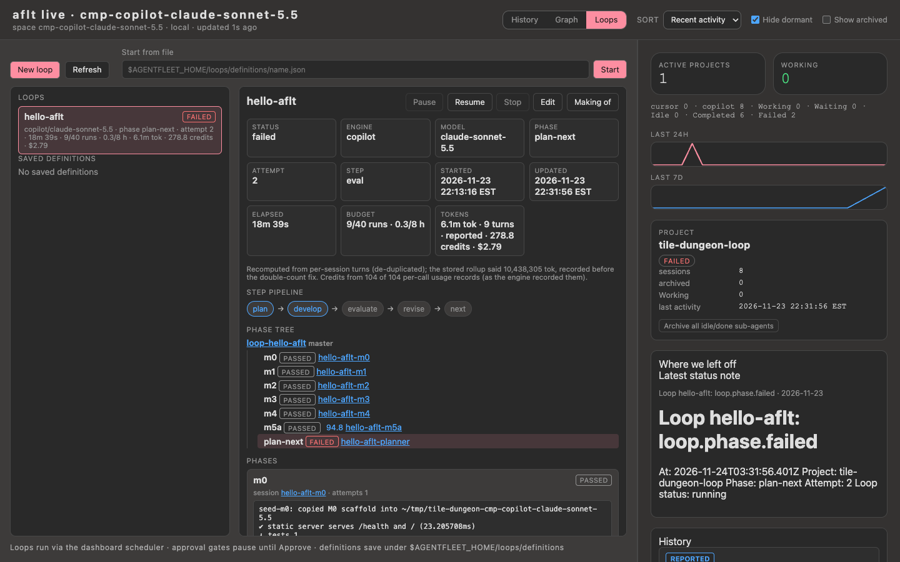

# 12 — Token usage

**Goals**

- Know where token counts land: per-turn `usage` and `usage-summary.json`
- Understand how Cursor, Copilot, and OpenCode report (or estimate) usage
- Spot the same numbers in History, Gantt tooltips, and memory rollups
- Read Copilot AI credits and dollars as Copilot recorded them
- Know the per-call records loop phases keep (`calls.jsonl`) and the `aflt making-of` page
- Stay honest about accuracy — no USD estimated from tokens

Stay in the throwaway space: `--space tutorial` or `AFLT_SPACE=tutorial`. There is **no** `usage` subcommand on the CLI — token counts are recorded automatically on runs and turns.

## What gets recorded

After a headless `aflt run` (or when interactive turns are captured / backfilled), each turn may carry an optional `usage` object on the JSONL row under:

```text
$AGENTFLEET_HOME/runs/<id>/turns.jsonl
```

Aflt also writes a session rollup next to it:

```text
$AGENTFLEET_HOME/runs/<id>/usage-summary.json
```

In a named space, that home is `~/.agentfleet/spaces/tutorial` (unless you set `AGENTFLEET_HOME` yourself — an explicit home always wins).

Find the run directory for a session:

```bash
aflt --space tutorial log <title|id> --path
```

That prints the path to the last captured run log under `runs/<id>/`. The sibling files `turns.jsonl` and `usage-summary.json` live in the same directory.

## Shared schema (high level)

Every normalized `usage` blob shares the same shape (`lib/usage.js`):

| Field | Meaning |
|-------|---------|
| `accuracy` | `reported` · `estimated` · `partial` |
| `source` / `cli` / `model` | Where the numbers came from (e.g. `cursor-result`, `copilot-usage-record`, `opencode-run-json`) |
| `inputTokens` | Uncached input (engines differ on raw input — see below) |
| `cacheRead` / `cacheWrite` | Cache tokens when the provider reports them |
| `totalInput` | Uncached + cache (derived when needed) |
| `outputTokens` / `reasoningTokens` | Output and reasoning when present |
| `totalTokens` / `promptToResponse` | Totals and input∶output ratio |
| `cost` | Provider-reported money only (OpenCode). Never invented from tokens |
| `premiumRequests` | Copilot-only accounting (not USD) |
| `credits` / `usd` / `costBasis` | Copilot AI credits from `copilotUsage.totalNanoAiu` (1e9 nano-AIU = 1 credit), dollars at $0.01 per credit, and `costBasis: "copilot-nano-aiu"`; `null` for engines that report no credits |

Session rollups (`usage-summary.json`) sum turns and add `turnCount`, `reportedTurns` / `estimatedTurns` / `partialTurns`, plus `models` and an overall `accuracy` (`partial` when the mix is mixed). A headless run is counted once: engine-log turns (Copilot events, Cursor transcripts) that re-record the same model calls as the latest `headless-run` turn are skipped and counted in `dedupedTurns`. Copilot `credits` / `usd` are summed the same way.

Example shape from the hermetic suite (Cursor-reported turn):

```json
{
  "v": 1,
  "accuracy": "reported",
  "source": "cursor-result",
  "cli": "cursor",
  "inputTokens": 6187,
  "cacheRead": 3968,
  "cacheWrite": 0,
  "totalInput": 10155,
  "outputTokens": 40,
  "reasoningTokens": 39,
  "totalTokens": 10195,
  "promptToResponse": 253.88,
  "cost": null,
  "premiumRequests": null
}
```

Compact History meta for that session looks like `10.2k tok · 254:1` (estimated/partial rows get a `~` prefix).

## How each engine captures usage

### Headless Cursor and OpenCode (`--output-format`)

From USAGE, `aflt run` accepts `--output-format text|json` (default user-facing format is text).

When you **omit** `--output-format`:

- **Cursor** and **OpenCode** — the CLI requests JSON from the engine internally so `result.usage` / step-finish tokens are available, then presents the extracted reply as **text**. Your stdout and `aflt log` stay the human reply, not a raw JSON dump.
- **Copilot** — loop runs request JSON internally and also read `events.jsonl` `session.usage_record` (and checkpoint/shutdown metrics). `aflt run` still presents text unless you pass `--output-format json`, and reads the same event log after the process exits. Counts are `reported` when a usage record is present.

If you pass `--output-format json` yourself, you get JSON end-to-end (no silent text presentation).

Cache note for Cursor: `inputTokens` is **uncached**; cache read/write are separate fields that fold into `totalInput`.

**What Cursor often cannot provide (do not invent):**

- **`cost`** — Cursor headless `result.usage` has no USD figure; `cost` stays `null` (never derived from tokens).
- **`model`** — many Cursor JSON results and agent transcripts omit model names, so session `models: []` is common even when token counts are `reported`.
- **`accuracy: "partial"`** — a session can mix a reported headless turn with an estimated transcript/backfill turn; the rollup correctly marks `partial`. Loop-level rollups on `state.json` sum phase `usage-summary.json` files the same way.

Loops: `aflt loop status` / the Loops view show a compact per-loop token rollup when phase sessions have usage summaries.

### Copilot turns

Interactive / sync paths prefer, in order:

1. `session.usage_record` events in the turn window
2. Checkpoint / shutdown `modelMetrics` deltas
3. Partial `result.usage` (often premium-only)
4. Char/4 estimate when only prompt/reply text exists

Copilot’s raw `inputTokens` is **cache-inclusive**. Aflt splits uncached = `input − cacheRead − cacheWrite` and keeps `totalInput` as the inclusive total. The provider’s `cost` field on usage records is stored as **`premiumRequests`**, not USD (`cost` stays `null` for Copilot). When a usage record carries `copilotUsage.totalNanoAiu`, the usage row also stores **`credits`** (nano-AIU ÷ 1e9) and **`usd`** (credits × $0.01) with `costBasis: "copilot-nano-aiu"` — Copilot's own billing unit, not a token-price estimate.

### Fallback estimate

If the engine returns no usable metrics, aflt may attach `accuracy: "estimated"` / `source: "estimated-chars"` (roughly `ceil(chars / 4)` for the prompt and the final reply text only). That figure is a floor, not a bill: tool calls, cache, and provider credits are not included, so a long Copilot edit can look like a few hundred tokens. History shows a `~` prefix for estimated or partial rows. Estimated never overwrites a reported row. USD is never invented from tokens.

## Recorded calls for loop phases

`aflt loop` phases keep more than the rollup. After each phase run, the loop runner writes under `runs/<session>/`:

| File | Contents |
|------|----------|
| `engine/` | A copy of the engine's own record: Copilot `events.jsonl`; Cursor `--output-format stream-json` events (loop phases run Cursor in stream-json) and its agent transcript |
| `calls.jsonl` | One normalized line per model call: phase, index, timestamp, engine, model, input, output, tool calls, tokens, cost, `costBasis` |
| `session-context.json` | System prompt(s), runtime instructions, tool-definition size — once per session |

`aflt making-of <loop>` turns these into one page with every call, its tokens and (Copilot) its credits and dollars, per phase and for the whole run — see [09 — Loops](09-loops.md#review-a-run-making-of).



Expand a call to see what was new in that request, what the model returned (text and tool calls with results) and a token table with the credit rate per token type:



## Dashboard History

When you open the live UI (`aflt dashboard --serve` — see [03 — Dashboard](03-dashboard.md); History screenshot: [dashboard-history.png](../images/dashboard-history.png)):

- **Tree rows** — compact token meta (`10.2k tok · 254:1`, with `~` when estimated/partial)
- **Gantt marker hover** — a usage line like `10,155 in → 40 out (254:1) · reported`
- **Session / project detail** — usage summary badge (`reported` / `estimated` / `partial`) with totals, uncached + cached breakdown when present, output (+ reasoning), ratio; OpenCode may show provider `$cost`; Copilot shows `premium` counts and `credits · $` (sessions synced before credits were recorded get them read-only from their per-call usage records, the same source as the making-of page)
- **Per-turn bar chart** — input (top) vs output (bottom) for recent turns; estimated/partial bars are dashed / faded

The Loops view shows the per-loop token rollup and recorded cost in each row and in the detail (`6.1m tok · 9 turns · reported · 278.8 credits · $2.79` for the Copilot Sonnet hello-aflt run; Cursor loops say `cost unknown` because Cursor records no cost). The rollup is recomputed at read time from the phase sessions' turns, de-duplicated, so loops recorded before the double-count fix show corrected totals (that Sonnet run's stored rollup said 10.4M tokens; it is 6.1M) with a note in the detail; `state.json` is not rewritten. Copilot credits come from the same per-call usage records as the making-of page when older turns lack them. Use `aflt making-of` for per-call and per-phase figures.



## Memory rollup

With a configured memory repo, `aflt memory sync` includes a compact `usage` object on each session line in `<project>/_aflt/sessions.jsonl`, and the generated `timeline.md` can show a project-level line such as:

```text
Usage: 10.2k tok · 254:1 (reported)
```

Sync is opt-in and never auto-runs. Preview without writing:

```bash
aflt --space tutorial memory sync --dry-run --json
```

(Requires `memoryRepo` / `AFLT_MEMORY_REPO` — see [05 — Memory](05-memory.md).)

## Honesty rules

- **Never invent USD from tokens.** Aflt does not multiply token counts by a price table. Copilot `usd` is Copilot's own recorded AI credits × $0.01, not a token estimate.
- **OpenCode `cost`** — kept only when the provider reports it (including `0`).
- **Copilot `premiumRequests`** — separate field; not mixed into `cost`.
- **`reported` vs `estimated` vs `partial`** — trust the badge; mixed sessions roll up as `partial`.
- A run with **no provider metrics** may have **no usage**, only an estimate, or a partial premium-only row.

## Inspect in the tutorial space

```bash
aflt space create tutorial          # skip if it already exists
aflt --space tutorial space current
```

Expected (text):

```text
tutorial
```

Dry-run a headless ask-mode probe (no engine launch on dry-run). Omitting `--output-format` is what enables Cursor/OpenCode usage capture on a real run:

```bash
aflt --space tutorial run "usage-probe" \
  --prompt "Reply with the single word pong and nothing else." \
  --mode ask --cwd "$PWD" --timeout 180 --dry-run --json
```

After a **real** run in this space (same flags without `--dry-run`, when you intend to call the engine):

```bash
aflt --space tutorial log usage-probe --path
# then, in that runs/<id>/ directory:
#   turns.jsonl          — each line may include "usage": { … }
#   usage-summary.json   — session rollup
```

Backfill interactive turns (and their usage when the engine store has it) without writing until you pass `--apply`:

```bash
aflt --space tutorial turns backfill --engine all --json
# aflt --space tutorial turns backfill --engine all --apply --json
```

## Caveats

- Omitting `--output-format` is the happy path for Cursor/OpenCode usage; passing `--output-format text` explicitly skips the internal JSON request path for those engines.
- Copilot counts are `reported` only when stdout JSON or `events.jsonl` has a usage record. Otherwise the `estimated` chars/4 figure counts the prompt and final reply only (not tool calls or credits).
- OpenCode all-zero error rows are dropped (not treated as reported).
- Dashboard and memory only show what was already recorded under `runs/<id>/` — they do not invent counts.

## Try it

```bash
aflt space create tutorial
export AFLT_SPACE=tutorial   # or keep passing --space tutorial
aflt space current
aflt run "usage-probe" \
  --prompt "Reply with the single word pong and nothing else." \
  --mode ask --cwd "$PWD" --timeout 180 --dry-run --json
aflt help | grep -n output-format
```

When you later run for real in this space, open History (chapter 03) and check `runs/<id>/usage-summary.json` beside the path from `aflt log usage-probe --path`.
