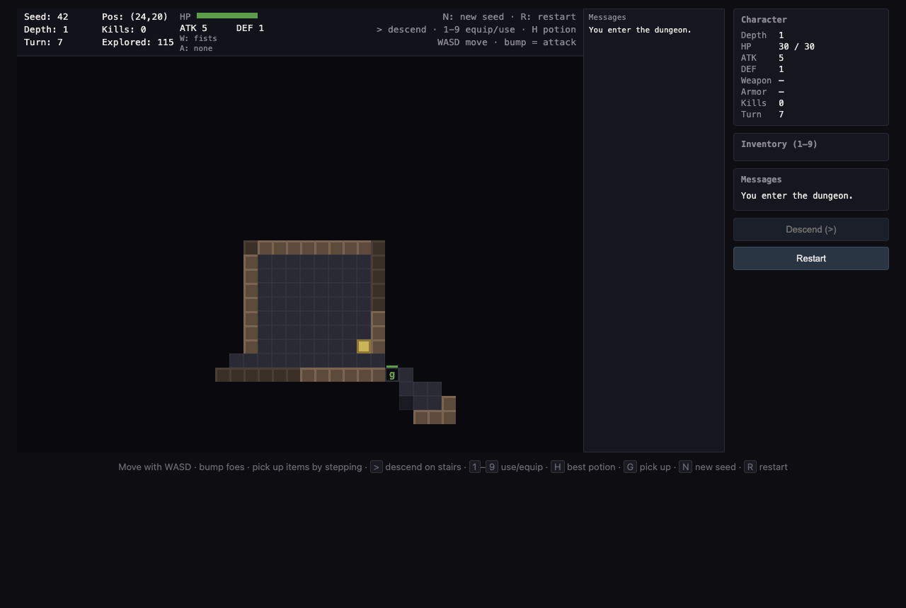
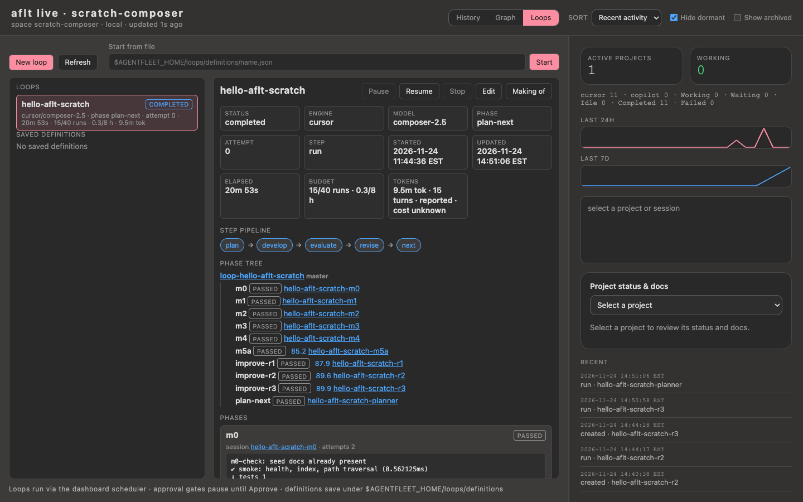
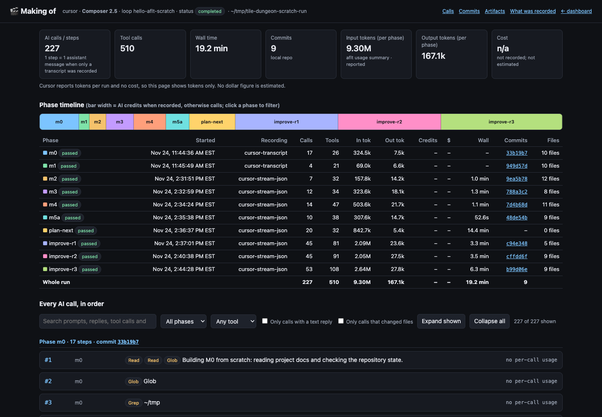

# hello-aflt-scratch — tile dungeon from a docs-only seed

A variant of [`hello-aflt`](../hello-aflt/README.md) where the seed contains
**no code and no HTML**. The game repo starts with instructions only, and an
agent writes every file, including the M0 scaffold.

Everything the loop uses lives **inside the project**: the seed carries the
loop definition, its prompts and its two check scripts under `.agentfleet/`,
so a run in an isolated folder never reads or runs a file from anywhere else.
The checks are CommonJS `.cjs` files, so they run whatever `"type"` the game's
`package.json` sets.

| | `hello-aflt` | `hello-aflt-scratch` |
|---|---|---|
| Seed copied into the repo | `m0-seed/`: `package.json`, `server.js`, `public/index.html`, `src/main.js`, `test/smoke.test.js`, docs | `seed/`: `AGENTS.md`, `SPEC.md`, `.agentfleet.json`, `.gitignore`, and `.agentfleet/` (`loop.json`, `prompts/`, `checks/m0-check.cjs`, `checks/improve-gate.cjs`) |
| Before M0 | — | `seed-docs` script phase (no AI call) checks the repo holds only the seed |
| M0 phase | `type: "script"`: `seed-m0.js` copies the scaffold (no AI call) | Real agent build of the scaffold from `SPEC.md` § M0 |
| M0 eval | `seed-m0.js` (copy + smoke test) | `.agentfleet/checks/m0-check.cjs` (structural check + `node --test` + server boot; never copies code) |
| M1–M5a, plan-next | Same milestones | Same milestones; prompts say there is no seed code and to work only in the repo |
| Improve gate | `improve-gate.js` | In the project: `.agentfleet/checks/improve-gate.cjs` (same gate) |

Use it to see what an engine builds with nothing but a spec, and to compare
engines/models on the same docs-only starting point.



## Example run

One run on Cursor `composer-2.5` (space `scratch-composer`): every phase
passed on the way through, the eval scored 85.2 after M5a, and three improve
rounds took it to 87.9, 89.6 and 89.9 (crash-free and solvability at 100;
weakest metric `avg_depth`). M2 through improve-r3 took about 19 minutes of
agent time; the whole run used 9.30M input tokens over 227 agent steps.
Cursor reports tokens only, so no cost is recorded.





## Quick start

Use a new, empty folder that is not inside another git repo, and its own space:

```bash
mkdir -p ~/aflt-projects/tile-dungeon-scratch && cd ~/aflt-projects/tile-dungeon-scratch
cp -R /path/to/aflt/examples/loops/hello-aflt-scratch/seed/. .
aflt init tile-dungeon-scratch --dir . --yes --engine cursor --isolated   # git init + a space of its own
git add -A && git commit -m "Seed hello-aflt-scratch"
aflt --space tile-dungeon-scratch loop validate .agentfleet/loop.json
aflt --space tile-dungeon-scratch loop run .agentfleet/loop.json
```

(`aflt init` is optional; plain `git init` plus `--space` of your choice works too.)
The loop uses `"workdir": { "mode": "project" }`: it runs in this repo even though
the repo holds its own definition, and refuses a dirty tree, so commit the seed
first. `"protected": { "paths": [".agentfleet/**"] }` fails any phase that edits
the loop, its prompts or its checks.

The first phase, `seed-docs`, is a `type: "script"` phase (no AI call): it runs
`node .agentfleet/checks/m0-check.cjs --seed-docs`, which passes only when the
repo holds the seed and nothing else, so no leftover code leaks into a
from-scratch run. The M0 agent then reads `SPEC.md` and writes the scaffold.

Pick an engine as for `hello-aflt` (`AGENTFLEET_ENGINE=cursor` or `copilot`,
optional `COPILOT_MODEL` / definition `model`). Watch it live:

```bash
aflt --space tile-dungeon-scratch loop start .agentfleet/loop.json --json
aflt --space tile-dungeon-scratch dashboard --serve --port 8787   # open http://127.0.0.1:8787/
aflt --space tile-dungeon-scratch loop status hello-aflt-scratch --json
```

## Seed

`seed/` may hold only instructions and config (`*.md`, `*.txt`,
`.agentfleet.json`, `.gitignore`) plus the loop's own files under
`.agentfleet/`: `loop.json`, `prompts/*.txt`, and the check tooling
`checks/m0-check.cjs` and `checks/improve-gate.cjs` (no game code).
`m0-check.cjs --seed-docs` refuses a repo with anything else in it, and
`test/loop-hello-aflt-scratch.test.js` fails if a code or HTML file is added to
the seed outside that tooling.

- `seed/AGENTS.md` — stack, safety and workflow rules, milestone list.
- `seed/SPEC.md` — the M0 scaffold contract (files, routes, port, tests) and the M1–M5a plan.

## M0 check

`node .agentfleet/checks/m0-check.cjs` (run by the loop in the game cwd) fails with a list of
problems unless:

- `package.json` is valid JSON with `"type": "module"`, `test` running `node --test`, `start` running `node server.js`, and no dependencies;
- `server.js` is ESM, exports `createServer`, defaults to `127.0.0.1:8792`;
- `public/index.html` has `<canvas id="game">` and loads `/src/main.js` as a module;
- `src/main.js`, `test/smoke.test.js` (node:test, exercises `createServer`), `README.md` (mentions 8792), `AGENTS.md`, `SPEC.md` exist;
- every `test/*.test.js` passes;
- `node server.js` on a free port answers `/health` with `{"ok":true}`, `/` with the canvas page, and `/src/main.js` with 200 (it stops only the PID it started).

A failure goes back to the M0 agent as a fix attempt (up to 3).

## Making of

`aflt making-of hello-aflt-scratch` (same `AFLT_SPACE`) writes a page with
every AI call, commit, diff and artifact of the run; the dashboard Loops tab
links to it (**Making of**). See
[docs/cli-quickstart-loops.md](../../../docs/cli-quickstart-loops.md#7-see-exactly-how-it-was-built-making-of).

## More improve rounds

After a finished run, the original continue loop works on this game too:

```bash
aflt loop run /path/to/aflt/examples/loops/hello-aflt/hello-aflt-improve.json --allow-existing
```

All other planner rules (3 kept rounds max, plateau stop, locked scorer) are the
same as [`hello-aflt`](../hello-aflt/README.md).
