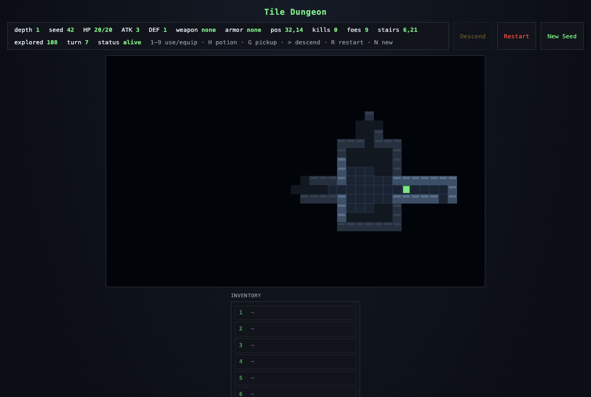
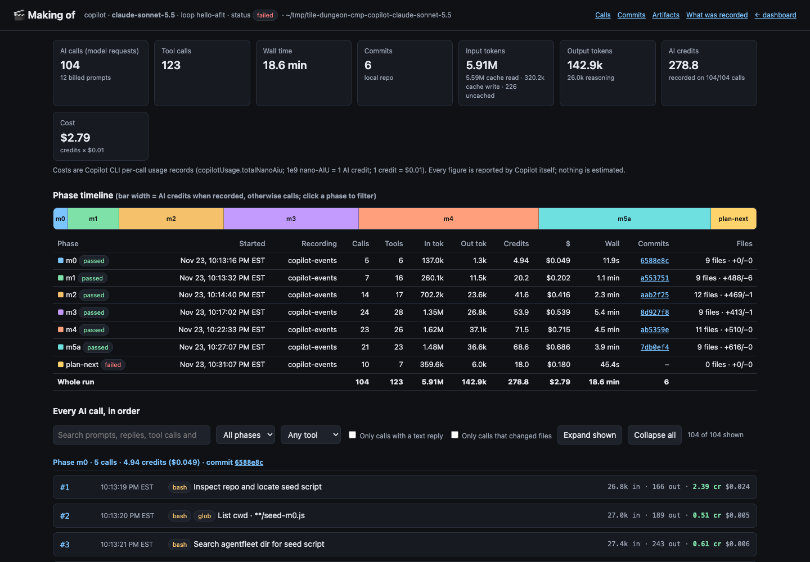

# hello-aflt — portable tile-dungeon loop example

> Want the agent to write the M0 scaffold too? [`hello-aflt-scratch`](../hello-aflt-scratch/README.md) is the same loop with a docs-only seed (no code or HTML).



## Quick start (one command)

From scratch on a work Mac (Copilot CLI is enough; no Grok Bot, no Cursor pin):

```bash
mkdir tile-dungeon && cd tile-dungeon && git init
aflt loop run /path/to/aflt/examples/loops/hello-aflt/hello-aflt.json
```

That single command scaffolds M0 if the tree is empty, then drives M1–M4, M5a, and up to 3 plan-next improve rounds. `aflt loop` is the orchestrator; Copilot/Cursor are only workers.

Copilot default (once per machine):

```bash
export AGENTFLEET_ENGINE=copilot
export COPILOT_MODEL=auto   # required when the account default model is unavailable
# or: aflt engine copilot
# or set config.json defaultModel (COPILOT_MODEL still wins for Copilot)
```

Then the same `aflt loop run …/hello-aflt.json` command.

Already have M5a and want more improve rounds (distinct loop name, no collision with a finished `hello-aflt`):

```bash
cd /path/to/existing-game
aflt loop run /path/to/aflt/examples/loops/hello-aflt/hello-aflt-improve.json --allow-existing
```

### Continue improve after a completed run

If `hello-aflt-improve` already finished in this fleethome, a plain `aflt loop run …/hello-aflt-improve.json` is a no-op (`loop already completed`). Re-run the same definition with **`--fresh`** so it starts a new state (0 of N phases) in the same home — prefer this over creating a space, so the default dashboard Loops view still shows the run. Still no `/tmp`, no engine pin, no Grok Bot:

```bash
cd /path/to/existing-game
aflt loop run /path/to/aflt/examples/loops/hello-aflt/hello-aflt-improve.json --fresh --allow-existing
```

---

Multi-phase `aflt loop` that builds a tile dungeon (M0 seed → M1–M4 → M5a eval harness → at most three eval-gated improve rounds via `plan-next`).

Works on a **work Mac with Copilot CLI** (no Cursor, no Grok Bot required).

## Prerequisites

- Node ≥ 20.10
- `aflt` on `PATH` (`npm install -g github:wwlib/aflt`, or `npm link` from a checkout). `npm install -g aflt` 404s until the package is published.
- An engine CLI: **GitHub Copilot CLI** recommended (`npm install -g @github/copilot`). Cursor / OpenCode also work if configured as the default.
- An empty git repo (or an existing game tree). M0 is seeded automatically when `package.json` is missing.

Not required: Cursor CLI, `AGENTFLEET_CURSOR_BIN`, Herdr, notify / Grok Bot webhooks, `/tmp` paths, or a pre-copied game scaffold.

## Engine default

This definition **omits** `engine` so phases inherit:

`--` (n/a) → `AGENTFLEET_ENGINE` → `$AGENTFLEET_HOME/config.json` `defaultEngine` → builtin `cursor`

## How paths resolve

`promptFile`, `seed-m0.js`, and `improve-gate.js` resolve **relative to this definition directory**, while `"cwd": "."` follows your **shell cwd** (the game repo).

Optional validate / dry-run / named space:

```bash
aflt loop validate /path/to/aflt/examples/loops/hello-aflt/hello-aflt.json --json
aflt loop run /path/to/aflt/examples/loops/hello-aflt/hello-aflt.json --dry-run --json
aflt space create hello-demo   # once
aflt --space hello-demo loop run /path/to/aflt/examples/loops/hello-aflt/hello-aflt.json
```

## M0 seed

`m0-seed/` is a portable zero-dependency scaffold (default **PORT 8792**). Phase `m0` is a **`"type": "script"`** phase: aflt runs `seed-m0.js` directly — **no AI call, no agent session, no credits** — which copies that tree into an empty cwd and runs `test/smoke.test.js`. If `package.json` already exists, the seed leaves the tree alone and only re-checks smoke. A failing seed fails the loop immediately (script phases have no fix attempts).

`prompts/M0.txt` is kept for anyone who wants an agent to build M0 instead: change `m0` to `"type": "run"` with `"promptFile": "prompts/M0.txt"`. (Before this change, Copilot spent ~5 calls / ~5 credits in m0 looking for the seed script outside the repo before the eval seeded it anyway.)

## Making of

`aflt making-of hello-aflt` (same `AFLT_SPACE`) writes one self-contained page with every AI call, every commit with its diff, the seed files above, files per phase, eval outputs and a link to the build (`--build-url`). The dashboard Loops tab links to it (**Making of**). See [docs/cli-quickstart-loops.md](../../../docs/cli-quickstart-loops.md#7-see-exactly-how-it-was-built-making-of).



## Improve gate

`improve-gate.js` (Node, no bash/`/tmp` paths) runs **after** the worker (workers do not commit):

1. Runs the game test suite on the working tree
2. **Previous** = overall from the **committed HEAD** gameplay tree (temporarily restores HEAD for that measure only, then puts worker files back — never loses uncommitted work)
3. **After** = overall from the **current working tree**
4. Compares HEAD vs working tree — **never** the last line of `eval/history.jsonl`, and **never** “before and after itself” on the dirty tree (that falsely plateaus when the gain is already uncommitted)
5. Prints a JSON line with `overall` / `after` so the Loops phase tree can show the score
6. On improvement (`after > previous`) → `--write` once on the kept tree, exit 0 (`keep_changes: true`)  
   On plateau/regression → restore gameplay paths to `HEAD`, write `plateau.json` with both scores, do **not** leave `eval/latest-score.json` at the discarded working-tree score, exit 0 (`keep_changes: false`)  
   On test failure or edits to locked `scripts/eval/eval.js` / `scorer.js` → exit 1

Plan-next instructs planned improve phases to use (definition-dir resolved):

```json
"eval": { "command": ["node", "improve-gate.js"], "exitCode": 0 }
```

### How plan-next counts rounds / scores

- Completed improve rounds = **this loop’s** passed `improve-*` phases in loop state — **not** the number of `eval/history.jsonl` lines (the gate / `--write` can append several lines per round).
- Live overall = `node scripts/eval/eval.js --json` (no `--write`), or this loop’s own gate HEAD vs working-tree scores. Do **not** treat leftover `eval/latest-score.json` / `eval/plateau.json` from a prior loop as the live score.
- `plateau.json` with `keep_changes: false` means gameplay was reverted; that score is **not** a kept round.
- `hello-aflt-improve.json` always starts at **0 of 3** rounds for that loop name, ignoring a prior `hello-aflt` loop’s history/plateau stop flag. Stop only for this loop’s own gate plateau/regression, 3 kept rounds, or live overall ≥ 99.


## Server port

Default **PORT 8792** for the comparison tree (8790/8791 often taken). Override with `PORT` in the game repo when needed.

## M5a metrics (do not invent)

The M5a prompt requires the same metric names, weights, and constants as the original tile-dungeon harness (`crash_free` 0.25, `solvability` 0.20, `avg_depth` 0.20, `turns_survived` 0.15, `balance_sanity` 0.20; `AVG_DEPTH_TARGET = 3.5`). Do not copy files from other checkouts — implement the harness in the game repo.

## Notify / Grok Bot

Optional. Point `notify.url` / `AFLT_NOTIFY_URL` at a webhook if you want progress events; the loop does not need a bot to continue.
